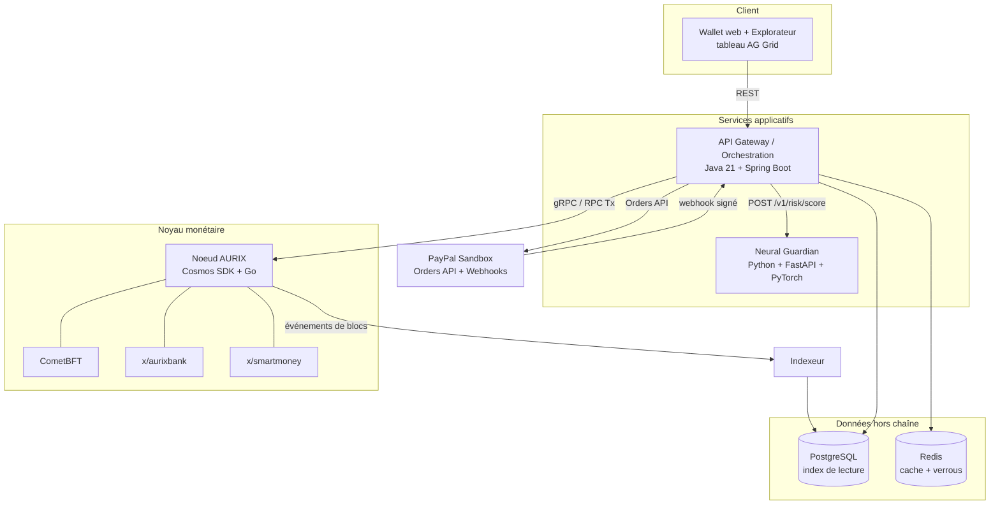
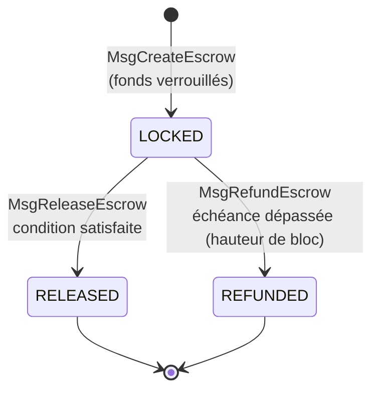
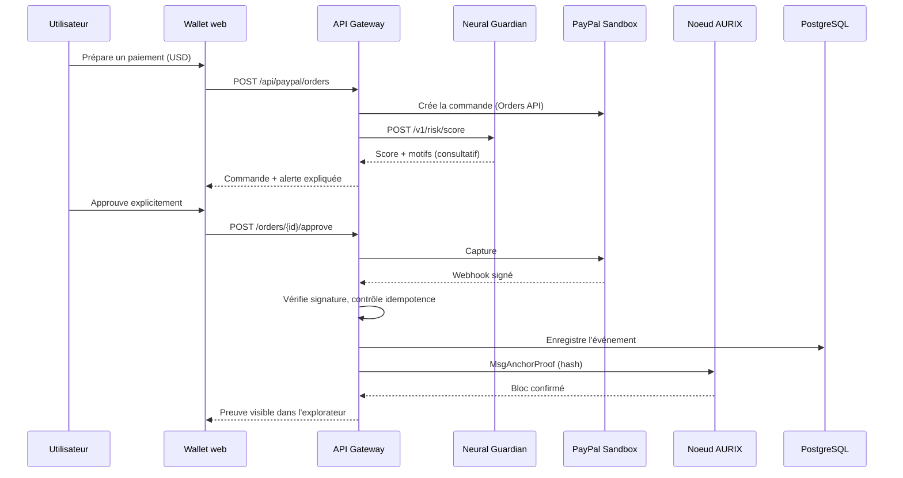
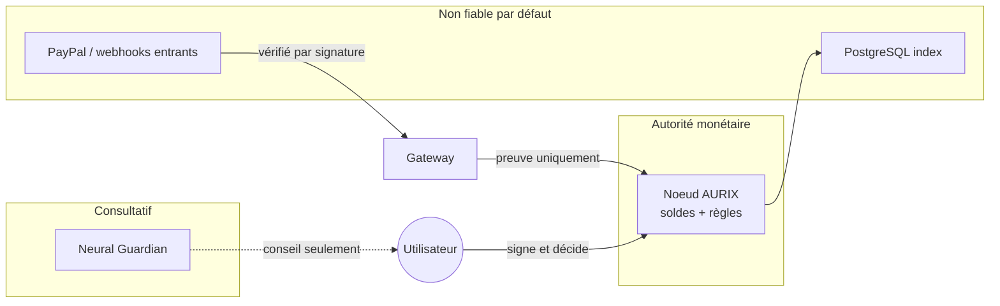
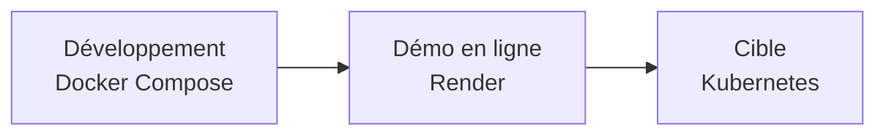

# AURIX — Architecture logicielle (V1 testnet)

*Document technique pour le PayPal AI Hackathon 2026 — 7 novembre 2026*

**Légende** : les éléments issus du document de conception v1.1 sont donnés tels quels. Les éléments marqués **[Proposition]** sont des choix de conception ajoutés ici, à valider.

---

## 1. Principes directeurs

1. **Le registre on-chain est la seule source de vérité des soldes AUR.** PostgreSQL n'est qu'un index de lecture.
2. **L'IA est consultative.** Elle ne peut ni valider, ni invalider, ni modifier une transaction de consensus.
3. **Séparation USD / AUR.** Les fonds PayPal (USD) ne se transforment jamais en AUR ; seule une *preuve de suivi* est enregistrée.
4. **Webhooks PayPal authentifiés (signature) et idempotents.**
5. **Aucun secret de production dans le dépôt.** Clés privées séparées.
6. **Le noyau fonctionne sans PayPal et sans IA** (couche 1 autonome).

---

## 2. Vue d'ensemble



| Couche conceptuelle | Composants logiciels |
| --- | --- |
| 4. Connectivité externe | Connecteur PayPal dans l'API Gateway |
| 3. Intelligence | Service Neural Guardian |
| 2. Programmable Money | Module `x/smartmoney` |
| 1. Protocole monétaire | Noeud Cosmos SDK, CometBFT, module `x/aurixbank` |

---

## 3. Composants

### 3.1 Noeud AURIX (Go, Cosmos SDK, CometBFT)

| Module | Responsabilité |
| --- | --- |
| `x/aurixbank` | Comptes, soldes AUR, nonces, frais, transferts, émission selon la politique monétaire |
| `x/smartmoney` | Séquestres (escrow) à états finis, libération, remboursement |
| CometBFT | Consensus Proof of Stake + BFT, finalité rapide |

**Messages de transaction** (noms **[Proposition]**) :

| Message | Module | Effet |
| --- | --- | --- |
| `MsgSend` | aurixbank | Transfère des AUR entre deux comptes, frais prélevés |
| `MsgCreateEscrow` | smartmoney | Verrouille des AUR de l'émetteur jusqu'à une condition ou une échéance |
| `MsgReleaseEscrow` | smartmoney | Libère les fonds vers le bénéficiaire si la condition est satisfaite |
| `MsgRefundEscrow` | smartmoney | Rembourse l'émetteur (échéance dépassée ou annulation autorisée) |
| `MsgAnchorProof` | smartmoney | Enregistre la preuve de suivi d'un paiement externe (hash uniquement) |

> **[Proposition]** `MsgAnchorProof` n'est pas dans le document v1.1, qui parle d'« associer une preuve de suivi ». Elle matérialise ce lien. Elle ne crée ni ne déplace aucun AUR.

### 3.2 Machine à états du séquestre



- Le contrôle du temps utilise la **hauteur de bloc** et le **temps protocolaire**, jamais l'horloge d'un service externe.
- Un séquestre ne quitte l'état `LOCKED` qu'une seule fois : pas de double libération, pas de libération après remboursement.
- **[Proposition]** Condition de libération en V1 : approbation explicite de l'émetteur ou d'un arbitre désigné à la création. Une condition plus riche (lecture d'une preuve de paiement ancrée) peut venir ensuite.

### 3.3 API Gateway / orchestration (Java 21 + Spring Boot)

Responsabilités : authentification des requêtes, orchestration du parcours de paiement, connecteur PayPal, appel à Neural Guardian, diffusion des transactions au noeud, lecture de l'index.

**Endpoints REST [Proposition]** :

| Méthode et chemin | Rôle |
| --- | --- |
| `POST /api/wallets` | Crée un wallet de démo (la clé privée reste côté client ou dans un coffre de démo) |
| `GET /api/wallets/{addr}` | Solde AUR (lu sur la chaîne), historique (lu dans l'index) |
| `POST /api/transfers` | Soumet un `MsgSend` signé ; consulte Neural Guardian avant diffusion |
| `POST /api/escrows` | Crée un séquestre |
| `POST /api/escrows/{id}/release` | Libère |
| `POST /api/escrows/{id}/refund` | Rembourse |
| `POST /api/paypal/orders` | Crée une commande PayPal (Orders API) et déclenche l'évaluation de risque |
| `POST /api/paypal/orders/{id}/approve` | Approbation humaine explicite, puis capture |
| `POST /api/paypal/webhook` | Réception des webhooks PayPal (signature + idempotence) |
| `GET /api/explorer/blocks`, `/txs` | Données de l'explorateur et du tableau AG Grid |

L'API doit être décrite en OpenAPI ; c'est aussi ce qui permet de la modéliser avec APIMatic.

### 3.4 Neural Guardian (Python, FastAPI, PyTorch)

**Contrat d'API [Proposition]** :

```http
POST /v1/risk/score
Content-Type: application/json

{
  "context": "aur_transfer | paypal_order",
  "sender": "aur1...",
  "recipient": "aur1...",
  "amount": 125.00,
  "currency": "AUR | USD",
  "timestamp": "2026-11-09T10:15:00Z"
}
```

```json
{
  "risk_score": 0.82,
  "level": "high",
  "reasons": [
    { "feature": "amount_vs_history", "impact": 0.41, "text": "Montant 8 fois supérieur à la moyenne" },
    { "feature": "new_recipient", "impact": 0.27, "text": "Premier envoi vers ce destinataire" }
  ],
  "model_version": "v0.1",
  "advisory_only": true
}
```

- Le champ `advisory_only: true` est constant : la réponse n'a aucun effet sur le consensus.
- Modèle V1 recommandé : LightGBM (référence tabulaire) + SHAP pour les motifs. L'analyse relationnelle par graphes (PyTorch Geometric) est une extension.
- Si le service est indisponible, la passerelle affiche « analyse indisponible » et laisse l'utilisateur décider : l'IA n'est jamais bloquante pour le protocole.

### 3.5 Connecteur PayPal (dans la passerelle)

| Étape | Détail |
| --- | --- |
| Création | Orders API en Sandbox, montant en USD |
| Capture | Seulement après approbation humaine explicite |
| Webhook | Vérification de la signature via l'API de vérification de PayPal ; rejet si invalide |
| Idempotence | L'identifiant d'événement PayPal est stocké avec une contrainte d'unicité ; un doublon est ignoré avec un succès HTTP 200 |
| Preuve | Après capture confirmée, `MsgAnchorProof` avec le hash de l'identifiant de commande et de capture |

Les identifiants client et secrets PayPal sont lus dans des variables d'environnement, jamais commités.

### 3.6 Indexeur et stockage

| Stockage | Contenu | Règle |
| --- | --- | --- |
| PostgreSQL | Blocs, transactions, séquestres, commandes PayPal, événements webhook, scores de risque | Lecture seule pour les soldes ; jamais source de vérité |
| Redis | Cache des lectures, verrous d'idempotence de courte durée | Perte sans conséquence monétaire |

**Tables [Proposition]** : `blocks`, `txs`, `escrows`, `paypal_orders`, `webhook_events (event_id UNIQUE)`, `risk_scores`.

---

## 4. Flux principal : paiement PayPal sécurisé par l'IA



**Flux secondaire** : transfert AUR → score Neural Guardian → confirmation utilisateur → `MsgSend` signé → consensus CometBFT → événement indexé. PayPal n'intervient pas.

---

## 5. Frontières de confiance



| Frontière | Règle |
| --- | --- |
| IA → protocole | Aucun chemin d'écriture : l'IA renvoie un score, pas une transaction |
| PayPal → protocole | Seulement une preuve de suivi après signature vérifiée |
| Index → utilisateur | Affichage uniquement ; en cas de doute, la chaîne fait foi |
| Clés privées | Jamais dans le dépôt ni dans les journaux |

---

## 6. Structure du dépôt [Proposition]

```
aurix/
├── chain/                    # Noeud Cosmos SDK (Go)
│   ├── app/
│   ├── x/aurixbank/
│   └── x/smartmoney/
├── gateway/                  # API Gateway (Spring Boot)
│   └── src/main/java/...
├── guardian/                 # Neural Guardian (FastAPI)
│   ├── app/
│   ├── models/
│   └── training/
├── indexer/                  # Lecture des blocs -> PostgreSQL
├── web/                      # Wallet, explorateur, tableau AG Grid
├── api/openapi.yaml          # Spécification de l'API (APIMatic)
├── deploy/
│   ├── docker-compose.yml
│   └── render.yaml
├── docs/
├── .env.example              # Variables sans valeurs secrètes
└── README.md
```

---

## 7. Déploiement



| Environnement | Contenu |
| --- | --- |
| Développement | Docker Compose : chain, gateway, guardian, indexer, postgres, redis, web |
| Démo hackathon | Services applicatifs sur Render ; vérifier que le noeud de chaîne peut y tourner comme service Docker persistant |
| Cible | Kubernetes (hors périmètre de la V1) |

**Variables d'environnement [Proposition]** (dans `.env.example`, sans valeurs) :

```
PAYPAL_CLIENT_ID=
PAYPAL_CLIENT_SECRET=
PAYPAL_WEBHOOK_ID=
PAYPAL_BASE_URL=https://api-m.sandbox.paypal.com
CHAIN_RPC_URL=
GUARDIAN_URL=
DATABASE_URL=
REDIS_URL=
```

---

## 8. Invariants à tester

| # | Invariant | Niveau de test |
| --- | --- | --- |
| 1 | L'offre totale d'AUR ne change que par l'émission prévue | Chaîne |
| 2 | La somme des fonds verrouillés égale la somme des séquestres `LOCKED` | Chaîne |
| 3 | Un séquestre ne peut être ni libéré deux fois, ni libéré après remboursement | Chaîne |
| 4 | Le nonce d'un compte croît strictement ; un rejeu est refusé | Chaîne |
| 5 | Un solde jamais négatif | Chaîne |
| 6 | Un webhook rejoué n'a aucun effet supplémentaire | Gateway |
| 7 | Un webhook à signature invalide est rejeté | Gateway |
| 8 | Aucune capture sans approbation humaine explicite | Gateway |
| 9 | La réponse de Neural Guardian ne modifie aucune transaction | Intégration |
| 10 | Si PayPal est indisponible, transferts et séquestres AUR fonctionnent | Intégration |

---

## 9. Variante simplifiée pour tenir en cinq jours [Proposition]

À décider selon la capacité de l'équipe :

| Élément | Cible v1.1 | Variante V1 réaliste |
| --- | --- | --- |
| Services applicatifs | Spring Boot + FastAPI | **FastAPI seul** (passerelle + IA) |
| Modèle de risque | PyTorch Geometric (GNN) | **LightGBM + SHAP** ; GNN en feuille de route |
| Orchestration | Kubernetes | **Docker Compose + Render** |
| Cache | Redis | Optionnel |
| Modules chaîne | `x/aurixbank`, `x/smartmoney` | Idem (cœur du projet, à conserver) |

Conserver le noyau Cosmos SDK et le connecteur PayPal ; ils portent la démonstration. Le reste se simplifie sans changer l'histoire racontée au jury.
