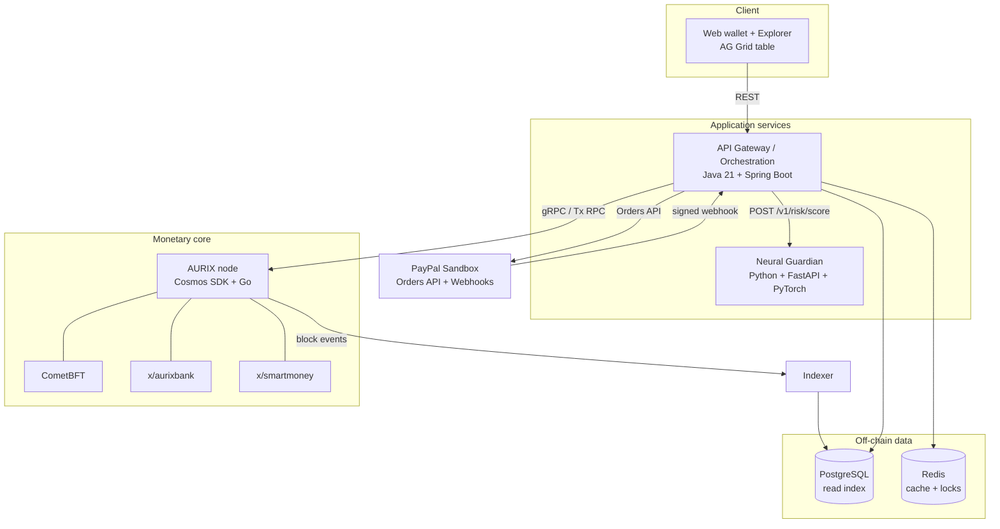
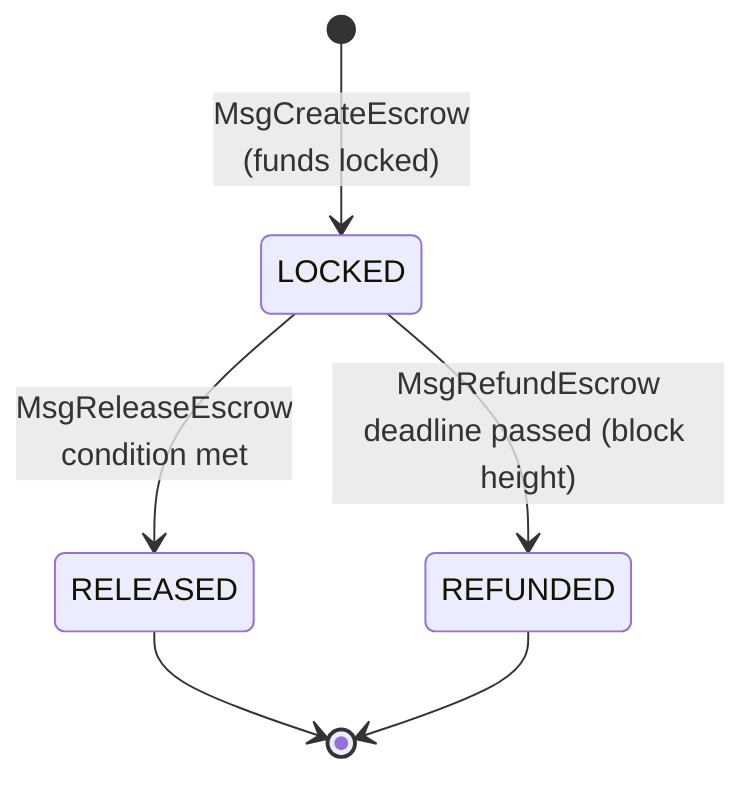
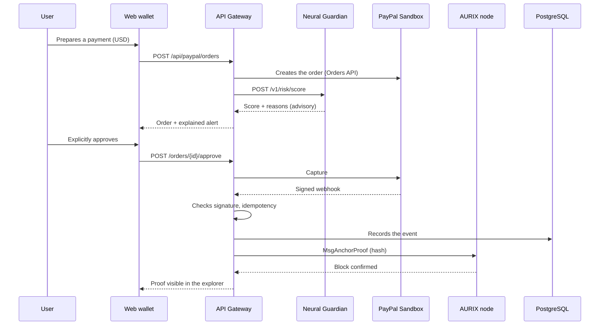
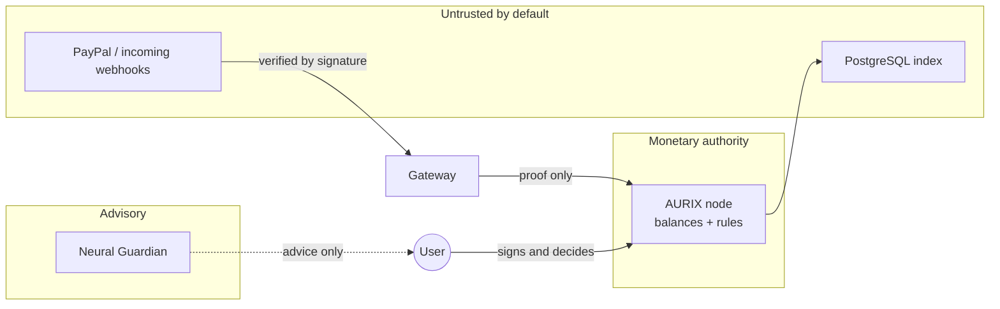
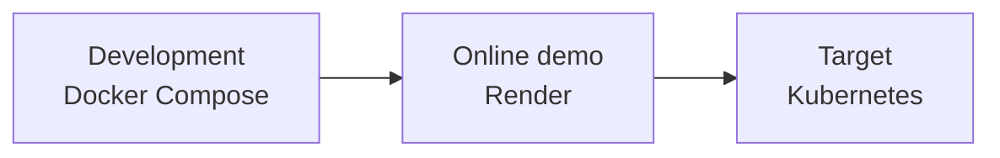

# AURIX — Software Architecture (V1 testnet)

*Technical document for the PayPal AI Hackathon 2026 — November 7, 2026*

**Legend**: items from design document v1.1 are given as is. Items marked **[Proposal]** are design choices added here, to be validated.

---

## 1. Guiding principles

1. **The on-chain ledger is the single source of truth for AUR balances.** PostgreSQL is only a read index.
2. **The AI is advisory.** It can neither validate, invalidate nor modify a consensus transaction.
3. **USD / AUR separation.** PayPal funds (USD) never turn into AUR; only a *tracking proof* is recorded.
4. **PayPal webhooks are authenticated (signature) and idempotent.**
5. **No production secrets in the repository.** Private keys kept separate.
6. **The core works without PayPal and without AI** (layer 1 is self-sufficient).

---

## 2. Overview



| Conceptual layer | Software components |
| --- | --- |
| 4. External connectivity | PayPal connector in the API Gateway |
| 3. Intelligence | Neural Guardian service |
| 2. Programmable Money | `x/smartmoney` module |
| 1. Monetary protocol | Cosmos SDK node, CometBFT, `x/aurixbank` module |

---

## 3. Components

### 3.1 AURIX node (Go, Cosmos SDK, CometBFT)

| Module | Responsibility |
| --- | --- |
| `x/aurixbank` | Accounts, AUR balances, nonces, fees, transfers, issuance per monetary policy |
| `x/smartmoney` | Finite-state escrows, release, refund |
| CometBFT | Proof of Stake + BFT consensus, fast finality |

**Transaction messages** (names **[Proposal]**):

| Message | Module | Effect |
| --- | --- | --- |
| `MsgSend` | aurixbank | Transfers AUR between two accounts, fees charged |
| `MsgCreateEscrow` | smartmoney | Locks the sender's AUR until a condition or a deadline |
| `MsgReleaseEscrow` | smartmoney | Releases funds to the recipient if the condition is met |
| `MsgRefundEscrow` | smartmoney | Refunds the sender (deadline passed or authorised cancellation) |
| `MsgAnchorProof` | smartmoney | Records the tracking proof of an external payment (hash only) |

> **[Proposal]** `MsgAnchorProof` is not in document v1.1, which speaks of "attaching a tracking proof". It materialises that link. It neither creates nor moves any AUR.

### 3.2 Escrow state machine



- Time is checked using **block height** and **protocol time**, never an external service's clock.
- An escrow leaves the `LOCKED` state only once: no double release, no release after refund.
- **[Proposal]** V1 release condition: explicit approval by the sender or by an arbiter designated at creation. A richer condition (reading an anchored payment proof) can come later.

### 3.3 API Gateway / orchestration (Java 21 + Spring Boot)

Responsibilities: request authentication, payment flow orchestration, PayPal connector, calls to Neural Guardian, broadcasting transactions to the node, reading the index.

**REST endpoints [Proposal]**:

| Method and path | Role |
| --- | --- |
| `POST /api/wallets` | Creates a demo wallet (the private key stays client-side or in a demo vault) |
| `GET /api/wallets/{addr}` | AUR balance (read from the chain), history (read from the index) |
| `POST /api/transfers` | Submits a signed `MsgSend`; consults Neural Guardian before broadcasting |
| `POST /api/escrows` | Creates an escrow |
| `POST /api/escrows/{id}/release` | Releases |
| `POST /api/escrows/{id}/refund` | Refunds |
| `POST /api/paypal/orders` | Creates a PayPal order (Orders API) and triggers risk assessment |
| `POST /api/paypal/orders/{id}/approve` | Explicit human approval, then capture |
| `POST /api/paypal/webhook` | Receives PayPal webhooks (signature + idempotency) |
| `GET /api/explorer/blocks`, `/txs` | Explorer and AG Grid table data |

The API must be described in OpenAPI; this also allows modelling it with APIMatic.

### 3.4 Neural Guardian (Python, FastAPI, PyTorch)

**API contract [Proposal]**:

```http
POST /v1/risk/score
Content-Type: application/json

{
  "context": "aur_transfer | paypal_order",
  "sender": "aur1...",
  "recipient": "aur1...",
  "amount": 125.00,
  "currency": "AUR | USD",
  "timestamp": "2026-11-09T10:15:00Z"
}
```

```json
{
  "risk_score": 0.82,
  "level": "high",
  "reasons": [
    { "feature": "amount_vs_history", "impact": 0.41, "text": "Amount 8 times higher than average" },
    { "feature": "new_recipient", "impact": 0.27, "text": "First payment to this recipient" }
  ],
  "model_version": "v0.1",
  "advisory_only": true
}
```

- The `advisory_only: true` field is constant: the response has no effect on consensus.
- Recommended V1 model: LightGBM (tabular baseline) + SHAP for reasons. Graph-based relational analysis (PyTorch Geometric) is an extension.
- If the service is unavailable, the gateway shows "analysis unavailable" and lets the user decide: the AI never blocks the protocol.

### 3.5 PayPal connector (in the gateway)

| Step | Detail |
| --- | --- |
| Creation | Orders API in Sandbox, amount in USD |
| Capture | Only after explicit human approval |
| Webhook | Signature checked via PayPal's verification API; rejected if invalid |
| Idempotency | The PayPal event ID is stored with a uniqueness constraint; a duplicate is ignored with an HTTP 200 success |
| Proof | After confirmed capture, `MsgAnchorProof` with the hash of the order ID and capture ID |

PayPal client IDs and secrets are read from environment variables, never committed.

### 3.6 Indexer and storage

| Store | Content | Rule |
| --- | --- | --- |
| PostgreSQL | Blocks, transactions, escrows, PayPal orders, webhook events, risk scores | Read-only for balances; never the source of truth |
| Redis | Read cache, short-lived idempotency locks | Loss has no monetary consequence |

**Tables [Proposal]**: `blocks`, `txs`, `escrows`, `paypal_orders`, `webhook_events (event_id UNIQUE)`, `risk_scores`.

---

## 4. Main flow: AI-secured PayPal payment



**Secondary flow**: AUR transfer → Neural Guardian score → user confirmation → signed `MsgSend` → CometBFT consensus → indexed event. PayPal is not involved.

---

## 5. Trust boundaries



| Boundary | Rule |
| --- | --- |
| AI → protocol | No write path: the AI returns a score, not a transaction |
| PayPal → protocol | Only a tracking proof after verified signature |
| Index → user | Display only; when in doubt, the chain prevails |
| Private keys | Never in the repository or in logs |

---

## 6. Repository structure [Proposal]

```
aurix/
├── chain/                    # Cosmos SDK node (Go)
│   ├── app/
│   ├── x/aurixbank/
│   └── x/smartmoney/
├── gateway/                  # API Gateway (Spring Boot)
│   └── src/main/java/...
├── guardian/                 # Neural Guardian (FastAPI)
│   ├── app/
│   ├── models/
│   └── training/
├── indexer/                  # Reads blocks -> PostgreSQL
├── web/                      # Wallet, explorer, AG Grid table
├── api/openapi.yaml          # API specification (APIMatic)
├── deploy/
│   ├── docker-compose.yml
│   └── render.yaml
├── docs/
├── .env.example              # Variables without secret values
└── README.md
```

---

## 7. Deployment



| Environment | Content |
| --- | --- |
| Development | Docker Compose: chain, gateway, guardian, indexer, postgres, redis, web |
| Hackathon demo | Application services on Render; check that the chain node can run there as a persistent Docker service |
| Target | Kubernetes (out of V1 scope) |

**Environment variables [Proposal]** (in `.env.example`, without values):

```
PAYPAL_CLIENT_ID=
PAYPAL_CLIENT_SECRET=
PAYPAL_WEBHOOK_ID=
PAYPAL_BASE_URL=https://api-m.sandbox.paypal.com
CHAIN_RPC_URL=
GUARDIAN_URL=
DATABASE_URL=
REDIS_URL=
```

---

## 8. Invariants to test

| # | Invariant | Test level |
| --- | --- | --- |
| 1 | Total AUR supply changes only through planned issuance | Chain |
| 2 | Sum of locked funds equals sum of `LOCKED` escrows | Chain |
| 3 | An escrow can be neither released twice nor released after refund | Chain |
| 4 | An account's nonce strictly increases; a replay is rejected | Chain |
| 5 | A balance is never negative | Chain |
| 6 | A replayed webhook has no additional effect | Gateway |
| 7 | A webhook with an invalid signature is rejected | Gateway |
| 8 | No capture without explicit human approval | Gateway |
| 9 | Neural Guardian's response modifies no transaction | Integration |
| 10 | If PayPal is unavailable, AUR transfers and escrows still work | Integration |

---

## 9. Simplified variant to fit in five days [Proposal]

To be decided based on team capacity:

| Item | v1.1 target | Realistic V1 variant |
| --- | --- | --- |
| Application services | Spring Boot + FastAPI | **FastAPI only** (gateway + AI) |
| Risk model | PyTorch Geometric (GNN) | **LightGBM + SHAP**; GNN on the roadmap |
| Orchestration | Kubernetes | **Docker Compose + Render** |
| Cache | Redis | Optional |
| Chain modules | `x/aurixbank`, `x/smartmoney` | Same (core of the project, keep) |

Keep the Cosmos SDK core and the PayPal connector; they carry the demo. Everything else can be simplified without changing the story told to the judges.
