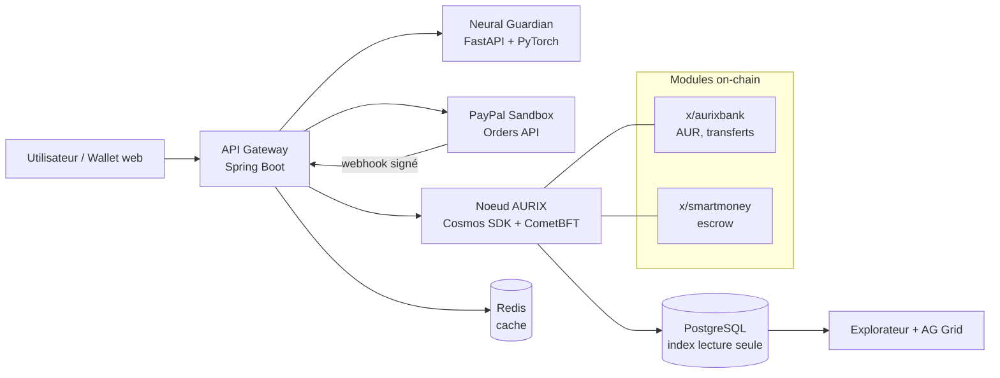
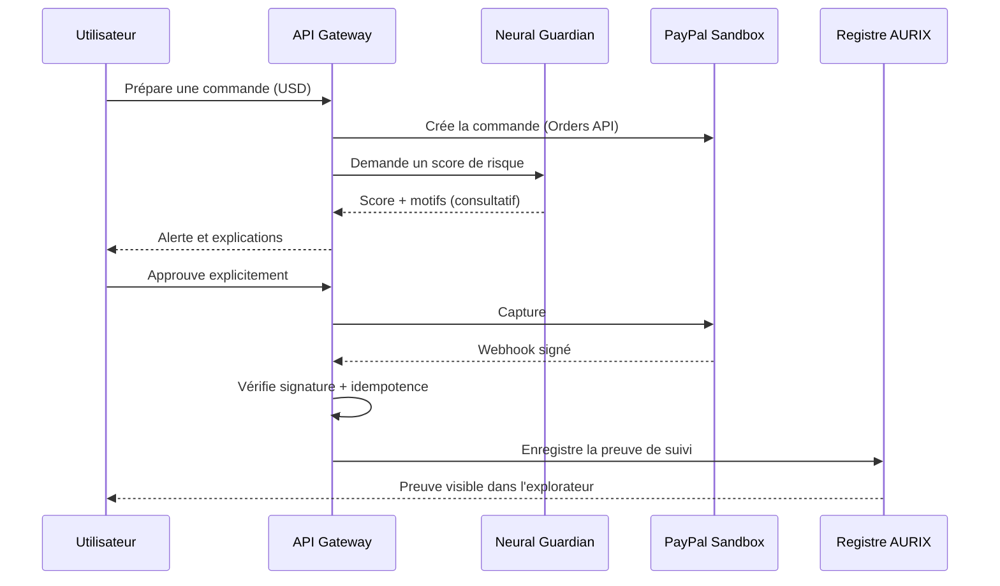

# AURIX — Dossier de présentation Hackathon PayPal AI 2026

*Independent Intelligent Monetary Protocol — mis à jour le 7 novembre 2026*

---

## 1. Pitch en un coup d'œil

AURIX est un protocole monétaire testnet où une IA évalue un paiement avant sa confirmation, où les conditions de paiement sont exécutées par le protocole, et où PayPal sert de passerelle vers l'économie réelle sans jamais se substituer à la monnaie native AUR.

| Élément | Message à retenir |
| --- | --- |
| Tagline | Programmable Value, Verifiable Trust. |
| Problème | Les paiements numériques dépendent d'un opérateur unique, sont difficiles à vérifier et rarement conditionnels. |
| Solution | Une monnaie native (AUR) sur registre BFT, un séquestre programmable (Smart Money) et un garde-fou IA consultatif (Neural Guardian). |
| Lien avec PayPal | PayPal Sandbox (Orders API + webhooks) joue le rôle de rail de paiement externe, relié au registre par une preuve de suivi. |
| Principe clé | L'IA conseille, le protocole décide, l'humain approuve. |
| Preuve | Un parcours de démonstration de moins de 3 minutes, de bout en bout, sur testnet. |

---

## 2. Problème et opportunité

La thèse : une monnaie numérique utile à grande échelle doit réunir vérifiabilité, règles monétaires explicites, simplicité d'usage, paiements programmables, sécurité assistée par IA et passerelles réglementées vers l'économie réelle.

- **Autonomie** : les règles d'émission, de transfert et de validation du registre natif ne dépendent d'aucun opérateur commercial unique.
- **Conditions de paiement** : les micro-échanges commerciaux et les contrats à étapes ont besoin d'un séquestre exécuté par le protocole.
- **Sécurité avant l'erreur** : l'alerte doit arriver avant la confirmation, avec ses motifs.
- **Pont vers le réel** : l'accès aux monnaies fiat passe par des prestataires régulés (ici PayPal), sans confondre USD et AUR.

> À compléter : un chiffre sourcé (fraude aux paiements, coût des transferts, micro-paiements) pour ancrer le problème.

---

## 3. Trois fonctionnalités V1 et un fil rouge

| Module | Ce que voit le jury | Ce qui s'exécute |
| --- | --- | --- |
| 1. AURIX Wallet & Transfer | Créer un wallet de démo, consulter le solde, envoyer/recevoir des AUR | Comptes, nonces, frais, signatures, consensus CometBFT |
| 2. Smart Money | Paiement conditionnel : fonds verrouillés, libérés si la condition est remplie, remboursés à l'échéance | Module escrow à états finis, contrôle par hauteur de bloc et temps protocolaire |
| 3. Neural Guardian | Alerte avant confirmation, score de risque, motifs expliqués | Modèle ML PyTorch ; décision finale laissée au protocole et à l'utilisateur |
| Connecteur PayPal | Paiement USD en Sandbox, preuve de suivi associée | Orders API, capture, webhook signé et idempotent |

PayPal Sandbox est le démonstrateur de paiement externe, pas une quatrième fonctionnalité du protocole.

### Fil rouge proposé pour la démo

*Proposition à valider : Neural Guardian évalue aussi la commande PayPal avant capture, pas seulement les transferts AUR.*

1. L'utilisateur prépare une commande PayPal Sandbox en USD (Orders API).
2. Neural Guardian affiche un score de risque et les motifs de l'alerte.
3. L'utilisateur approuve explicitement, ou annule.
4. PayPal capture le paiement ; le serveur vérifie le webhook (signature, idempotence).
5. Une preuve de suivi est enregistrée sur le registre AURIX, sans créer d'AUR.
6. En parallèle, un paiement en AUR passe par Smart Money : verrouillage, condition, libération ou remboursement.

---

## 4. Architecture

### 4.1 Les quatre couches

```
┌──────────────────────────────────────────────────────────────┐
│ COUCHE 4 — External Financial Connectivity                   │
│ PayPal Sandbox (Orders API, webhooks) • futures passerelles  │
│ Autorité : aucune sur les soldes AUR                         │
├──────────────────────────────────────────────────────────────┤
│ COUCHE 3 — AURIX Intelligence                                │
│ Neural Guardian • analyse de graphes • explicabilité (SHAP)  │
│ Autorité : consultative uniquement                           │
├──────────────────────────────────────────────────────────────┤
│ COUCHE 2 — Programmable Money                                │
│ Smart Money • escrow • conditions • remboursement            │
│ Autorité : exécution déterministe définie par le protocole   │
├──────────────────────────────────────────────────────────────┤
│ COUCHE 1 — AURIX Monetary Protocol                           │
│ AUR • consensus BFT (CometBFT) • registre • émission         │
│ Autorité : source de vérité des soldes                       │
└──────────────────────────────────────────────────────────────┘
```

| Couche | Contenu | Rôle | Autorité |
| --- | --- | --- | --- |
| 4. Connectivité financière externe | PayPal Sandbox, futures passerelles | Pont vers les rails traditionnels | Aucune sur les soldes AUR |
| 3. AURIX Intelligence | Neural Guardian, graphes, explicabilité | Alerter et expliquer | Consultative uniquement |
| 2. Programmable Money | Smart Money, escrow, conditions, remboursement | Exécuter des conditions | Définie par le protocole |
| 1. AURIX Monetary Protocol | AUR, consensus BFT, registre, émission | Définir l'état monétaire | Source de vérité des soldes |

Le noyau (couche 1) ne dépend d'aucune couche supérieure : le protocole fonctionne sans PayPal et sans IA.

### 4.2 Architecture technique (composants et flux)



### 4.3 Flux du fil rouge (séquence)



### 4.4 Stack cible

| Besoin | Technologie |
| --- | --- |
| Consensus | CometBFT |
| Noyau blockchain | Cosmos SDK + Go (`x/aurixbank`, `x/smartmoney`) |
| Services applicatifs | Java 21 + Spring Boot (API Gateway, orchestration) |
| IA | Python + FastAPI + PyTorch / PyTorch Geometric |
| Données | PostgreSQL (index hors chaîne) + Redis (cache) |
| Orchestration | Docker Compose en développement, Kubernetes en cible |

### 4.5 Comparaison avec Bitcoin

| Dimension | Bitcoin | AURIX (objectif de conception) |
| --- | --- | --- |
| Monnaie native | BTC | AUR |
| Consensus | Proof of Work | Proof of Stake + BFT via CometBFT, finalité rapide |
| Programmabilité | Script limité, couches secondaires | Paiements conditionnels natifs ciblés |
| IA | Aucune | Neural Guardian externe et consultatif |
| Connectivité | Échanges et passerelles décentralisés | Passerelles externes modulaires |

---

## 5. Script de démo vidéo (2 min 55)

| Temps | Écran | Message |
| --- | --- | --- |
| 0:00–0:20 | Titre, puis wallet vide | Le problème en une phrase, puis la tagline |
| 0:20–0:50 | Wallet : création, solde, envoi d'AUR, bloc confirmé | Transfert pair à pair sans PayPal |
| 0:50–1:30 | Commande PayPal Sandbox, alerte Neural Guardian, approbation | L'IA conseille, l'humain décide ; Orders API réelle |
| 1:30–2:05 | Capture, webhook vérifié, preuve sur AURIX | USD et AUR restent séparés ; preuve vérifiable |
| 2:05–2:35 | Smart Money : verrouillage, condition, libération (puis remboursement) | Le protocole exécute la condition |
| 2:35–2:55 | Tableau AG Grid, schéma des 4 couches, tagline | Ce qui est construit et ce qui vient ensuite |

Conseils : enregistrer chaque séquence séparément, figer des données de démo, sous-titrer la vidéo.

---

## 6. Périmètre honnête

Limites reconnues : la valeur de marché de AUR n'est pas garantie ; le code ouvert ne remplace pas une décentralisation multi-opérateurs ; les transactions publiques exigent des précautions de confidentialité ; l'accès au fiat dépend des prestataires et de la régulation.

| Statut | Contenu |
| --- | --- |
| Dans la démo (V1, testnet) | Wallet et transferts AUR, Smart Money, Neural Guardian, PayPal Sandbox, explorateur et historique |
| Positionnement | Testnet de démonstration ; AUR n'a pas de valeur monétaire réelle |
| Feuille de route | Multi-opérateurs, passerelles réglementées supplémentaires, GNN, publications |

> Question ouverte : sur quelles données Neural Guardian est-il entraîné pour la démo ? À préciser dans le README.

---

## 7. Catégories de prix

| Priorité | Catégorie | Ce que le jury doit voir | Preuve |
| --- | --- | --- | --- |
| 1 | Best Use of PayPal + AI | Orders API réelle, agent IA qui prépare, analyse et sécurise le paiement | Séquence 0:50–1:30 |
| 2 | Best Demo Delivery | Parcours fluide, moins de 3 minutes | Vidéo chronométrée |
| 3 | Most Creative | Hybridation protocole indépendant + passerelle traditionnelle | Schéma des 4 couches |
| 4 | Most Impactful | Micro-échanges et contrats à étapes sous séquestre | Scénario Smart Money |
| 5 | Sponsors (AG Grid, APIMatic, Render) | Tableau des transactions, modélisation d'API, déploiement | Tableau, spec API, démo en ligne |

Critères d'évaluation (d'après une page tierce, à confirmer) : mise en œuvre technique, design, impact potentiel, innovation, présentation.

---

## 8. Sécurité et risques

Principes non négociables :

1. Le registre on-chain est la seule source de vérité pour les soldes AUR ; PostgreSQL n'est qu'un index de lecture.
2. L'IA ne peut ni valider, ni invalider, ni modifier une transaction de consensus.
3. Les webhooks PayPal sont authentifiés par signature et idempotents.
4. Clés privées séparées ; aucun secret de production dans le dépôt.

| Risque | Conséquence | Mesure |
| --- | --- | --- |
| Indisponibilité PayPal | Rupture de la passerelle fiat | Le protocole AUR fonctionne sans PayPal |
| Confusion USD / AUR | Mauvaise lecture de la nature des fonds | Séparation visuelle nette, soldes distincts |
| Webhook falsifié | Fausse confirmation de paiement | Vérification de signature, idempotence |
| Agent IA trop autonome | Ordre non désiré exécuté | Approbation humaine explicite obligatoire |
| Démo en direct qui échoue | Perte de la démo | Données figées, vidéo par séquences, version déployée de secours |

---

## 9. Plan d'exécution (7 au 12 novembre)

Échéance de soumission : des pages tierces indiquent le 13 novembre 2026 à 1 h 30 (heure de l'Inde), soit le 12 novembre vers 22 h à Lubumbashi. À confirmer sur Devpost ; viser l'après-midi du 12.

| Date | Objectif | Livrable vérifiable | Abandon en premier si retard |
| --- | --- | --- | --- |
| 7 nov | Gel du périmètre | Dépôt, schéma cible, compte PayPal Sandbox, scénario validé | Kubernetes, graphes |
| 8 nov | Paiements | Commande PayPal créée et capturée ; transfert AUR sur testnet | Fonctions annexes du wallet |
| 9 nov | Smart Money et IA | Escrow complet ; score Neural Guardian affiché ; tests d'invariants | Modèle complexe (garder la référence tabulaire) |
| 10 nov | Interface | Wallet web, historique, explorateur, AG Grid | Finitions visuelles |
| 11 nov | Stabilisation et vidéo | Test de bout en bout, README, vidéo < 3 min | Tout nouveau développement |
| 12 nov | Soumission | Dépôt Devpost, vérification des liens | Rien |

---

## 10. Vision et recherche

| Axe | Domaine | Sujet |
| --- | --- | --- |
| Article 1 | Systèmes distribués | Souveraineté et interopérabilité entre protocoles monétaires indépendants et passerelles financières |
| Article 2 | Blockchain et méthodes formelles | Exécution déterministe de séquestres à états finis |
| Article 3 | Machine learning | Détection d'anomalies : temporel, graphes (PyTorch Geometric), LightGBM en référence, SHAP, faux positifs |
| Extension | Coordination vérifiable | Réconciliation, webhooks et tolérance aux pannes entre systèmes hétérogènes |

---

## 11. Points à corriger avant la soumission

1. **Relier l'IA à PayPal** : faire évaluer aussi la commande PayPal avant capture (priorité 1).
2. **Réduire le périmètre technique** : supprimer la couche Java (FastAPI est déjà requis), rester sur Docker Compose + Render, commencer par LightGBM + SHAP, GNN en feuille de route.
3. **Vérifier deux références** : Chiu et Monnet (2026, AER: Insights) ; Budish (2025, QJE).
4. **Nuancer « indépendant »** : un testnet à validateur unique n'est pas multi-opérateurs.
5. **Corriger la langue** : « strictly » → « strictement » (deux occurrences) ; prévoir un résumé et des sous-titres en anglais.
6. **Ajouter un chiffre sourcé** dans la section Problème.

---

## 12. Checklist de soumission

- [ ] Vidéo de moins de 3 minutes, hébergée et accessible
- [ ] Dépôt de code avec README (installation, architecture, données de Neural Guardian, limites)
- [ ] Description du projet (Pitch, Fonctionnalités, Architecture)
- [ ] Démo en ligne déployée sur Render, avec identifiants Sandbox de test
- [ ] Aucun secret ni clé privée dans le dépôt
- [ ] Catégories de prix cochées, sponsors utilisés inclus
- [ ] Soumission l'après-midi du 12 novembre, puis re-vérification des liens

## Références

- Nakamoto, S. (2008). *Bitcoin: A Peer-to-Peer Electronic Cash System.*
- Castro, M. & Liskov, B. (1999). *Practical Byzantine Fault Tolerance.* OSDI.
- Chiu, J. & Koeppl, T. (2019). *The Economics of Cryptocurrencies — Bitcoin and Beyond.* Bank of Canada Staff Working Paper.
- Chiu, J. & Monnet, C. (2026). *On the Programmability and Uniformity of Digital Currencies.* AER: Insights. *(à vérifier)*
- Budish, E. (2025). *Trust at Scale: The Economic Limits of Cryptocurrencies and Blockchains.* QJE. *(à vérifier)*
- Documentation : Cosmos SDK, CometBFT, Kubernetes, PayPal Developer (Orders API & Webhooks), AG Grid, APIMatic, Render.
- Hackathon : https://paypalaihackathon.devpost.com/ (non ouvert ici)
