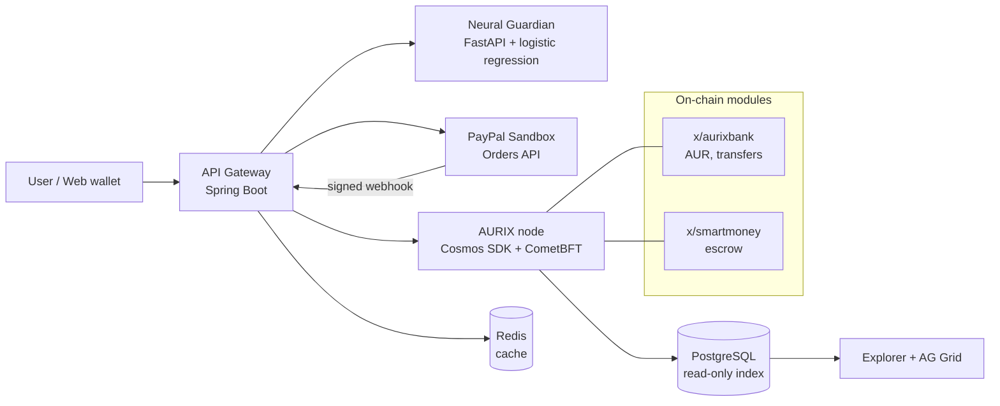
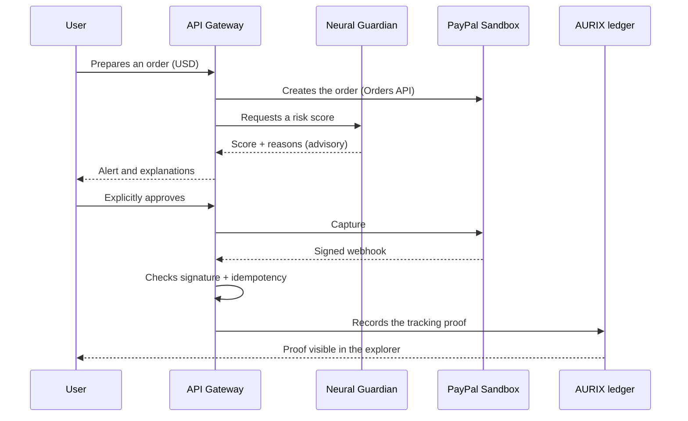

# AURIX — PayPal AI Hackathon 2026 Pitch File

*Independent Intelligent Monetary Protocol — updated November 7, 2026*

---

## 1. Pitch at a glance

AURIX is a testnet monetary protocol where an AI assesses a payment before it is confirmed, where payment conditions are executed by the protocol, and where PayPal serves as a bridge to the real economy without ever replacing the native currency AUR.

| Item | Key message |
| --- | --- |
| Tagline | Programmable Value, Verifiable Trust. |
| Problem | Digital payments depend on a single operator, are hard to verify and rarely conditional. |
| Solution | A native currency (AUR) on a BFT ledger, programmable escrow (Smart Money) and an advisory AI safeguard (Neural Guardian). |
| Link with PayPal | PayPal Sandbox (Orders API + webhooks) acts as the external payment rail, linked to the ledger by a tracking proof. |
| Core principle | The AI advises, the protocol decides, the human approves. |
| Proof | An end-to-end demo journey under 3 minutes, on testnet. |

---

## 2. Problem and opportunity

The thesis: a digital currency that is useful at scale must combine verifiability, explicit monetary rules, ease of use, programmable payments, AI-assisted security and regulated bridges to the real economy.

- **Autonomy**: the native ledger's issuance, transfer and validation rules depend on no single commercial operator.
- **Payment conditions**: commercial micro-exchanges and milestone contracts need protocol-executed escrow.
- **Security before the mistake**: the alert must come before confirmation, with its reasons.
- **Bridge to the real world**: fiat access goes through regulated providers (here PayPal), without confusing USD and AUR.

> To do: add a sourced figure (payment fraud, transfer costs, micro-payments) to ground the problem.

---

## 3. Three MVP 0.1 features and a common thread

| Module | What the judges see | What runs |
| --- | --- | --- |
| 1. AURIX Wallet & Transfer | Create a demo wallet, check the balance, send/receive AUR | Accounts, nonces, fees, signatures, CometBFT consensus |
| 2. Smart Money | Conditional payment: funds locked, released if the condition is met, refunded at the deadline | Finite-state escrow module, checked by block height and protocol time |
| 3. Neural Guardian | Alert before confirmation, risk score, explained reasons | Calibrated logistic regression with exact SHAP reasons (trained on PaySim); final decision left to the protocol and the user |
| PayPal connector | USD payment in Sandbox, associated tracking proof | Orders API, capture, signed and idempotent webhook |

PayPal Sandbox is the external payment demonstrator, not a fourth protocol feature.

### Proposed demo storyline

*Proposal to validate: Neural Guardian also assesses the PayPal order before capture, not just AUR transfers.*

1. The user prepares a PayPal Sandbox order in USD (Orders API).
2. Neural Guardian displays a risk score and the reasons for the alert.
3. The user explicitly approves, or cancels.
4. PayPal captures the payment; the server verifies the webhook (signature, idempotency).
5. A tracking proof is recorded on the AURIX ledger, without creating AUR.
6. In parallel, an AUR payment goes through Smart Money: lock, condition, release or refund.

---

## 4. Architecture

### 4.1 The four layers

```
┌──────────────────────────────────────────────────────────────┐
│ LAYER 4 — External Financial Connectivity                    │
│ PayPal Sandbox (Orders API, webhooks) • future gateways      │
│ Authority: none over AUR balances                            │
├──────────────────────────────────────────────────────────────┤
│ LAYER 3 — AURIX Intelligence                                 │
│ Neural Guardian • graph analysis • explainability (SHAP)     │
│ Authority: advisory only                                     │
├──────────────────────────────────────────────────────────────┤
│ LAYER 2 — Programmable Money                                 │
│ Smart Money • escrow • conditions • refund                   │
│ Authority: deterministic execution defined by the protocol   │
├──────────────────────────────────────────────────────────────┤
│ LAYER 1 — AURIX Monetary Protocol                            │
│ AUR • BFT consensus (CometBFT) • ledger • issuance            │
│ Authority: source of truth for balances                      │
└──────────────────────────────────────────────────────────────┘
```

| Layer | Content | Role | Authority |
| --- | --- | --- | --- |
| 4. External financial connectivity | PayPal Sandbox, future gateways | Bridge to traditional rails | None over AUR balances |
| 3. AURIX Intelligence | Neural Guardian, graphs, explainability | Alert and explain | Advisory only |
| 2. Programmable Money | Smart Money, escrow, conditions, refund | Execute conditions | Defined by the protocol |
| 1. AURIX Monetary Protocol | AUR, BFT consensus, ledger, issuance | Define the monetary state | Source of truth for balances |

The core (layer 1) depends on no upper layer: the protocol works without PayPal and without AI.

### 4.2 Technical architecture (components and flows)



### 4.3 Storyline flow (sequence)



### 4.4 Target stack

| Need | Technology |
| --- | --- |
| Consensus | CometBFT |
| Blockchain core | Cosmos SDK + Go (`x/aurixbank`, `x/smartmoney`) |
| Application services | Java 21 + Spring Boot (API Gateway, orchestration) |
| AI | Python + FastAPI, logistic regression + SHAP (PyTorch Geometric on the roadmap); Gemma 4 advisor |
| Data | PostgreSQL (off-chain index) + Redis (cache) |
| Orchestration | Docker Compose in development, Kubernetes as target |

### 4.5 Comparison with Bitcoin

| Dimension | Bitcoin | AURIX (design goal) |
| --- | --- | --- |
| Native currency | BTC | AUR |
| Consensus | Proof of Work | Proof of Stake + BFT via CometBFT, fast finality |
| Programmability | Limited script, secondary layers | Native conditional payments targeted |
| AI | None | External, advisory Neural Guardian |
| Connectivity | Decentralised exchanges and gateways | Modular external gateways |

---

## 5. Demo video script (2 min 55)

| Time | Screen | Message |
| --- | --- | --- |
| 0:00–0:20 | Title, then empty wallet | The problem in one sentence, then the tagline |
| 0:20–0:50 | Wallet: creation, balance, sending AUR, confirmed block | Peer-to-peer transfer without PayPal |
| 0:50–1:30 | PayPal Sandbox order, Neural Guardian alert, approval | The AI advises, the human decides; real Orders API |
| 1:30–2:05 | Capture, verified webhook, proof on AURIX | USD and AUR stay separate; verifiable proof |
| 2:05–2:35 | Smart Money: lock, condition, release (then refund) | The protocol executes the condition |
| 2:35–2:55 | AG Grid table, 4-layer diagram, tagline | What is built and what comes next |

Tips: record each sequence separately, freeze demo data, subtitle the video.

---

## 6. Honest scope

Acknowledged limits: AUR's market value is not guaranteed; open code does not replace multi-operator decentralisation; public transactions require privacy precautions; fiat access depends on providers and regulation.

| Status | Content |
| --- | --- |
| In the demo (MVP 0.1, testnet) | AUR wallet and transfers, Smart Money, Neural Guardian, PayPal Sandbox, explorer and history |
| Positioning | Demonstration testnet; AUR has no real monetary value |
| Roadmap | Multi-operator, additional regulated gateways, GNN, publications |

> Open question: what data is Neural Guardian trained on for the demo? To be specified in the README.

---

## 7. Prize categories

| Priority | Category | What the judges must see | Evidence |
| --- | --- | --- | --- |
| 1 | Best Use of PayPal + AI | Real Orders API, an AI agent that prepares, analyses and secures the payment | Sequence 0:50–1:30 |
| 2 | Best Demo Delivery | Smooth journey, under 3 minutes | Timed video |
| 3 | Most Creative | Hybrid of an independent protocol + traditional gateway | 4-layer diagram |
| 4 | Most Impactful | Escrowed micro-exchanges and milestone contracts | Smart Money scenario |
| 5 | Sponsors (AG Grid, APIMatic, Render) | Transaction table, API modelling, deployment | Table, API spec, online demo |

Judging criteria (per a third-party page, to be confirmed): technical implementation, design, potential impact, innovation, presentation.

---

## 8. Security and risks

Non-negotiable principles:

1. The on-chain ledger is the single source of truth for AUR balances; PostgreSQL is only a read index.
2. The AI can neither validate, invalidate nor modify a consensus transaction.
3. PayPal webhooks are authenticated by signature and idempotent.
4. Private keys kept separate; no production secrets in the repository.

| Risk | Consequence | Mitigation |
| --- | --- | --- |
| PayPal unavailable | Fiat gateway outage | The AUR protocol works without PayPal |
| USD / AUR confusion | Misreading the nature of funds | Clear visual separation, distinct balances |
| Forged webhook | False payment confirmation | Signature verification, idempotency |
| Over-autonomous AI agent | Unwanted order executed | Mandatory explicit human approval |
| Live demo fails | Demo lost | Frozen data, video in sequences, deployed fallback version |

---

## 9. Execution plan (November 7 to 12)

Submission deadline: third-party pages state November 13, 2026 at 1:30 a.m. (India time), i.e. around 10 p.m. on November 12 in Lubumbashi. To be confirmed on Devpost; aim for the afternoon of the 12th.

| Date | Goal | Verifiable deliverable | Drop first if late |
| --- | --- | --- | --- |
| Nov 7 | Scope freeze | Repository, target diagram, PayPal Sandbox account, validated scenario | Kubernetes, graphs |
| Nov 8 | Payments | PayPal order created and captured; AUR transfer on testnet | Secondary wallet features |
| Nov 9 | Smart Money and AI | Full escrow; Neural Guardian score displayed; invariant tests | Complex model (keep tabular baseline) |
| Nov 10 | Interface | Web wallet, history, explorer, AG Grid | Visual polish |
| Nov 11 | Stabilisation and video | End-to-end test, README, video < 3 min | Any new development |
| Nov 12 | Submission | Devpost submission, link checks | Nothing |

---

## 10. Vision and research

| Track | Field | Topic |
| --- | --- | --- |
| Paper 1 | Distributed systems | Sovereignty and interoperability between independent monetary protocols and financial gateways |
| Paper 2 | Blockchain and formal methods | Deterministic execution of finite-state escrows |
| Paper 3 | Machine learning | Anomaly detection: temporal, graphs (PyTorch Geometric), LightGBM baseline, SHAP, false positives |
| Extension | Verifiable coordination | Reconciliation, webhooks and fault tolerance between heterogeneous systems |

---

## 11. Items to fix before submission

1. **Link the AI to PayPal**: also score the PayPal order before capture (priority 1).
2. **Reduce the technical scope**: drop the Java layer (FastAPI is already required), stay on Docker Compose + Render, start with LightGBM + SHAP, GNN on the roadmap.
3. **Check two references**: Chiu and Monnet (2026, AER: Insights); Budish (2025, QJE).
4. **Nuance "independent"**: a single-validator testnet is not multi-operator.
5. **Language fixes**: provide an English summary and subtitles.
6. **Add a sourced figure** in the Problem section.

---

## 12. Submission checklist

- [ ] Video under 3 minutes, hosted and accessible
- [ ] Code repository with README (installation, architecture, Neural Guardian data, limits)
- [ ] Project description (Pitch, Features, Architecture)
- [ ] Online demo deployed on Render, with Sandbox test credentials
- [ ] No secrets or private keys in the repository
- [ ] Prize categories ticked, sponsors used included
- [ ] Submit on the afternoon of November 12, then re-check links

## References

- Nakamoto, S. (2008). *Bitcoin: A Peer-to-Peer Electronic Cash System.*
- Castro, M. & Liskov, B. (1999). *Practical Byzantine Fault Tolerance.* OSDI.
- Chiu, J. & Koeppl, T. (2019). *The Economics of Cryptocurrencies — Bitcoin and Beyond.* Bank of Canada Staff Working Paper.
- Chiu, J. & Monnet, C. (2026). *On the Programmability and Uniformity of Digital Currencies.* AER: Insights. *(to be checked)*
- Budish, E. (2025). *Trust at Scale: The Economic Limits of Cryptocurrencies and Blockchains.* QJE. *(to be checked)*
- Documentation: Cosmos SDK, CometBFT, Kubernetes, PayPal Developer (Orders API & Webhooks), AG Grid, APIMatic, Render.
- Hackathon: https://paypalaihackathon.devpost.com/ (not opened here)
