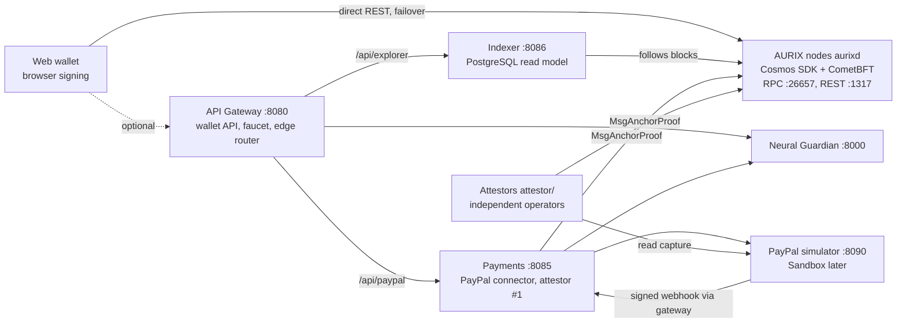

# AURIX — Independent Intelligent Monetary Protocol

> **Programmable Value, Verifiable Trust.**
> Project submitted to the **PayPal AI Hackathon 2026** — MVP 0.1 testnet.

AURIX is a testnet monetary protocol where an AI assesses a payment **before** it is confirmed, where payment conditions are enforced by the protocol (escrow), and where **PayPal Sandbox** acts as a bridge to the real economy without ever replacing the native currency **AUR**.

**Core principle: the AI advises, the protocol decides, the human approves.**

---

## Table of contents

- [MVP 0.1 features](#mvp-01-features)
- [Architecture](#architecture)
- [Tech stack](#tech-stack)
- [Repository layout](#repository-layout)
- [Quick start](#quick-start)
- [Implementation status](#implementation-status)
- [Way of working: Scrum](#way-of-working-scrum)
- [Documentation](#documentation)
- [Security](#security)
- [Limitations and scope](#limitations-and-scope)

---

## MVP 0.1 features

| Module | Description |
| --- | --- |
| **AURIX Wallet & Transfer** | Create a demo wallet, check the balance, send/receive AUR (CometBFT consensus) |
| **Smart Money** | Finite-state escrow: lock, release on condition, refund at deadline |
| **Neural Guardian** | Advisory risk score with explained reasons (SHAP) before confirmation |
| **PayPal connector** | USD payment via PayPal Orders API (local simulator now, Sandbox next), signed and idempotent webhook, tracking proof anchored on AURIX once **k-of-n independent attestors** confirmed the capture at PayPal |

## Architecture

Four layers; the core depends on no upper layer:

| Layer | Content | Authority |
| --- | --- | --- |
| 4. External connectivity | PayPal Sandbox | None over AUR balances |
| 3. Intelligence | Neural Guardian | Advisory only |
| 2. Programmable Money | `x/smartmoney` (escrow) | Deterministic execution |
| 1. Monetary protocol | AUR, CometBFT, `x/aurixbank` | Source of truth for balances |



The wallet reads and broadcasts **directly** against chain nodes (`web/config.json`, `?nodes=` URL override, Settings panel), so it keeps working when the gateway is down; the gateway is only needed for PayPal, Neural Guardian scoring, the explorer API and the dev faucet. The gateway is a thin edge: `/api/explorer/*` is served by the **indexer** (blocks, txs and per-address history in PostgreSQL, rebuilt from the chain at any time) and `/api/paypal/*` by the **payments** service (orders, capture, webhooks, proof anchoring); all three share `common/aurix_common` (keys, Cosmos tx signing, chain and PayPal clients). A PayPal proof is `PENDING` on chain until `anchor_threshold` of the `anchor_signers` (payments + independent attestors, governed by `x/gov`) have each verified the capture at PayPal; then it becomes `CONFIRMED` and the order `ANCHORED`.

Redis is planned, not built. Full details: [`docs/architecture/services.md`](docs/architecture/services.md).

## Tech stack

| Need | Technology |
| --- | --- |
| Consensus | CometBFT (PoS + BFT) |
| Blockchain core | Cosmos SDK v0.50 + Go (`x/auth`, `x/bank`, `x/staking`, `x/slashing`, `x/distribution`, `x/evidence`, custom `x/smartmoney`) |
| Gateway | FastAPI *(Spring Boot in the original target)* |
| AI | Python, FastAPI, logistic regression + exact linear SHAP + isotonic calibration (LightGBM evaluated and rejected; PyTorch Geometric on the roadmap) |
| Data | PostgreSQL (indexer read model), SQLite (payments orders, gateway risk log); Redis planned |
| Front end | Web wallet + explorer, AG Grid |
| API | OpenAPI (APIMatic) |
| Deployment | Docker Compose, Render (Kubernetes as target) |

## Repository layout

```
aurix/
├── chain/        # Cosmos SDK node: app/, x/smartmoney, proto/, cmd/aurixd
├── common/       # Shared Python library (aurix_common): keys, Cosmos txs, chain/PayPal clients
├── gateway/      # API Gateway: wallet API, faucet, routes to indexer and payments
├── payments/     # PayPal connector + first proof attestor (own SQLite)
├── indexer/      # Explorer read model in PostgreSQL (follows the chain)
├── attestor/     # Independent PayPal attestor daemon (k-of-n anchoring)
├── guardian/     # Neural Guardian (FastAPI)
├── paypal-sim/   # Temporary local PayPal simulator (tests only)
├── web/          # Wallet, explorer, AG Grid
├── api/          # openapi.json (generated)
├── deploy/       # docker-compose.yml, render.yaml, public node / static wallet config
├── networks/     # aurix-testnet-2 multi-operator genesis package
├── docs/         # Documentation (Scrum, modelling, diagrams)
├── tests/e2e/    # Playwright demo journey
└── .env.example
```

## Quick start

### With the dev scripts

```bash
scripts/dev-up.sh     # start chain, guardian, paypal-sim, PostgreSQL, indexer, payments, gateway
scripts/test-all.sh   # run all test suites
scripts/dev-down.sh   # stop everything
```

`ATTESTORS=2 ANCHOR_THRESHOLD=2 scripts/dev-up.sh` also starts two independent attestors (genesis lists gateway + attestors as anchor signers, 2 attestations required). `scripts/attest-test.sh` runs that setup end to end (honest payment ATTESTING 1/2 → ANCHORED; forged proof stays PENDING and is refused by the other attestor). The gateway allows cross-origin calls (`CORS_ORIGINS`, default `*` for dev) so a statically deployed wallet can use its faucet and PayPal API.

### With Docker Compose

```bash
docker compose -f deploy/docker-compose.yml up --build
```

Then open http://localhost:8080. By default PayPal is served by the **local PayPal simulator** (`paypal-sim/`, port 8090, clearly labelled in the UI): the buyer pays on the simulator's page, the capture is confirmed by a signed webhook, then the proof is anchored. To switch to the real PayPal Sandbox later, follow [`paypal-sim/README.md`](paypal-sim/README.md#switching-to-the-real-paypal-sandbox-and-deleting-this-folder).

### Without Docker

Run the commands below from the repository root, each in its own terminal.

```bash
cd chain && go build -o build/aurixd ./cmd/aurixd && AURIXD=./build/aurixd scripts/init-local.sh && ./build/aurixd start
```

```bash
cd guardian && python -m venv .venv && .venv/bin/pip install -r requirements.txt && .venv/bin/uvicorn app.main:app --port 8000
```

```bash
cd paypal-sim && python -m venv .venv && .venv/bin/pip install -r requirements.txt && .venv/bin/uvicorn app.main:app --port 8090
```

The simplest is `scripts/dev-up.sh` (starts everything, including a throwaway PostgreSQL). By hand, from each service directory (the requirements install `../common` in editable mode):

```bash
cd payments && python -m venv .venv && .venv/bin/pip install -r requirements.txt && PAYPAL_ENV=simulator PAYPAL_BASE_URL=http://localhost:8090 PAYPAL_CLIENT_ID=sim-client-id PAYPAL_CLIENT_SECRET=sim-client-secret PAYPAL_WEBHOOK_ID=SIM-WEBHOOK-ID .venv/bin/uvicorn aurix_payments.main:app --port 8085
```

```bash
cd indexer && python -m venv .venv && .venv/bin/pip install -r requirements.txt && INDEXER_DATABASE_URL=postgresql://aurix@localhost:5432/aurix .venv/bin/uvicorn aurix_indexer.main:app --port 8086
```

```bash
cd gateway && python -m venv .venv && .venv/bin/pip install -r requirements.txt && .venv/bin/uvicorn app.main:app --port 8080
```

### Tests

```bash
cd chain && go test ./...
```

```bash
cd guardian && .venv/bin/python -m pytest -q
```

```bash
cd paypal-sim && .venv/bin/python -m pytest -q
```

```bash
cd gateway && .venv/bin/pip install -r requirements-dev.txt && .venv/bin/python -m pytest -q
```

The gateway tests build, initialise and start a real `aurixd` node (needs Go and `jq`) and run the payments and indexer services in-process against a throwaway PostgreSQL (needs the PostgreSQL binaries, or set `TEST_DATABASE_URL`). The browser journey (wallet → send → escrow → PayPal → explorer) runs with Playwright against a running stack:

```bash
NODES=http://localhost:1317,http://localhost:2317 node tests/e2e/demo-journey.js   # direct-to-chain path
node tests/e2e/gateway-off.js   # static wallet; stops the gateway, then node0 (destructive: run last)
```

`scripts/test-all.sh` runs everything: chain Go tests, slashing, guardian, paypal-sim, gateway, payments, indexer and attestor pytest, `attest-test.sh`, `harden-test.sh`, `gov-test.sh`, `upgrade-drill.sh`, then both browser journeys on a fresh 4-validator stack.

## Implementation status

| Component | Status | Notes |
| --- | --- | --- |
| `chain/` | ✅ MVP 0.1 | **Cosmos SDK v0.50 + CometBFT v0.38**, **4 validators** by default (BFT: survives 1 faulty node, verified with `scripts/bft-demo.sh`). `x/aurixbank` = `x/auth` + `x/bank` (`uaur`, fixed supply, sequences as nonces, fees); custom `x/smartmoney` module (escrow, k-of-n proof attestation); `x/gov` + `x/upgrade` (params and anchor signers changed by proposal). See [`chain/README.md`](chain/README.md). |
| `guardian/` | ✅ MVP 0.1 | FastAPI + logistic regression, exact linear SHAP reasons, calibrated probability. **Trained on PaySim** (Kaggle, 6.3 M transactions): test PR-AUC 0.973 [0.967, 0.978], leakage-free train/validation/test split; LightGBM rejected for seed instability. See [`guardian/MODEL_CARD.md`](guardian/MODEL_CARD.md). |
| `gateway/` | ✅ MVP 0.1 | FastAPI edge (variant recommended in the architecture doc): wallet API, tx preparation with the signed Guardian quorum, broadcast, dev faucet, CORS; reverse proxy for the indexer and payments services; optional for the wallet. |
| `payments/` | ✅ MVP 0.1 | PayPal connector: Orders v2, explicit approval, webhook signature verification, idempotency; first attestor (order `ATTESTING` until the proof is `CONFIRMED`), failed anchors retried. Own SQLite. |
| `indexer/` | ✅ MVP 0.1 | Follows the chain block by block into **PostgreSQL** (blocks, txs, address index); serves the explorer and search; balances, escrows and proofs stay live reads from the chain. |
| `common/` | ✅ | Shared library `aurix_common` used by gateway, payments and indexer. |
| `attestor/` | ✅ MVP 0.1 | Independent daemon: polls pending proofs, re-checks each capture at PayPal (status, order id, hash) and attests or refuses. `/health` with attested/refused counts. See [`attestor/README.md`](attestor/README.md). |
| `paypal-sim/` | 🧪 temporary | Local PayPal API simulator used until the real Sandbox is connected. |
| `web/` | ✅ MVP 0.1 | secp256k1 keys generated in the browser; Cosmos txs (`SIGN_MODE_DIRECT`) signed locally and broadcast **directly** to chain nodes with failover (gateway optional). AG Grid explorer. |
| `api/openapi.json` | ✅ | Generated from the gateway (`create_app().openapi()`). |
| `deploy/` | ⚠️ | Compose and Render blueprint written; not yet deployed online. See [`deploy/README.md`](deploy/README.md). |
| `scripts/` | ✅ | `dev-up.sh` (`ATTESTORS=N`, `GUARDIANS=N`), `dev-down.sh`, `test-all.sh`, `attest-test.sh`, `harden-test.sh`, `slashing-test.sh`, `bft-demo.sh`, `gov-test.sh`, `upgrade-drill.sh`. |
| Redis | ❌ planned | Not needed by the MVP. |
| Research programme | 📝 planned | [`research/PLAN.md`](research/PLAN.md): step-by-step plan to make AURIX's scientific claims measured and reproducible. |
| Real PayPal Sandbox | ❌ pending | Needs Sandbox credentials; config-only switch. |
| Demo video, Devpost | 📝 drafted | [`docs/submission/`](docs/submission/devpost.md) |

## Way of working: Scrum

The project runs on **Scrum with one-day sprints** (November 7–12, 2026):

| Sprint | Date | Goal |
| --- | --- | --- |
| S0 | Nov 7 | Scope freeze, backlog, environment |
| S1 | Nov 8 | Payments: PayPal Orders + AUR transfer |
| S2 | Nov 9 | Smart Money + Neural Guardian |
| S3 | Nov 10 | UI: wallet, explorer, AG Grid |
| S4 | Nov 11 | Stabilisation, README, video |
| S5 | Nov 12 | Devpost submission |

Backlog, user stories, Definition of Done and ceremonies: [`docs/scrum/`](docs/scrum/README.md).

## Documentation

| Document | Content |
| --- | --- |
| [docs/README.md](docs/README.md) | Documentation index |
| [docs/scrum/README.md](docs/scrum/README.md) | Scrum setup, roles, ceremonies, DoR/DoD |
| [docs/scrum/product-backlog.md](docs/scrum/product-backlog.md) | Epics, user stories, priorities, estimates |
| [docs/scrum/sprints.md](docs/scrum/sprints.md) | Detailed sprint plan and burndown |
| [docs/architecture/services.md](docs/architecture/services.md) | Service modelling |
| [docs/architecture/diagrams.md](docs/architecture/diagrams.md) | Use cases, sequences, states, classes, ER, deployment |
| [docs/submission/devpost.md](docs/submission/devpost.md) | Devpost project description |
| [docs/submission/demo-script.md](docs/submission/demo-script.md) | < 3 min demo video script |
| [guardian/MODEL_CARD.md](guardian/MODEL_CARD.md) | Neural Guardian model card |
| [deploy/README.md](deploy/README.md) | Deployment and healthchecks |
| [AURIX_SOFTWARE_ARCHITECTURE.md](AURIX_SOFTWARE_ARCHITECTURE.md) | Reference software architecture ([French original](AURIX_ARCHITECTURE_LOGICIELLE.md)) |
| [AURIX_hackathon_brief.md](AURIX_hackathon_brief.md) | Hackathon pitch file ([French original](AURIX_dossier_hackathon.md)) |

## Security

1. The on-chain ledger is the **single source of truth** for AUR balances.
2. The AI can neither validate, invalidate nor modify a transaction.
3. USD funds (PayPal) never become AUR: only a **proof (hash)** is anchored, and only once k-of-n independent attestors confirmed the capture (one compromised signer cannot confirm a fake payment).
4. **Amount in proofs.** Every `MsgAnchorProof` carries the captured `amount` and `currency`; the chain rejects an attestation whose amount/currency/refs differ from the first one (`ErrProofMismatch`), and each attestor compares them with the PayPal capture (exact 2-decimal string) before attesting.
5. **Expiry.** A proof that never reaches the threshold is deleted after `pending_ttl_blocks` (default 600 blocks) by the EndBlocker; confirmed proofs never expire.
6. **Real keys.** Gateway, faucet, attestors and guardians load `*_MNEMONIC` (BIP39, wordlist + checksum verified, `m/44'/118'/0'/0/0`) or `*_KEY_FILE`; the `*_SEED` dev keys log a warning and are refused with `AURIX_ENV=production`. `networks/aurix-testnet-2/scripts/keygen.sh` generates them. The web wallet creates a 12-word BIP39 mnemonic in the browser, encrypted in `localStorage` (PBKDF2 + AES-GCM); the old fixed key is only behind "Demo account".
7. **Signed risk scores.** Each Neural Guardian signs its score (secp256k1 over sha256 of a canonical payload). The gateway queries all `GUARDIAN_URLS`, drops invalid/forged/stale signatures, aggregates the most severe decision and reports `quorum_met` against `GUARDIAN_QUORUM`; the wallet re-verifies every signature in the browser and shows "k/n guardians agree". Still advisory only.
8. **Cross-verification.** The wallet compares balance, sequence and height across 2 nodes, warns "nodes disagree", and marks a tx final only once 2 nodes return it ("single-node trust" badge otherwise).
9. PayPal webhooks are signature-verified and idempotent.
10. No secrets or private keys in the repository (the dev seeds are public by design and dev-only).

`scripts/harden-test.sh` checks 4–7 on a live localnet (wrong amount rejected, wrong-amount first attestation refused and expired, 2-guardian quorum).

## Limitations and scope

- Demonstration testnet: **AUR has no real monetary value**.
- The 4 validators run on one machine, operated by one team: real BFT consensus, not yet independent multi-operator decentralisation. The multi-operator package (`networks/aurix-testnet-2`) and the attestor service are ready and tested locally, but need real outside operators to be launched (see [`docs/planning/decentralization.md`](docs/planning/decentralization.md)).
- Roadmap (MVP 0.3): **MSCFA**, multi-source cryptographic financial attestation, i.e. portable proof packages verifiable by a third party, and **conditional USD escrow** on top of PayPal authorize/capture ([`docs/architecture/mscfa.md`](docs/architecture/mscfa.md)); multiple validators, additional regulated gateways, GNN, Kubernetes.
