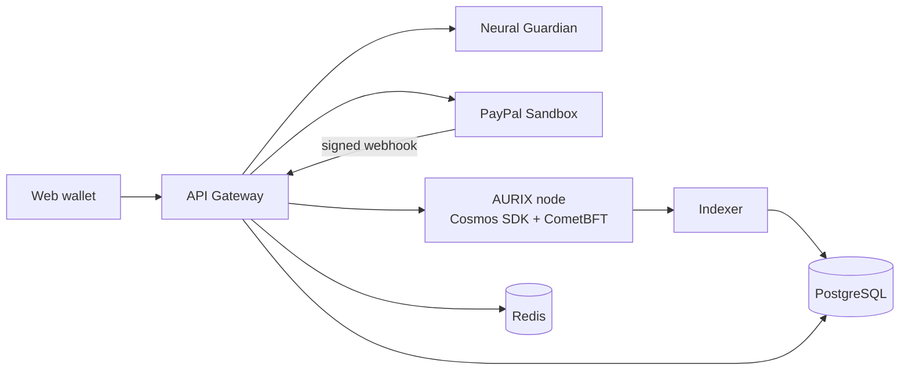

# AURIX — Independent Intelligent Monetary Protocol

> **Programmable Value, Verifiable Trust.**
> Project submitted to the **PayPal AI Hackathon 2026** — V1 testnet.

AURIX is a testnet monetary protocol where an AI assesses a payment **before** it is confirmed, where payment conditions are enforced by the protocol (escrow), and where **PayPal Sandbox** acts as a bridge to the real economy without ever replacing the native currency **AUR**.

**Core principle: the AI advises, the protocol decides, the human approves.**

---

## Table of contents

- [V1 features](#v1-features)
- [Architecture](#architecture)
- [Tech stack](#tech-stack)
- [Repository layout](#repository-layout)
- [Quick start](#quick-start)
- [Implementation status](#implementation-status)
- [Way of working: Scrum](#way-of-working-scrum)
- [Documentation](#documentation)
- [Security](#security)
- [Limitations and scope](#limitations-and-scope)

---

## V1 features

| Module | Description |
| --- | --- |
| **AURIX Wallet & Transfer** | Create a demo wallet, check the balance, send/receive AUR (CometBFT consensus) |
| **Smart Money** | Finite-state escrow: lock, release on condition, refund at deadline |
| **Neural Guardian** | Advisory risk score with explained reasons (SHAP) before confirmation |
| **PayPal connector** | USD payment in Sandbox (Orders API), signed and idempotent webhook, tracking proof anchored on AURIX |

## Architecture

Four layers; the core depends on no upper layer:

| Layer | Content | Authority |
| --- | --- | --- |
| 4. External connectivity | PayPal Sandbox | None over AUR balances |
| 3. Intelligence | Neural Guardian | Advisory only |
| 2. Programmable Money | `x/smartmoney` (escrow) | Deterministic execution |
| 1. Monetary protocol | AUR, CometBFT, `x/aurixbank` | Source of truth for balances |



Full details: [`docs/architecture/services.md`](docs/architecture/services.md).

## Tech stack

| Need | Technology |
| --- | --- |
| Consensus | CometBFT (PoS + BFT) |
| Blockchain core | Go state machine (V1), Cosmos SDK + CometBFT as target |
| Gateway | FastAPI *(Spring Boot in the original target)* |
| AI | Python, FastAPI, LightGBM + SHAP (PyTorch Geometric on the roadmap) |
| Data | SQLite (V1 index), PostgreSQL + Redis planned |
| Front end | Web wallet + explorer, AG Grid |
| API | OpenAPI (APIMatic) |
| Deployment | Docker Compose, Render (Kubernetes as target) |

## Repository layout

```
aurix/
├── chain/        # AURIX node (Go): aurixbank + smartmoney state machine
├── gateway/      # API Gateway / orchestration
├── guardian/     # Neural Guardian (FastAPI)
├── web/          # Wallet, explorer, AG Grid
├── api/          # openapi.json (generated)
├── deploy/       # docker-compose.yml, render.yaml
├── docs/         # Documentation (Scrum, modelling, diagrams)
├── tests/e2e/    # Playwright demo journey
└── .env.example
```

## Quick start

### With Docker Compose

```bash
docker compose -f deploy/docker-compose.yml up --build
```

Then open http://localhost:8080. Without PayPal credentials the gateway runs in an **offline mock mode** (clearly labelled in the UI). To use the real PayPal Sandbox, copy `.env.example` to `.env` and fill `PAYPAL_CLIENT_ID`, `PAYPAL_CLIENT_SECRET` and `PAYPAL_WEBHOOK_ID` (never commit it).

### Without Docker

Run the commands below from the repository root, each in its own terminal.

```bash
cd chain && go run ./cmd/aurixd
```

```bash
cd guardian && python -m venv .venv && .venv/bin/pip install -r requirements.txt && .venv/bin/uvicorn app.main:app --port 8000
```

```bash
cd gateway && python -m venv .venv && .venv/bin/pip install -r requirements.txt && .venv/bin/uvicorn app.main:app --port 8080
```

### Tests

```bash
cd chain && go test ./...
```

```bash
cd guardian && .venv/bin/python -m pytest -q
```

```bash
cd gateway && .venv/bin/python -m pytest -q
```

The gateway tests build and start a real `aurixd` node. The browser journey (wallet → send → escrow → PayPal → explorer) runs with Playwright against a running stack:

```bash
node tests/e2e/demo-journey.js
```

## Implementation status

| Component | Status | Notes |
| --- | --- | --- |
| `chain/` | ✅ V1 | Go state machine implementing `x/aurixbank` and `x/smartmoney` messages and invariants 1–5, single validator, in-memory state. Porting to Cosmos SDK modules is the next step. |
| `guardian/` | ✅ V1 | FastAPI + LightGBM, SHAP reasons via native TreeSHAP. **Trained on a synthetic dataset** generated in `guardian/app/model.py`. |
| `gateway/` | ✅ V1 | FastAPI (variant recommended in the architecture doc). PayPal Orders v2, webhook signature verification, idempotency, proof anchoring. SQLite index (PostgreSQL planned). |
| `web/` | ✅ V1 | Keys generated and signed in the browser. AG Grid explorer. |
| `api/openapi.json` | ✅ | Generated from the gateway (`create_app().openapi()`). |
| `deploy/` | ⚠️ | Compose and Render blueprint written; images not yet built in CI. |

## Way of working: Scrum

The project runs on **Scrum with one-day sprints** (November 7–12, 2026):

| Sprint | Date | Goal |
| --- | --- | --- |
| S0 | Nov 7 | Scope freeze, backlog, environment |
| S1 | Nov 8 | Payments: PayPal Orders + AUR transfer |
| S2 | Nov 9 | Smart Money + Neural Guardian |
| S3 | Nov 10 | UI: wallet, explorer, AG Grid |
| S4 | Nov 11 | Stabilisation, README, video |
| S5 | Nov 12 | Devpost submission |

Backlog, user stories, Definition of Done and ceremonies: [`docs/scrum/`](docs/scrum/README.md).

## Documentation

| Document | Content |
| --- | --- |
| [docs/README.md](docs/README.md) | Documentation index |
| [docs/scrum/README.md](docs/scrum/README.md) | Scrum setup, roles, ceremonies, DoR/DoD |
| [docs/scrum/product-backlog.md](docs/scrum/product-backlog.md) | Epics, user stories, priorities, estimates |
| [docs/scrum/sprints.md](docs/scrum/sprints.md) | Detailed sprint plan and burndown |
| [docs/architecture/services.md](docs/architecture/services.md) | Service modelling |
| [docs/architecture/diagrams.md](docs/architecture/diagrams.md) | Use cases, sequences, states, classes, ER, deployment |
| [AURIX_SOFTWARE_ARCHITECTURE.md](AURIX_SOFTWARE_ARCHITECTURE.md) | Reference software architecture ([French original](AURIX_ARCHITECTURE_LOGICIELLE.md)) |
| [AURIX_hackathon_brief.md](AURIX_hackathon_brief.md) | Hackathon pitch file ([French original](AURIX_dossier_hackathon.md)) |

## Security

1. The on-chain ledger is the **single source of truth** for AUR balances.
2. The AI can neither validate, invalidate nor modify a transaction.
3. USD funds (PayPal) never become AUR: only a **proof (hash)** is anchored.
4. PayPal webhooks are signature-verified and idempotent.
5. No secrets or private keys in the repository.

## Limitations and scope

- Demonstration testnet: **AUR has no real monetary value**.
- A single-validator testnet is not multi-operator.
- Roadmap: multiple validators, additional regulated gateways, GNN, Kubernetes.
