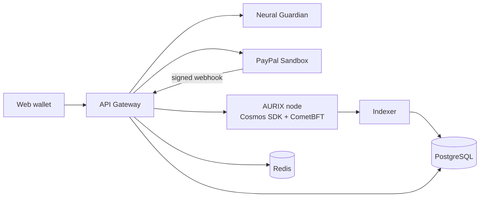

# AURIX — Independent Intelligent Monetary Protocol

> **Programmable Value, Verifiable Trust.**
> Project submitted to the **PayPal AI Hackathon 2026** — V1 testnet.

AURIX is a testnet monetary protocol where an AI assesses a payment **before** it is confirmed, where payment conditions are enforced by the protocol (escrow), and where **PayPal Sandbox** acts as a bridge to the real economy without ever replacing the native currency **AUR**.

**Core principle: the AI advises, the protocol decides, the human approves.**

---

## Table of contents

- [V1 features](#v1-features)
- [Architecture](#architecture)
- [Tech stack](#tech-stack)
- [Repository layout](#repository-layout)
- [Quick start](#quick-start)
- [Way of working: Scrum](#way-of-working-scrum)
- [Documentation](#documentation)
- [Security](#security)
- [Limitations and scope](#limitations-and-scope)

---

## V1 features

| Module | Description |
| --- | --- |
| **AURIX Wallet & Transfer** | Create a demo wallet, check the balance, send/receive AUR (CometBFT consensus) |
| **Smart Money** | Finite-state escrow: lock, release on condition, refund at deadline |
| **Neural Guardian** | Advisory risk score with explained reasons (SHAP) before confirmation |
| **PayPal connector** | USD payment in Sandbox (Orders API), signed and idempotent webhook, tracking proof anchored on AURIX |

## Architecture

Four layers; the core depends on no upper layer:

| Layer | Content | Authority |
| --- | --- | --- |
| 4. External connectivity | PayPal Sandbox | None over AUR balances |
| 3. Intelligence | Neural Guardian | Advisory only |
| 2. Programmable Money | `x/smartmoney` (escrow) | Deterministic execution |
| 1. Monetary protocol | AUR, CometBFT, `x/aurixbank` | Source of truth for balances |



Full details: [`docs/architecture/services.md`](docs/architecture/services.md).

## Tech stack

| Need | Technology |
| --- | --- |
| Consensus | CometBFT (PoS + BFT) |
| Blockchain core | Cosmos SDK + Go |
| Gateway | Java 21 + Spring Boot *(alternative: FastAPI)* |
| AI | Python, FastAPI, LightGBM + SHAP (PyTorch Geometric on the roadmap) |
| Data | PostgreSQL (index), Redis (cache) |
| Front end | Web wallet + explorer, AG Grid |
| API | OpenAPI (APIMatic) |
| Deployment | Docker Compose, Render (Kubernetes as target) |

## Repository layout

```
aurix/
├── chain/        # Cosmos SDK node (x/aurixbank, x/smartmoney)
├── gateway/      # API Gateway / orchestration
├── guardian/     # Neural Guardian (FastAPI)
├── indexer/      # Blocks -> PostgreSQL
├── web/          # Wallet, explorer, AG Grid
├── api/          # openapi.yaml
├── deploy/       # docker-compose.yml, render.yaml
├── docs/         # Documentation (Scrum, modelling, diagrams)
└── .env.example
```

## Quick start

> Services are under development; these are the target commands.

```bash
cp .env.example .env
```

```bash
docker compose -f deploy/docker-compose.yml up --build
```

Required variables (never committed): `PAYPAL_CLIENT_ID`, `PAYPAL_CLIENT_SECRET`, `PAYPAL_WEBHOOK_ID`, `PAYPAL_BASE_URL`, `CHAIN_RPC_URL`, `GUARDIAN_URL`, `DATABASE_URL`, `REDIS_URL`.

## Way of working: Scrum

The project runs on **Scrum with one-day sprints** (November 7–12, 2026):

| Sprint | Date | Goal |
| --- | --- | --- |
| S0 | Nov 7 | Scope freeze, backlog, environment |
| S1 | Nov 8 | Payments: PayPal Orders + AUR transfer |
| S2 | Nov 9 | Smart Money + Neural Guardian |
| S3 | Nov 10 | UI: wallet, explorer, AG Grid |
| S4 | Nov 11 | Stabilisation, README, video |
| S5 | Nov 12 | Devpost submission |

Backlog, user stories, Definition of Done and ceremonies: [`docs/scrum/`](docs/scrum/README.md).

## Documentation

| Document | Content |
| --- | --- |
| [docs/README.md](docs/README.md) | Documentation index |
| [docs/scrum/README.md](docs/scrum/README.md) | Scrum setup, roles, ceremonies, DoR/DoD |
| [docs/scrum/product-backlog.md](docs/scrum/product-backlog.md) | Epics, user stories, priorities, estimates |
| [docs/scrum/sprints.md](docs/scrum/sprints.md) | Detailed sprint plan and burndown |
| [docs/architecture/services.md](docs/architecture/services.md) | Service modelling |
| [docs/architecture/diagrams.md](docs/architecture/diagrams.md) | Use cases, sequences, states, classes, ER, deployment |
| [AURIX_ARCHITECTURE_LOGICIELLE.md](AURIX_ARCHITECTURE_LOGICIELLE.md) | Reference software architecture (French) |
| [AURIX_dossier_hackathon.md](AURIX_dossier_hackathon.md) | Hackathon pitch file (French) |

## Security

1. The on-chain ledger is the **single source of truth** for AUR balances.
2. The AI can neither validate, invalidate nor modify a transaction.
3. USD funds (PayPal) never become AUR: only a **proof (hash)** is anchored.
4. PayPal webhooks are signature-verified and idempotent.
5. No secrets or private keys in the repository.

## Limitations and scope

- Demonstration testnet: **AUR has no real monetary value**.
- A single-validator testnet is not multi-operator.
- Roadmap: multiple validators, additional regulated gateways, GNN, Kubernetes.
