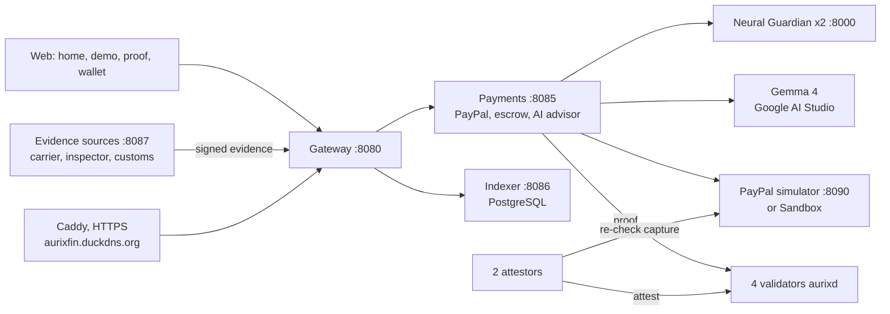

# AURIX — Programmable Value, Verifiable Trust

> Project for the **PayPal AI Hackathon 2026** · testnet (AUR has no monetary value).
> Public URL: **https://aurixfin.duckdns.org** · guided demo: [`/demo.html`](https://aurixfin.duckdns.org/demo.html) · proof check: [`/proof.html`](https://aurixfin.duckdns.org/proof.html)
> During the evaluation, try this URL first; the online deployment is being finalised (until December 1, 2026).
> If it does not answer, run the demo locally in one command (see [Quick start](#quick-start-docker-compose)).

AURIX is a trust layer on top of PayPal. A buyer describes a purchase in plain words, **an AI drafts the payment
condition**, the buyer approves it, **PayPal holds the dollars**, and **signed evidence** (carrier, inspector, customs)
decides whether they are captured or released. Every decision comes with a proof package that anyone can re-verify
offline. AURIX never holds the money.

**The AI advises, the rule decides, the human approves.**

---

## What you can try

| Page | What it shows |
| --- | --- |
| **Home** (`/`) | What AURIX does, in English or French |
| **Demo** (`/demo.html`) | 5 guided steps: describe the purchase → the AI (Gemma 4) drafts the condition and the transaction workflow → the buyer pays on PayPal → signed evidence arrives (a forged one is refused) → decision and AI explanation |
| **Proof** (`/proof.html`) | Verify a proof package in the browser (VALID), change one digit (INVALID), ask the AI to explain it for an auditor |
| Full wallet (`/app.html`) | AUR wallet, send, escrow, PayPal, explorer, settings (not linked from the demo) |

Every page has an **EN / FR** switch; the AI answers in the chosen language.

## Features

| Module | Description |
| --- | --- |
| **AI-drafted conditions** | `POST /api/escrow/propose`: Gemma 4 turns a description into a condition (`all` / `any` / `at_least` over signed evidence, time limits, buyer dispute window). The output is strictly validated; the summary and the workflow diagram are computed from the condition itself, never from model text |
| **Conditional USD payment** | PayPal authorizes (holds) the funds; AURIX captures only when the signed evidence meets the rule before the deadline, otherwise voids. Optional arbiter and buyer dispute |
| **Verifiable proofs** | Signed proof package; `aurix-verify` (CLI) and the browser verifier replay the decision; 2-of-n independent attestors confirm each PayPal capture before it is anchored on chain |
| **Neural Guardian** | Advisory risk score with SHAP reasons, signed by 2 guardians (quorum); never blocks a payment |
| **AUR wallet & Smart Money** | Native AUR transfers and on-chain escrow on a 4-validator Cosmos SDK / CometBFT chain |

## Architecture

| Layer | Content | Authority |
| --- | --- | --- |
| 4. External | PayPal (simulator or Sandbox), evidence sources | None over AUR balances |
| 3. Intelligence | Neural Guardian, AI advisor (Gemma 4) | Advisory only |
| 2. Programmable money | Decision rules `delivery-attested/1`, `conditions/1`; `x/smartmoney` | Deterministic |
| 1. Monetary protocol | AUR, CometBFT, `x/aurixbank` | Source of truth for balances |



Details: [`docs/architecture/services.md`](docs/architecture/services.md), evidence escrow and `conditions/1`:
[`docs/architecture/evidence-escrow.md`](docs/architecture/evidence-escrow.md).

## Quick start (Docker Compose)

```bash
docker compose -f deploy/docker-compose.yml up -d --build
```

Open http://localhost:8080 once every service is `healthy` (`docker compose -f deploy/docker-compose.yml ps`, 1 to 2 minutes).

Configuration lives in `deploy/.env` (git-ignored, never commit it):

| Variable | Purpose |
| --- | --- |
| `PAYPAL_ENV`, `PAYPAL_BASE_URL`, `PAYPAL_CLIENT_ID`, `PAYPAL_CLIENT_SECRET`, `PAYPAL_WEBHOOK_ID` | Default: the local PayPal simulator (works offline). For the real Sandbox: `sandbox`, `https://api-m.sandbox.paypal.com`, your app credentials and webhook id |
| `ADVISOR_LLM_URL`, `ADVISOR_LLM_MODEL`, `ADVISOR_LLM_API_KEY`, `ADVISOR_LLM_TIMEOUT` | AI advisor. Google AI Studio: `https://generativelanguage.googleapis.com/v1beta/openai`, `gemma-4-26b-a4b-it`, timeout `150`. Empty URL: a deterministic template, labelled as such |
| `DUCKDNS_TOKEN`, `AURIX_DOMAIN` | Public HTTPS (below) |

### Public HTTPS (aurixfin.duckdns.org)

The optional `https` profile adds a Let's Encrypt certificate (proved through the DuckDNS DNS challenge, no open
port needed) and a Caddy reverse proxy:

```bash
docker compose -f deploy/docker-compose.yml --profile https run --rm certs        # get the certificate
docker compose -f deploy/docker-compose.yml --profile https up -d https           # serve https://aurixfin.duckdns.org
docker compose -f deploy/docker-compose.yml --profile https run --rm certs renew  # renew (every 60-90 days)
```

Visitors also need the router to forward ports 80 and 443 to the host, and the host firewall to allow them.

## Tests

| Suite | Command |
| --- | --- |
| Chain | `cd chain && go test ./...` |
| Python services | `python -m pytest -q` in `verifier/`, `payments/`, `gateway/`, `attestor/`, `guardian/`, `indexer/`, `paypal-sim/`, `delivery-sim/` |
| Everything + browser journeys | `scripts/test-all.sh` (Linux) |

`verifier/tests/test_js_parity.py` checks that the browser verifier gives the same verdicts as `aurix-verify`,
including for `conditions/1`. The gateway and indexer suites start a real `aurixd` node and PostgreSQL (Linux, Go, `jq`).

## Status

| Component | Status |
| --- | --- |
| Chain (4 validators, BFT: keeps producing with 1 node down), Smart Money, k-of-n anchoring | ✅ |
| Neural Guardian (logistic regression, PaySim, test PR-AUC 0.973; [model card](guardian/MODEL_CARD.md)) | ✅ |
| Conditional USD payment, `conditions/1`, AI-drafted conditions, offline / browser verifier | ✅ |
| AI advisor with Gemma 4 (Google AI Studio) | ✅ tested live; 30 to 100 s per answer |
| Guided demo, proof page, EN / FR | ✅ |
| PayPal | ✅ simulator end to end · ⚠️ Sandbox: orders created, full capture + signed webhook not yet validated end to end |
| Public HTTPS on aurixfin.duckdns.org | 🚧 certificate obtained; deployment being finalised (until December 1, 2026) |
| Demo video | 📝 script: [`docs/submission/demo-script.md`](docs/submission/demo-script.md) |
| Research contributions | C1 (deterministic execution / k-of-n attestation / advisory AI) demonstrated; C2 threat-model analysis and C3 ablation study not done yet |

## Recent changes

- **AI-drafted conditions** (rule `conditions/1`), buyer dispute window, inspector and customs evidence sources.
- **New web experience**: landing page, guided 5-step demo, proof page, transaction workflow diagram, EN / FR.
- **Gemma 4** via Google AI Studio (JSON mode and reasoning blocks handled), up to 3-minute AI waits with a live counter.
- **Resilience to unstable networks**: failed PayPal / AI / attestor connections are retried (a request already
  sent never is), longer PayPal timeouts, errors name the unreachable host, fonts never block rendering.
- **Public HTTPS** profile (Let's Encrypt via DuckDNS + Caddy) for `aurixfin.duckdns.org`.
- `.gitattributes` keeps shell scripts in LF so the stack starts on Windows checkouts.

## Security

1. The chain is the only source of truth for AUR balances; PayPal dollars never become AUR, only a proof hash is anchored.
2. The AI (Neural Guardian, Gemma 4) can neither approve, block nor change a payment; a drafted condition applies only
   once the buyer approves it.
3. Each evidence source signs with its own key and may only attest its own kind of event; forged evidence is refused.
4. A PayPal proof is confirmed only when 2 independent attestors have re-checked the capture at PayPal.
5. Webhooks are signature-verified and idempotent; secrets live in `deploy/.env`, never in the repository.

## Limitations

- Testnet only: **AUR has no monetary value**; PayPal runs as a simulator (or Sandbox).
- The 4 validators run on one machine, operated by one team: real BFT, not yet independent operators.
- The demo evidence sources (carrier, inspector, customs) are simulated; a valid signature proves who signed, not
  that goods physically arrived.
- When the site is public, anyone can use the testnet faucet and demo arbiter.

## Documentation

| Document | Content |
| --- | --- |
| [docs/architecture/evidence-escrow.md](docs/architecture/evidence-escrow.md) | Conditional USD payment, rules, `conditions/1` |
| [docs/architecture/services.md](docs/architecture/services.md) | Services and data flows |
| [docs/submission/devpost.md](docs/submission/devpost.md), [demo-script.md](docs/submission/demo-script.md) | Submission and video script |
| [docs/scrum/](docs/scrum/README.md) | Backlog and sprints |
| [AURIX_SOFTWARE_ARCHITECTURE.md](AURIX_SOFTWARE_ARCHITECTURE.md) | Reference software architecture |
| [deploy/RENDER.md](deploy/RENDER.md) | Step-by-step deployment on Render |
| [deploy/README.md](deploy/README.md) | Deployment and healthchecks |

## License

Licensed under the [Apache License, Version 2.0](LICENSE).
