# Diagrams (as built — MVP)

Dashed boxes = **planned, not built**. "PayPal" below is the local **PayPal simulator** (`paypal-sim/`) until Sandbox credentials are added; the gateway code path is identical for both.

## 1. Context diagram (C4 level 1)

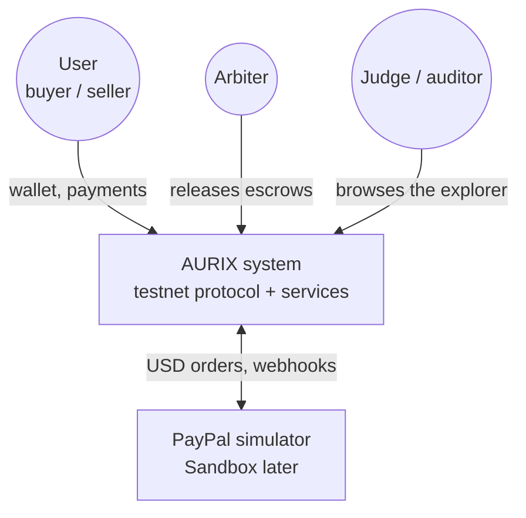

## 2. Container diagram (C4 level 2)

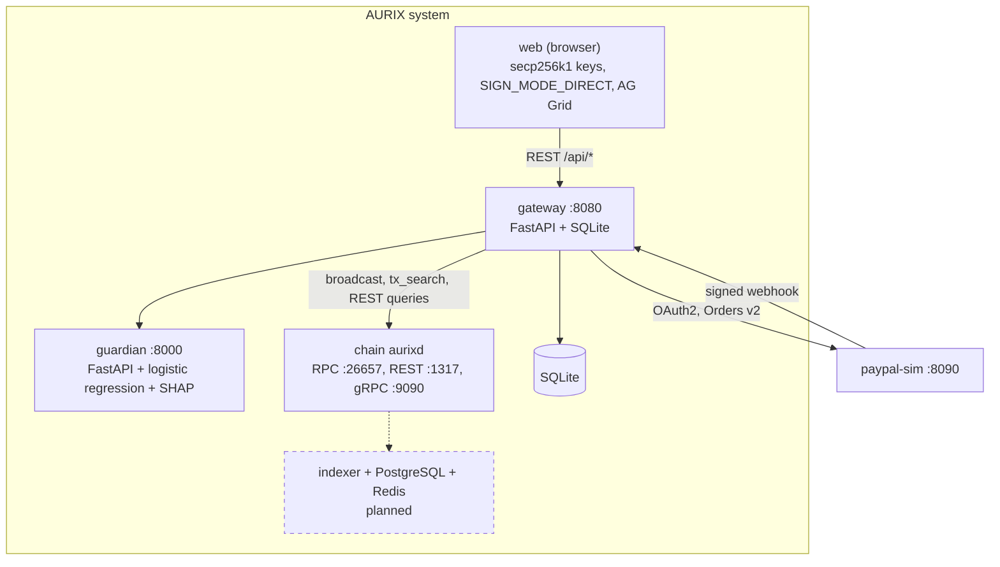

## 3. Use cases

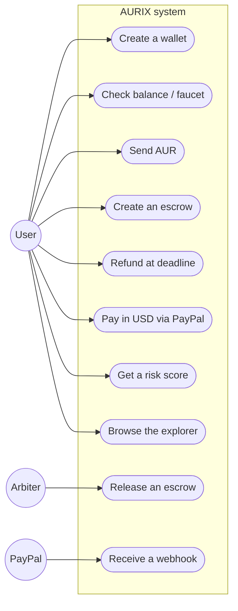

## 4. Sequence — AUR transfer (browser-side signing)

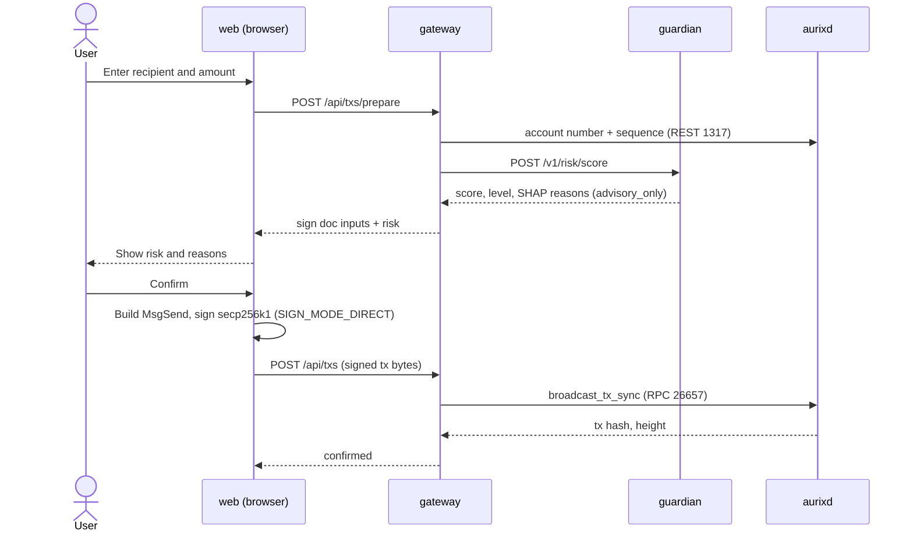

## 5. Sequence — PayPal payment + proof

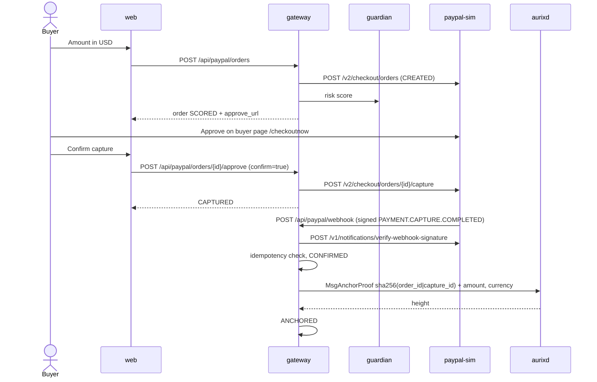

## 6. Sequence — Smart Money

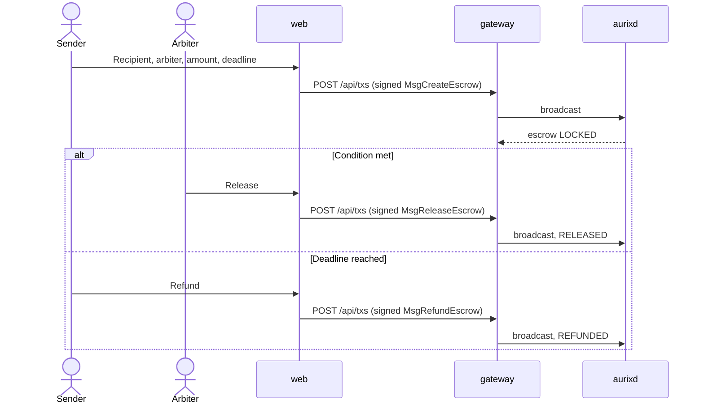

## 7. State diagrams

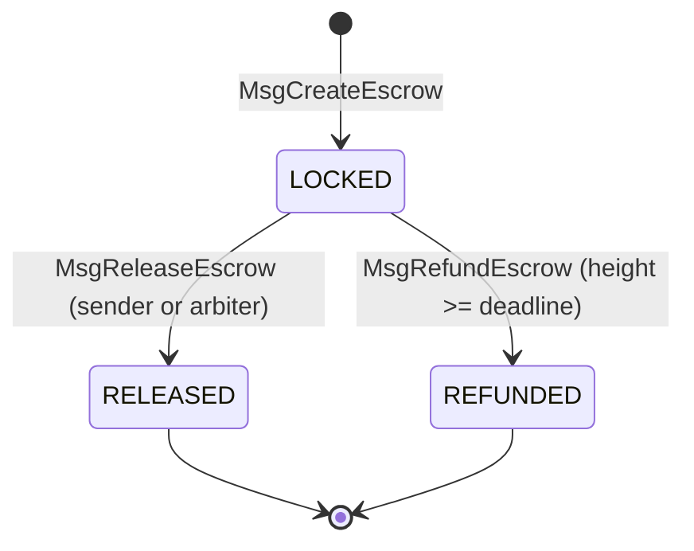

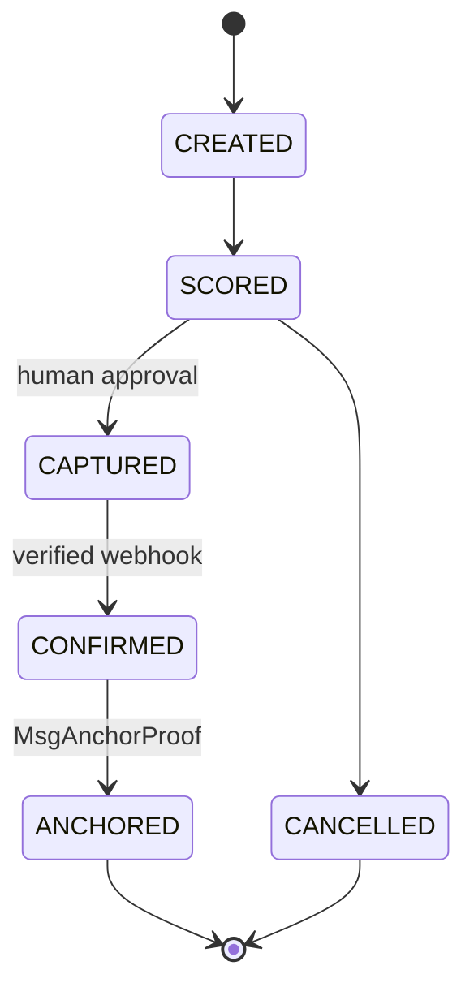

## 8. Class diagram — gateway

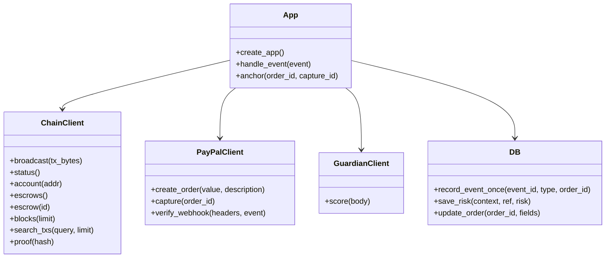

## 9. Trust boundaries

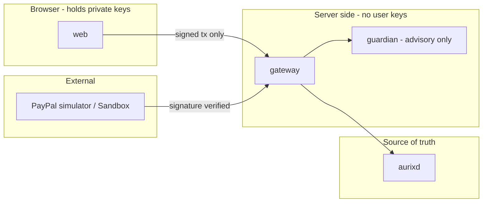

## 10. Deployment

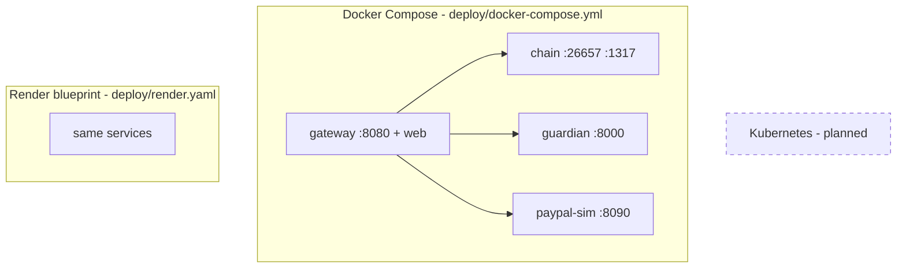

See [`deploy/README.md`](../../deploy/README.md) for healthchecks and the Render setup.
