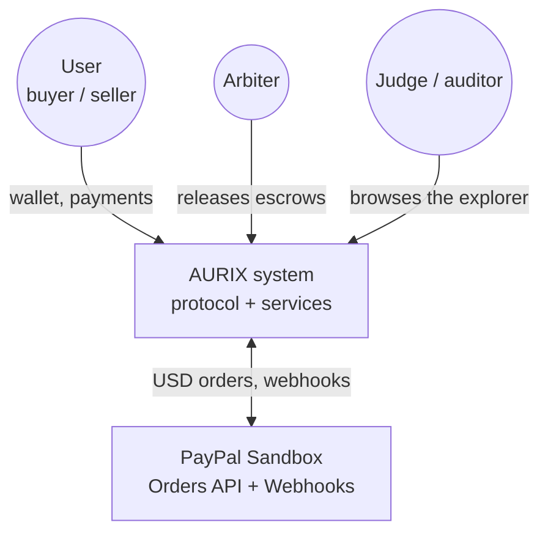
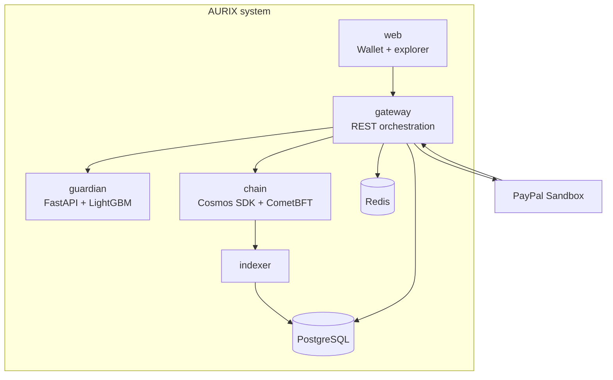
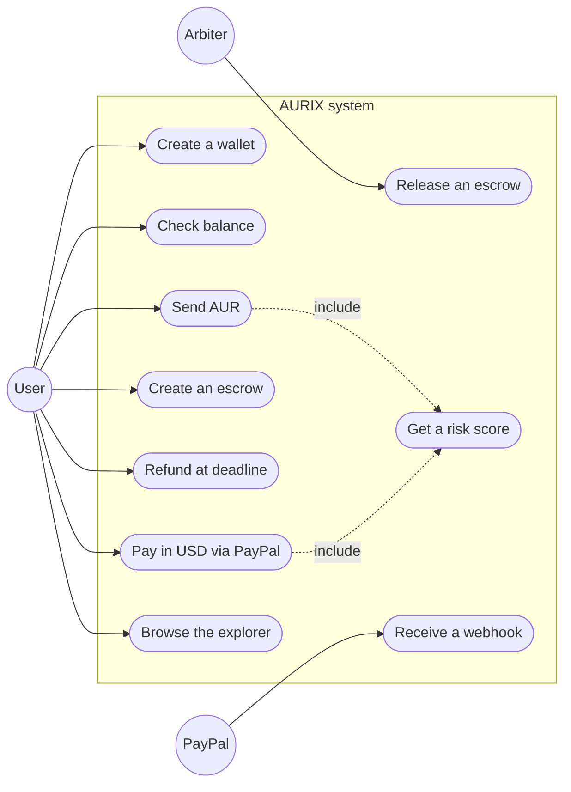
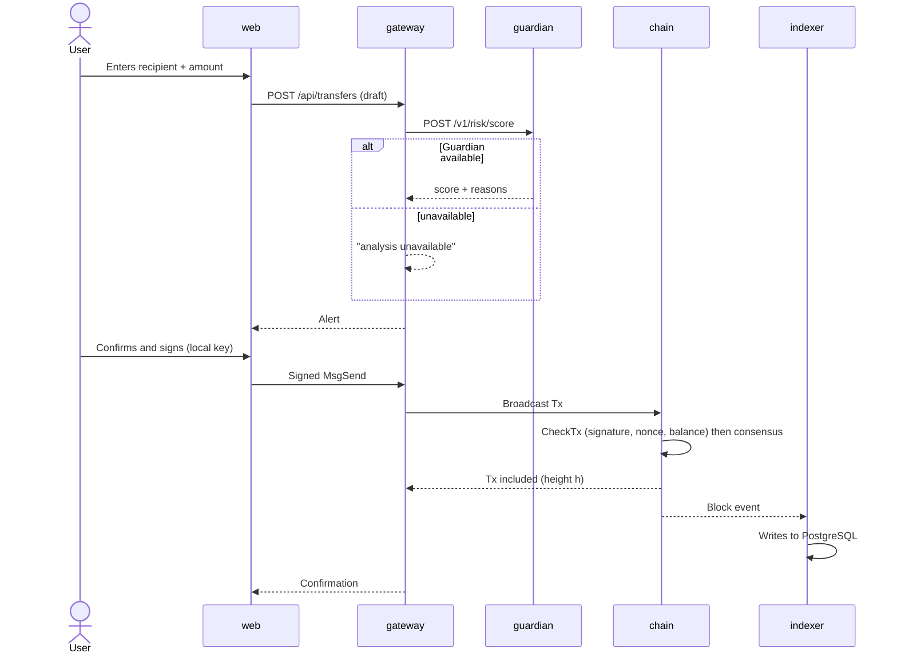
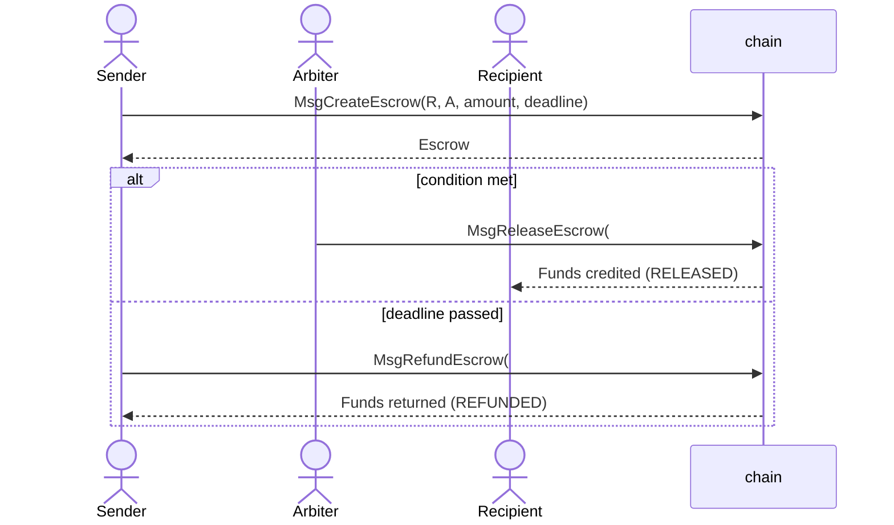
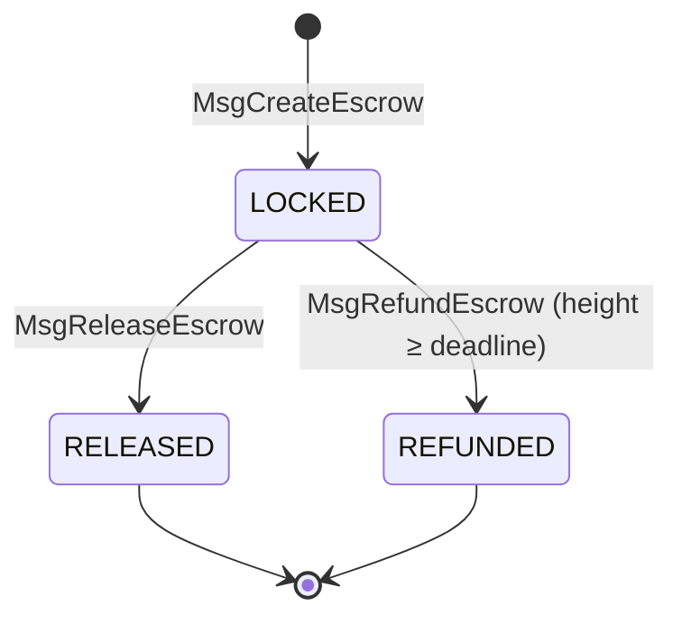
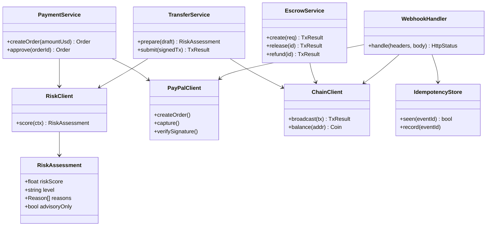
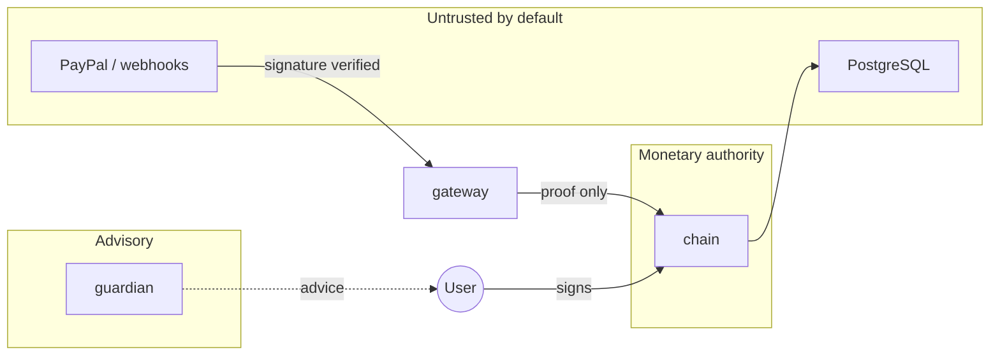
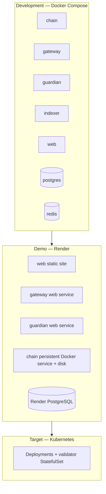

# Diagrams

## 1. Context diagram (C4 level 1)

## 2. Container diagram (C4 level 2)

## 3. Use cases

## 4. Sequence — AUR transfer

## 5. Sequence — PayPal payment + proof

## 6. Sequence — Smart Money

## 7. State diagrams

Escrow:

PayPal order: see [services.md](services.md#paypal-order-lifecycle).

## 8. Class diagram — gateway

## 9. Trust boundaries

## 10. Deployment

