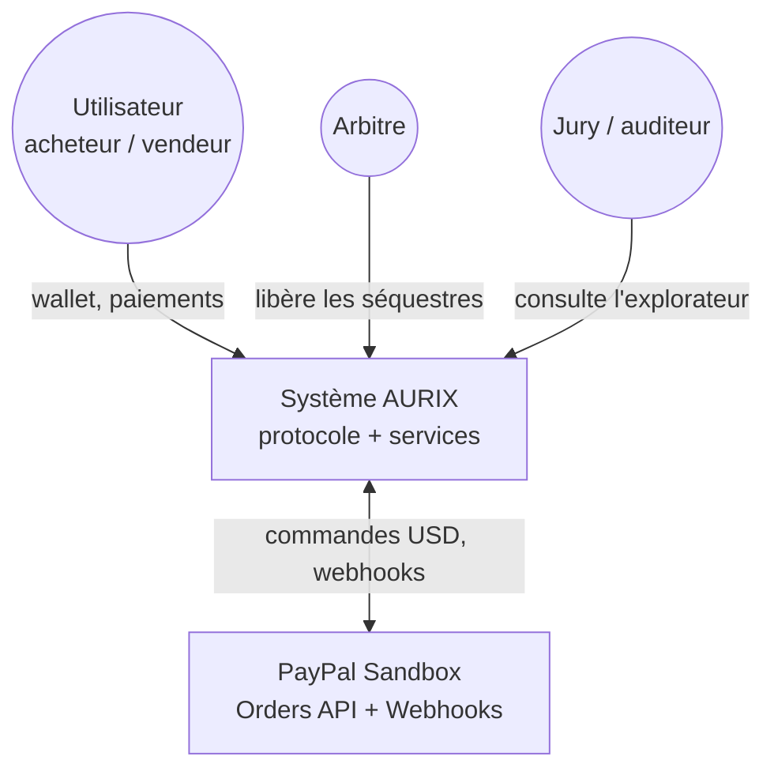
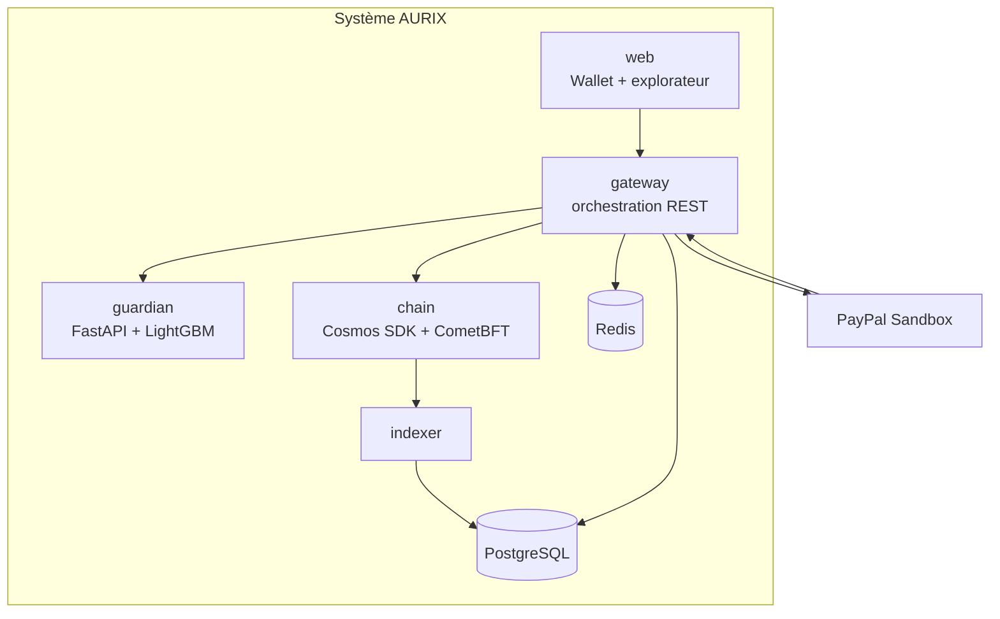
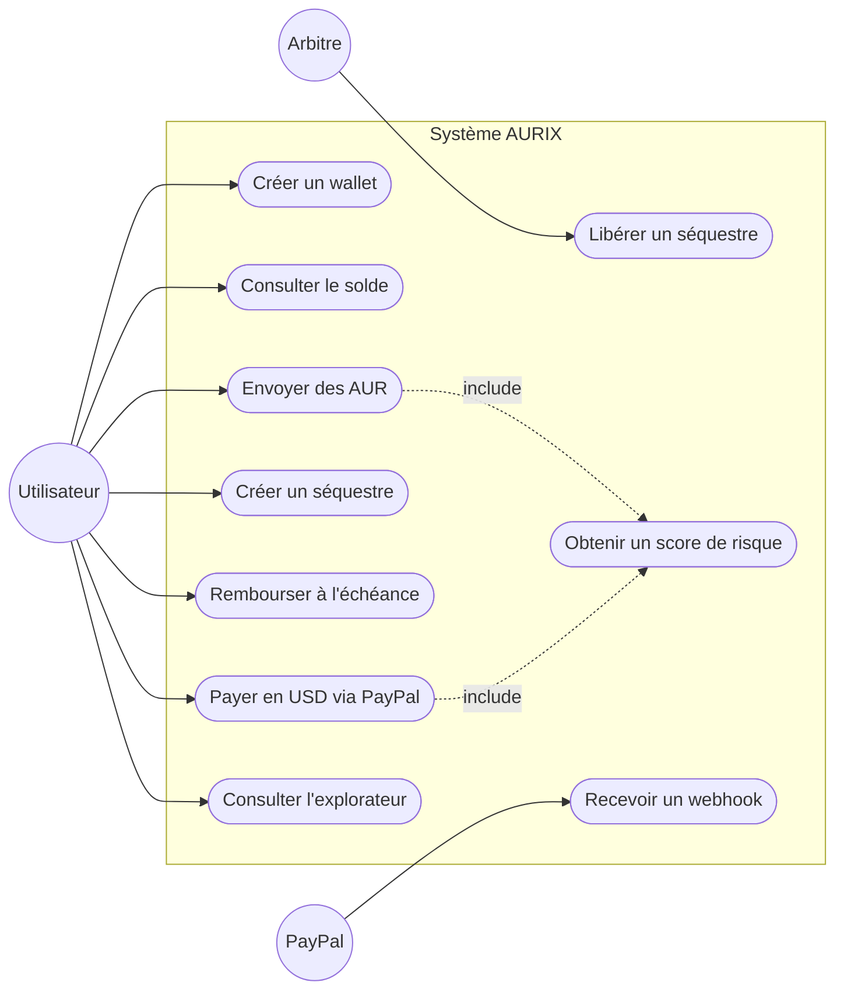
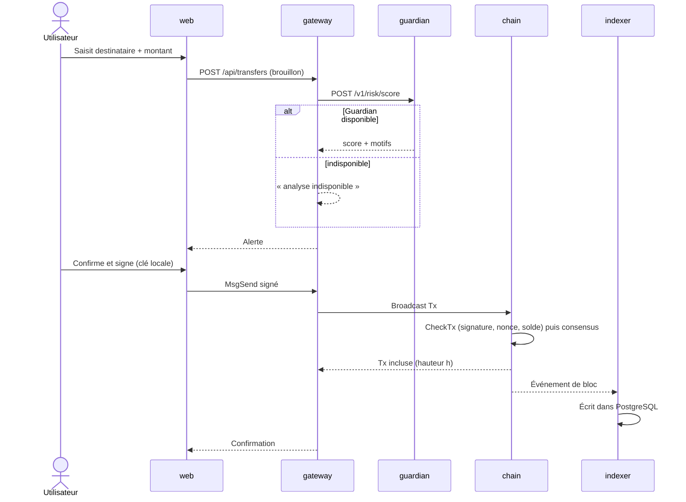
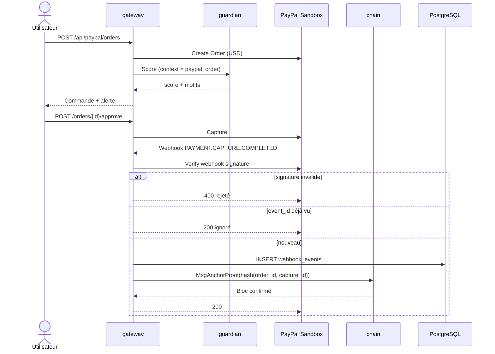
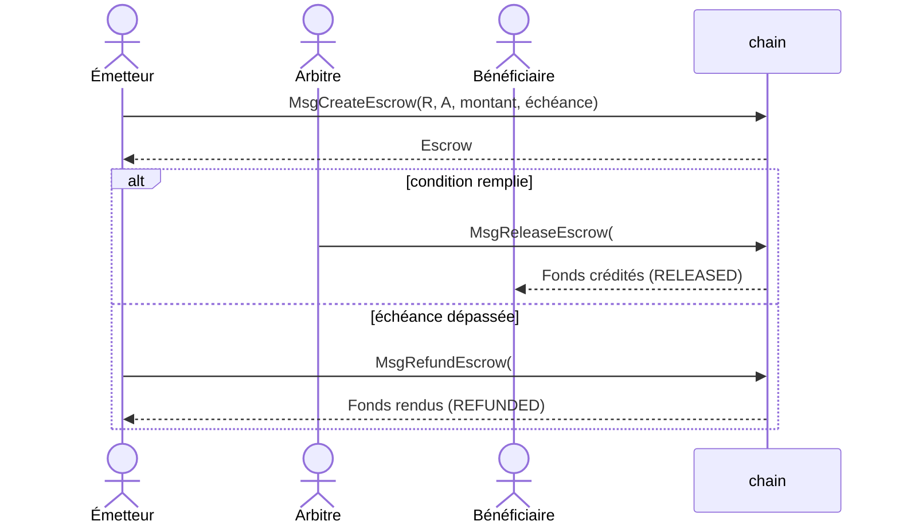
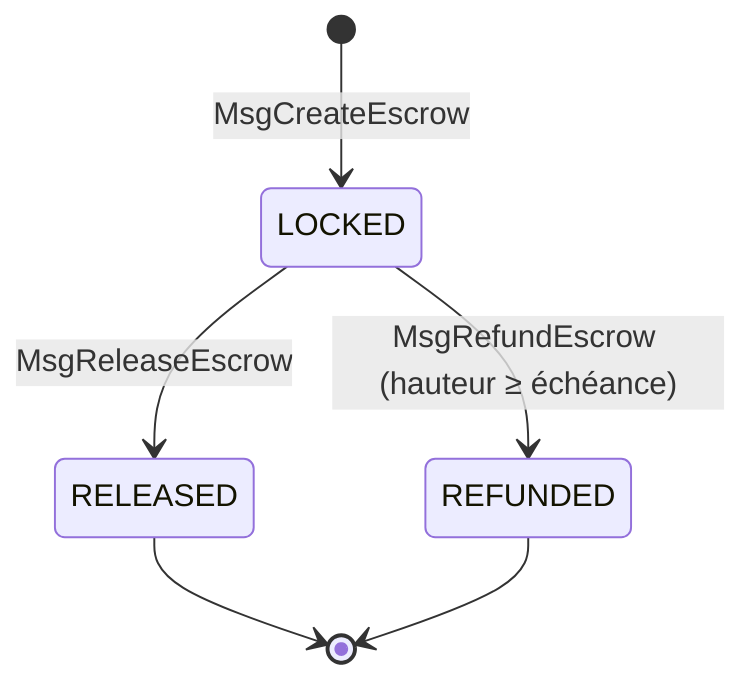
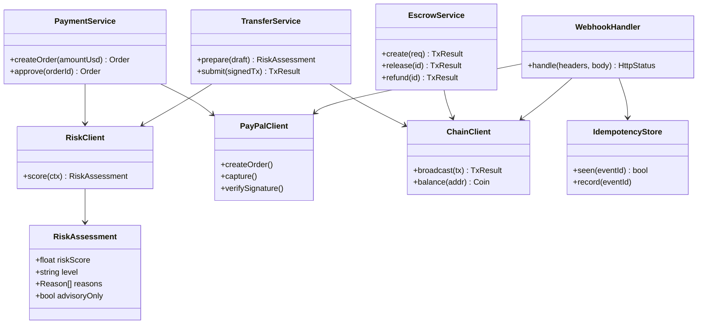
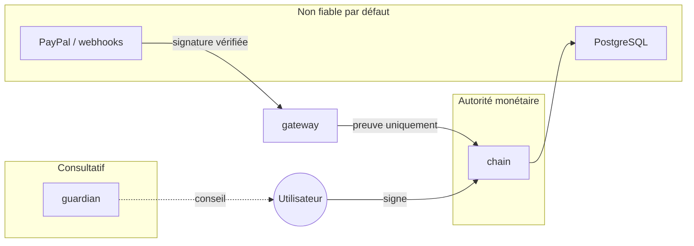
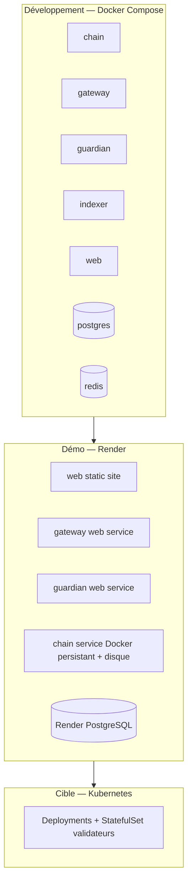

# Diagrammes

## 1. Diagramme de contexte (C4 niveau 1)

## 2. Diagramme de conteneurs (C4 niveau 2)

## 3. Cas d'utilisation

## 4. Séquence — transfert AUR

## 5. Séquence — paiement PayPal + preuve

## 6. Séquence — Smart Money

## 7. Diagrammes d'états

Séquestre :

Commande PayPal : voir [services.md](services.md#cycle-de-vie-dune-commande-paypal).

## 8. Diagramme de classes — gateway

## 9. Frontières de confiance

## 10. Déploiement

