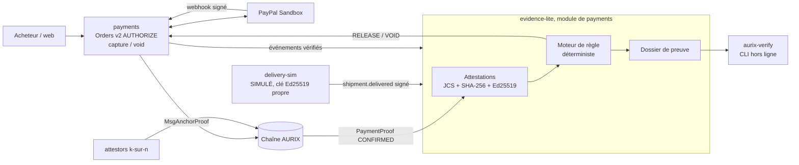

# AURIX MVP 0.2 — Escrow à preuves (Evidence-Released USD Escrow)

**Statut :** implémenté sur la branche `MVP_0.1` et revu (revue complète du 2026-11-08, constats corrigés). Testé de bout en bout avec le simulateur PayPal et la vraie chaîne. Reste : validation sur la PayPal Sandbox réelle, test avec un vrai modèle Gemma 4, déploiement Render.
**Date :** 2026-11-08
**Position :** version intermédiaire entre le MVP 0.1 (hackathon) et le MVP 0.3 complète
([`mscfa.md`](mscfa.md) : MSCFA complet + escrow USD on-chain, §14 bis).

---

## 1. L'idée en une phrase

**Un paiement PayPal en USD est autorisé, puis encaissé automatiquement seulement quand des preuves
signées par des sources indépendantes confirment que la condition est remplie. Sinon, il est annulé à
la date limite. Le tout est livré sous forme de dossier de preuve qu'un tiers peut revérifier hors ligne.**

L'escrow USD apporte la valeur métier (des dollars, pas des AUR). Le MSCFA apporte ce qui déclenche la
libération et ce qui la rend vérifiable (des attestations signées, reliées et exportables). Ensemble :
**PayPal garde l'argent, les preuves décident, n'importe qui peut vérifier la décision.**

## 2. Ce que PayPal n'offre pas aujourd'hui

| Besoin | PayPal aujourd'hui | Escrow à preuves |
| --- | --- | --- |
| Encaisser seulement si la livraison est confirmée | Autorisation puis capture **manuelle** par le marchand ; protection acheteur **après coup** (litige) | Capture **déclenchée par une attestation signée** du transporteur |
| Annuler automatiquement si rien ne se passe | L'autorisation expire ; aucune règle métier | Annulation (void) à la date limite fixée par l'acheteur |
| Montrer à un tiers pourquoi le paiement a été encaissé | Historique privé du compte | Dossier de preuve exporté, règle de décision **rejouable** hors ligne |

## 3. Scénario de démonstration

Un acheteur commande un article à 120 USD, livraison sous 7 jours.

1. **Commande conditionnelle** : l'acheteur choisit la condition « livraison attestée par le transporteur »,
   une date limite (7 jours, toujours ≤ 29 jours) et, en option, un arbitre.
2. **Autorisation PayPal** (`intent = AUTHORIZE`) : l'acheteur approuve. Les 120 USD sont **bloqués** chez PayPal,
   rien n'est encaissé. Le Guardian a évalué la commande **avant** l'approbation (existant).
3. **Attestation 1, paiement autorisé** : `payments` vérifie le webhook PayPal signé (existant) ; AURIX produit
   une attestation signée Ed25519.
4. **Attestation 2, livraison** : le transporteur (simulé, marqué comme tel) envoie `shipment.delivered`
   signé avec sa propre clé, avec la référence de la commande.
5. **Décision** : le moteur de règle vérifie la signature du transporteur, la correspondance des références,
   le montant et la devise, la date limite. Décision `RELEASE`, signée.
6. **Capture PayPal** : `payments` encaisse l'autorisation. Webhook signé, puis **attestation k-sur-n** des
   attestors sur la chaîne (existant, `MsgAnchorProof`). Attestation 3.
7. **Dossier de preuve** : export `.zip` avec les 3 attestations, la décision, les clés publiques.
   `aurix-verify` le revérifie hors ligne **et rejoue la règle** : il obtient la même décision.

Variantes à montrer :
- **Pas de livraison avant la date limite** : décision `VOID`, l'autorisation est annulée, l'acheteur n'est pas débité.
- **Attestation falsifiée** (signature invalide ou montant différent) : rejetée, pas de capture, anomalie dans le dossier.
- **Litige** : l'arbitre bloque la libération avant la date limite ; décision `HOLD`, puis `RELEASE` ou `VOID` par l'arbitre,
  toujours avant la date limite. Un blocage encore en place à la date limite se termine en `VOID` : l'acheteur est
  remboursé plutôt que de laisser les fonds bloqués au-delà de l'autorisation PayPal.

Ajouts au périmètre initial, décidés pendant le développement : une échéance en minutes pour la démo
(désactivée en production) et le vérificateur dans le navigateur (`web/verify.js`, prévu en MVP 0.3, avancé).

## 4. Architecture



### Pourquoi « intermédiaire »

| | MVP 0.1 (hackathon) | **MVP 0.2 escrow à preuves** | MVP 0.3 |
| --- | --- | --- | --- |
| Escrow | AUR, sur la chaîne | **USD chez PayPal, libéré par les preuves** | USD, condition enregistrée sur la chaîne (`MsgCreateFiatEscrow`) |
| Qui décide | Émetteur / arbitre | **Règle déterministe sur preuves signées**, rejouable par le vérificateur | La chaîne (consensus BFT) |
| MSCFA | — | **Réduit** : 3 types d'attestation, 1 source externe, module dans `payments` | Service `evidence` complet, PostgreSQL, API générique, rotation de clés |
| Changement de la chaîne | — | **Aucun** (réutilise `MsgAnchorProof`) | Nouveaux messages protobuf |
| Vérificateur | Explorateur | **CLI `aurix-verify` hors ligne** | CLI + page web + révocations en ligne |

Le point clé de le MVP 0.2 : **pas besoin de modifier la chaîne pour que la décision soit vérifiable.** La règle
est déterministe et publique ; ses entrées sont signées ; le vérificateur la rejoue. Le MVP 0.3 ajoute le
consensus BFT sur la décision elle-même.

## 5. La règle de décision

Fonction pure, versionnée (`rule = "delivery-attested/1"`), partagée par `payments` et `aurix-verify` :

```text
decide(terms, evidence, now) ->
  # une preuve ne compte que si sa signature est valide, sa clé a le bon rôle, et
  # operation_id == provider_reference.order_id (si présent) == terms.order_id
  a = dernière action de l'arbitre désigné, signée et REÇUE par AURIX avant la date limite
  if a == RELEASE ou VOID                       -> a
  if a == HOLD : if now > deadline -> VOID  sinon -> HOLD
  auth = payment.authorized (clé AURIX) au montant et à la devise exacts des termes
  d = shipment.delivered du transporteur convenu (clé source:<transporteur>), avec
        event_time <= deadline, event_time <= now,
        et REÇUE par AURIX (reçu signé) <= deadline
  if auth et d                                  -> RELEASE
  if now > deadline                             -> VOID
  sinon                                         -> WAIT
```

Règles : montants en décimal (jamais de `float`) ; références comparées exactement (jamais par proximité de
montant ou de date) ; la décision et ses entrées (hash de chaque attestation) sont signées par AURIX et
ajoutées au dossier.

Pourquoi l'heure de **réception** : l'heure d'un événement est déclarée par celui qui signe et peut être
antidatée ; l'heure à laquelle AURIX a reçu la preuve est enregistrée dans un reçu signé (`receipts.json`). Une
livraison réellement survenue avant la date limite mais évaluée après (le poller passe toutes les quelques
secondes) donne `RELEASE` si AURIX l'a reçue à temps. Pour la même raison, la validité d'une clé est vérifiée à
l'heure de réception, et non à la date `created_at` choisie par le signataire.

## 6. Formats

Attestations au format `aurix.financial-attestation` v1.0 décrit dans [`mscfa.md`](mscfa.md) §6, limité à :
`payment.authorized`, `shipment.delivered`, `payment.captured`, `payment.anchored`, `payment.voided`,
`arbiter.decision`. La référence à la `PaymentProof` on-chain est portée par `payment.anchored` (source
`aurix_chain`, méthode `aurix_chain_kofn_attestation`), émise une fois la preuve confirmée par k attestors :
`payment.captured` est émis plus tôt, à la réception du webhook, quand la preuve n'existe pas encore.

Décision :

```json
{ "schema": "aurix.escrow-decision", "schema_version": "1.0",
  "order_id": "5O1…", "rule": "delivery-attested/1", "decision": "RELEASE",
  "inputs": ["sha256:…payment.authorized", "sha256:…shipment.delivered"],
  "decided_at": "2026-11-15T10:02:00Z", "deadline": "2026-11-15T23:59:59Z" }
```

Dossier : structure de [`mscfa.md`](mscfa.md) §8, plus `decision.json` et `decision.sig.json`.
Le rapport du vérificateur indique toujours : source de livraison **simulée** ; la validité cryptographique
ne prouve pas la remise physique du colis ; les fonds ont été gérés par PayPal, pas par AURIX.

## 7. Composants et modifications

| Élément | Changement |
| --- | --- |
| `paypal-sim/app/main.py` (**fait**) | Mode `AUTHORIZE`, `POST /v2/payments/authorizations/{id}/capture` et `/void`, webhooks `PAYMENT.AUTHORIZATION.CREATED` / `.VOIDED`, expiration simulée |
| `common/aurix_common/clients.py` (**fait**) | `create_order(intent=…)`, `capture_authorization()`, `void_authorization()` |
| `payments/aurix_payments/` (**fait**) | Module `escrow.py` : commandes conditionnelles (`deadline`, `arbiter`, transporteur), attestations signées, règle partagée avec `aurix_verify`, décision signée et finale, capture ou void idempotents avec réessai dans le `poller()` existant, export du dossier ; routes `/api/escrow/*` (aussi via le gateway) |
| `delivery-sim/` (nouveau, **fait**, port 8087) | Petit service FastAPI : `POST /ship/{order_id}`, `POST /deliver/{order_id}`, signature Ed25519 avec clé démo distincte ; `source_type = simulated` |
| `verifier/` (nouveau, **fait**) | `python -m aurix_verify proof.zip` : empreintes, signatures, clés, **rejeu de la règle** ; aucune dépendance aux services. `payments` importe ce même paquet (JCS, signatures, règle) : le vérificateur rejoue exactement le code qui a décidé |
| `web/` (**fait**) | Onglet « Conditional (USD) » : création, autorisation, état et raisons de la règle, frise des preuves (réel/simulé, signature), boutons du transporteur simulé (livraison, livraison falsifiée), conseiller IA (explication, brief arbitre), boutons d'arbitre de démo, téléchargement du dossier |
| `deploy/`, `scripts/` (**fait**, sauf Render) | Service `delivery-sim` dans `docker-compose.yml` et `dev-up.sh`, secrets `ESCROW_KEY_FILE`, `ESCROW_TRUSTED_KEYS_FILE`, `DELIVERY_SIM_KEY_FILE` ; `verifier` et `delivery-sim` dans `test-all.sh` |

Aucune modification de `chain/`.

## 7 bis. Conseiller IA (Gemma 4, consultatif)

**Principe : l'IA explique et suggère, elle ne décide jamais.** La décision reste la règle déterministe
`delivery-attested/1`, que `aurix-verify` rejoue ; un LLM n'y entre pas (ses réponses ne sont pas reproductibles).
Code : `payments/aurix_payments/advisor.py`.

| Fonction | Route | Ce que fait le modèle | Ce qu'il ne fait pas |
| --- | --- | --- | --- |
| Explication en clair | `POST /api/escrow/orders/{id}/explain` `{audience: buyer\|merchant\|auditor, lang}` | Résume ce qui s'est passé, pourquoi la règle a décidé, les limites (sources simulées, signature ≠ livraison physique) | Modifier l'état ou la décision |
| Assistant de l'arbitre | `POST /api/escrow/orders/{id}/arbiter-brief` | JSON : résumé, incohérences, questions à vérifier hors AURIX, **suggestion** `HOLD/RELEASE/VOID/NONE` | Agir : seule l'action **signée** de l'arbitre compte |

- **Modèle** : Gemma 4 par défaut (`ADVISOR_LLM_MODEL=gemma4:e4b`) via tout point d'accès compatible OpenAI
  (`ADVISOR_LLM_URL`) : Ollama en local (`http://localhost:11434/v1`), vLLM, ou l'endpoint compatible OpenAI de
  Google AI Studio (`ADVISOR_LLM_API_KEY`). Sans modèle joignable : texte généré par gabarit, signalé comme tel.
- **Données envoyées** : uniquement des champs structurés du dossier (types d'événements, sources, statuts de
  vérification, montants, dates, anomalies). Ni identité du payeur, ni payload brut, ni texte libre du transporteur.
- **Injection de prompt** : les faits sont passés comme données, le prompt système interdit de les suivre comme
  instructions ; la sortie n'est qu'affichée (échappée), jamais réinjectée dans la règle.
- **Traçabilité** : chaque texte est enregistré et exporté dans le dossier (`advisory/<kind>.json`, protégé par le
  manifeste signé) avec le modèle effectivement utilisé ; le vérificateur l'affiche comme « consultatif, non utilisé
  par la règle ».
- **Arbitre de démo** : `POST /api/escrow/orders/{id}/demo-arbiter` signe avec la clé d'arbitre de démo détenue par
  le serveur, uniquement hors production (`AURIX_ENV≠production`). Un vrai arbitre signe avec sa propre clé et
  dépose son attestation sur `/api/escrow/evidence`.

## 8. Sécurité

- Les secrets PayPal restent dans `payments` uniquement ; `delivery-sim` ne peut que déposer des attestations signées.
- Une attestation de livraison sans signature valide d'une clé enregistrée est rejetée et journalisée.
- Capture et void sont idempotents (clé d'idempotence PayPal = `order_id + decision`) ; une décision `RELEASE`
  ne peut jamais être suivie d'un `VOID`, et inversement (machine à états testée).
- Statuts, comme pour le paiement immédiat existant : `CAPTURED` dès la réponse authentifiée de l'API PayPal,
  `CONFIRMED` à la réception du webhook signé, `ANCHORED` une fois la preuve confirmée par k attestors. Seul
  `ANCHORED` (et l'attestation `payment.anchored`) vaut preuve de paiement dans l'interface et le dossier.
- Les identifiants d'attestation externes sont contraints (`[A-Za-z0-9_-]{1,64}`, préfixe `att_` réservé à AURIX).
- Les appels au conseiller IA sont limités (langue sur liste fermée, débit par commande et global, un avis
  conservé par type). L'API n'a pas de comptes utilisateurs sur le testnet : limite déclarée dans le Devpost.
- Le dossier exporté ne contient ni données personnelles du payeur ni payload brut (seulement son hash).

## 9. Critères d'acceptation

- [x] Une commande conditionnelle crée une autorisation PayPal ; l'acheteur n'est pas débité. — `test_escrow.py::test_delivery_evidence_releases_the_payment`
- [x] Une livraison attestée et valide déclenche la capture, puis l'ancrage k-sur-n. — e2e `demo-journey.js` sur la vraie chaîne (2 attestors)
- [x] Sans livraison avant la date limite, l'autorisation est annulée. — `test_no_evidence_before_deadline_voids_the_authorization`, e2e `E2E_VOID=1`
- [x] Une attestation falsifiée ou incohérente est rejetée et n'entraîne aucune capture. — `test_forged_or_misattributed_evidence_is_refused`, `test_review_fixes.py`
- [x] L'arbitre peut bloquer puis trancher avant la date limite. — `test_arbiter_hold_then_void`, `test_arbiter_hold_still_in_place_at_deadline_voids`
- [x] `aurix-verify` revérifie le dossier hors ligne et obtient la même décision en rejouant la règle. — `verifier/tests`, e2e (CLI) et parité Python/JS
- [x] Une modification d'un octet du dossier est détectée. — `test_one_byte_change_is_detected`, bouton « Tamper » (e2e)
- [x] La source simulée est signalée dans l'interface, le dossier et le rapport. — interface, `trust-metadata.json`, limites du rapport
- [x] `payments` garde son comportement actuel pour les commandes non conditionnelles (non-régression). — suites `payments` et `gateway` existantes vertes

## 10. Effort estimé

| Bloc | Estimation |
| --- | --- |
| Simulateur + client PayPal (autorisation, capture, void) | 0,5 j |
| Module `evidence.py` (JCS, Ed25519, attestations, règle, export) | 1 j |
| Commandes conditionnelles dans `payments` + boucle de décision | 0,5 j |
| `delivery-sim` + `aurix-verify` | 0,5 j |
| Onglet web + tests + e2e | 0,5–1 j |
| **Total** | **≈ 3 à 3,5 jours** |

Vérification nécessaire en Sandbox réelle : comportement des autorisations (durée de 29 jours,
période garantie de 3 jours, réautorisation) sur la documentation PayPal officielle avant de s'y engager.

## 11. Limites

- Les fonds restent chez PayPal : AURIX ne garantit pas leur disponibilité au-delà de ce que PayPal garantit pour une autorisation.
- Durée maximale de 29 jours.
- La décision est prise par un service AURIX selon une règle publique et rejouable, mais pas encore par consensus (MVP 0.3).
- Le transporteur est simulé : la démo prouve le mécanisme, pas une intégration réelle.
