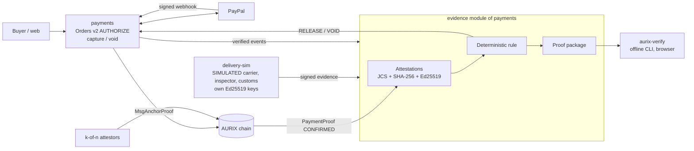

# AURIX MVP 0.2 — Evidence-Released USD Escrow

**Status:** implemented on the `MVP_0.1` branch and reviewed. Tested end to end with the PayPal simulator and the
real chain; AI-drafted conditions tested with Gemma 4 (Google AI Studio). Remaining: a full capture on the real
PayPal Sandbox, online deployment.

---

## 1. The idea in one sentence

**A USD PayPal payment is authorized, then captured automatically only when evidence signed by independent sources
shows that the condition is met. Otherwise it is voided at the deadline. Everything comes as a proof package that a
third party can re-verify offline.**

The USD escrow brings the business value (dollars, not AUR). The signed attestations bring what triggers the release
and what makes it verifiable. Together: **PayPal holds the money, the evidence decides, anyone can verify the decision.**

## 2. What PayPal does not offer today

| Need | PayPal today | Evidence escrow |
| --- | --- | --- |
| Capture only once delivery is confirmed | Authorization, then a **manual** capture by the merchant; buyer protection **after the fact** (dispute) | Capture **triggered by a signed attestation** from the carrier (or any agreed source) |
| Void automatically when nothing happens | The authorization expires; no business rule | Void at the deadline chosen by the buyer |
| Show a third party why the payment was captured | Private account history | Exported proof package, decision rule **replayable** offline |

## 3. Demo scenario

A buyer orders an item for 120 USD, delivery within 7 days.

1. **Conditional order:** the buyer picks the condition (or lets the AI draft one, §12), a deadline (≤ 29 days) and,
   optionally, an arbiter.
2. **PayPal authorization** (`intent = AUTHORIZE`): the buyer approves. The 120 USD are **held** at PayPal, nothing
   is captured. Neural Guardian scored the order **before** the approval.
3. **Attestation 1, payment authorized:** `payments` verifies the signed PayPal webhook; AURIX issues an Ed25519
   signed attestation.
4. **Attestation 2, delivery:** the carrier (simulated, labelled as such) sends `shipment.delivered`, signed with its
   own key, with the order reference.
5. **Decision:** the rule checks the carrier's signature, the references, the amount and currency, the deadline.
   Signed `RELEASE` decision.
6. **PayPal capture:** `payments` captures the authorization. Signed webhook, then **k-of-n attestation** by the
   attestors on chain (`MsgAnchorProof`). Attestation 3.
7. **Proof package:** a `.zip` with the attestations, the decision and the public keys. `aurix-verify` re-checks it
   offline **and replays the rule**: it reaches the same decision.

Variants:
- **No delivery before the deadline:** `VOID`, the authorization is voided, the buyer is not charged.
- **Forged evidence** (invalid signature, wrong source or amount): refused, no capture.
- **Dispute:** the arbiter holds the release before the deadline (`HOLD`), then decides `RELEASE` or `VOID`. A hold
  still in place at the deadline ends in `VOID`: the buyer is refunded rather than funds staying held past the PayPal
  authorization.

Demo-only additions: a deadline in minutes (disabled in production) and the in-browser verifier (`web/verify.js`).

## 4. Architecture



| | MVP 0.1 | **MVP 0.2 evidence escrow** | Later |
| --- | --- | --- | --- |
| Escrow | AUR, on chain | **USD at PayPal, released by evidence** | USD, condition recorded on chain |
| Who decides | Sender / arbiter | **Deterministic rule over signed evidence**, replayed by the verifier | The chain (BFT consensus) |
| Chain changes | — | **None** (reuses `MsgAnchorProof`) | New protobuf messages |

The key point: **the chain does not need to change for the decision to be verifiable.** The rule is deterministic
and public; its inputs are signed; the verifier replays it.

## 5. The decision rules

Pure, versioned functions in `verifier/aurix_verify/rule.py`, shared by `payments` and `aurix-verify` (and ported to
`web/verify.js`, kept in lockstep by `verifier/tests/test_js_parity.py`).

`delivery-attested/1`:

```text
decide(terms, evidence, now) ->
  # evidence counts only if its signature is valid, its key has the right role, and
  # operation_id == provider_reference.order_id (if present) == terms.order_id
  a = latest action of the designated arbiter, signed and RECEIVED by AURIX before the deadline
  if a == RELEASE or VOID                        -> a
  if a == HOLD: if now > deadline -> VOID  else -> HOLD
  auth = payment.authorized (AURIX key) for exactly the agreed amount and currency
  d = shipment.delivered from the agreed carrier (key source:<carrier>), with
        event_time <= deadline, event_time <= now, and RECEIVED by AURIX (signed receipt) <= deadline
  if auth and d                                  -> RELEASE
  if now > deadline                              -> VOID
  else                                           -> WAIT
```

`conditions/1` (a condition tree, §12) applies the same arbiter, authorization and reception checks, then:

```text
  used = evidence satisfying the tree (all / any / at_least; leaf = evidence type + source + optional limit)
  if auth and used:
      release_at = min(time AURIX had all of it + dispute_window_hours, deadline)
      open buyer dispute received before release_at -> HOLD (VOID once the deadline passes)
      now >= release_at                            -> RELEASE
      else                                         -> WAIT (dispute window open)
  if now > deadline                                -> VOID
  else                                             -> WAIT
```

Rules: amounts in decimal (never `float`); references compared exactly; the decision and its inputs (hash of each
attestation) are signed by AURIX and added to the package.

Why the **reception** time: an event's time is declared by its signer and can be backdated; the time AURIX received
the evidence is recorded in a signed receipt (`receipts.json`). Evidence that arrived before the deadline but was
evaluated after it still counts. For the same reason a key's validity is checked at reception time, not at the
`created_at` chosen by the signer.

## 6. Formats

**Attestation** (`aurix.financial-attestation` v1.0, `verifier/aurix_verify/attestation.py`):
`attestation_id`, `operation_id` (the order), `source` (`provider`, `source_type` real / simulated, `environment`,
`provider_event_id`, `provider_reference`, `verification_method`), `event` (`type`, optional `amount`, `action`),
`timestamps` (`source_event_time`, …). Canonicalised with RFC 8785 (JCS), hashed with SHA-256, signed with Ed25519.

Event types: `payment.authorized`, `payment.captured`, `payment.anchored`, `payment.voided` (AURIX),
`shipment.shipped`, `shipment.delivered`, `inspection.passed`, `customs.cleared` (sources), `buyer.disputed` (AURIX),
`arbiter.decision` (arbiter). `payment.anchored` references the on-chain `PaymentProof` once k attestors confirmed it.

**Signature verdicts:** `valid`, `invalid`, `unknown_key`, `revoked_key`, `valid_but_key_revoked_after_signing`.

**Decision:**

```json
{ "schema": "aurix.escrow-decision", "schema_version": "1.0",
  "order_id": "5O1…", "rule": "conditions/1", "decision": "RELEASE",
  "inputs": ["sha256:…", "sha256:…"],
  "decided_at": "2026-11-15T10:02:00Z", "deadline": "2026-11-15T23:59:59Z" }
```

**Proof package** (`aurix-proof-<order_id>.zip`, `verifier/aurix_verify/package.py`): signed `manifest.json`,
`terms.json`, `attestations/<id>.json`, `receipts.json`, `decision.json` (each with its signature), `trust/public-keys.json`,
`trust/trust-metadata.json`, optional `advisory/<kind>.json`. The verifier report always states which sources are
simulated, that cryptographic validity does not prove physical delivery, and that PayPal, not AURIX, held the funds.

## 7. Components

| Component | Role |
| --- | --- |
| `paypal-sim/` | Local PayPal simulator: `AUTHORIZE`, capture, void, webhooks, simulated expiry |
| `common/aurix_common/clients.py` | PayPal client: `create_order(intent=…)`, `capture_authorization()`, `void_authorization()`; retries failed connections |
| `payments/aurix_payments/escrow.py` | Conditional orders, signed attestations, rule, signed and final decision, idempotent capture or void retried by the poller, proof export, `/api/escrow/*` |
| `delivery-sim/` (port 8087) | Simulated carrier, inspector and customs, each with its own Ed25519 key: `/ship`, `/deliver`, `/inspect`, `/customs` |
| `verifier/` | `python -m aurix_verify proof.zip`: hashes, signatures, keys, **rule replay**; no service dependency |
| `web/` | Guided demo (`demo.html`), proof page (`proof.html`), full wallet tab "Conditional (USD)" |

No change to `chain/`.

## 8. AI advisor (Gemma 4, advisory only)

**The AI explains and suggests; it never decides.** The decision stays the deterministic rule that `aurix-verify`
replays; an LLM cannot be part of it (its answers are not reproducible). Code: `payments/aurix_payments/advisor.py`.

| Function | Route | What the model does | What it does not do |
| --- | --- | --- | --- |
| Draft a condition | `POST /api/escrow/propose` | Turns a free description into a condition tree, with warnings | Apply it: the buyer reviews, edits and approves |
| Plain explanation | `POST /api/escrow/orders/{id}/explain` `{audience, lang}` | What happened, why the rule decided, the limits | Change the state or decision |
| Arbiter brief | `POST /api/escrow/orders/{id}/arbiter-brief` | Summary, inconsistencies, questions, **suggested** action | Act: only the arbiter's **signed** action counts |

- **Model:** any OpenAI-compatible endpoint (`ADVISOR_LLM_URL`, `ADVISOR_LLM_MODEL`, `ADVISOR_LLM_API_KEY`): Google AI
  Studio (`gemma-4-26b-a4b-it`), Ollama, vLLM. Without a reachable model, a deterministic template, labelled as such.
- **Data sent:** structured fields only (event types, sources, verification status, amounts, dates). No payer
  identity, no raw payload.
- **Prompt injection:** facts are passed as data; the output is only displayed (escaped) and, for conditions,
  strictly validated against the schema and the registered sources.
- **Traceability:** each text is saved in the proof package (`advisory/<kind>.json`) with the model actually used.
- **Demo arbiter:** `/api/escrow/orders/{id}/demo-arbiter` signs with a server-held demo key, outside production only.

## 9. Security

- PayPal secrets stay in `payments`; evidence sources can only submit signed attestations.
- Evidence without a valid signature from a registered key, or from a source attesting another kind of event, is refused.
- Capture and void are idempotent (PayPal request id = order + decision); `RELEASE` is never followed by `VOID`, nor
  the reverse.
- Statuses: `CAPTURED` on PayPal's authenticated API response, `CONFIRMED` on the signed webhook, `ANCHORED` once k
  attestors confirmed the proof. Only `ANCHORED` counts as a payment proof.
- External attestation ids are constrained (`[A-Za-z0-9_-]{1,64}`, prefix `att_` reserved for AURIX).
- AI calls are rate limited and the language is allowlisted. The testnet API has no user accounts.
- The proof package holds no payer personal data and no raw payload (only its hash).

## 10. Acceptance criteria

- [x] A conditional order creates a PayPal authorization; the buyer is not charged.
- [x] Valid evidence triggers the capture, then k-of-n anchoring (e2e on the real chain, 2 attestors).
- [x] Without the evidence by the deadline, the authorization is voided.
- [x] Forged or inconsistent evidence is refused and causes no capture.
- [x] The arbiter can hold, then decide, before the deadline; the buyer can dispute in the dispute window.
- [x] `aurix-verify` re-checks the package offline and reaches the same decision (Python / browser parity).
- [x] A one-byte change in the package is detected.
- [x] Simulated sources are flagged in the UI, the package and the report.
- [x] An AI-drafted condition is validated before use, and its summary is computed from the condition itself.

## 11. Limits

- The funds stay at PayPal: AURIX guarantees nothing beyond what PayPal guarantees for an authorization (at most 29 days).
- The decision is taken by an AURIX service following a public, replayable rule, not yet by consensus.
- Carrier, inspector and customs are simulated: the demo proves the mechanism, not a real integration.

## 12. Custom conditions (rule `conditions/1`)

Besides `delivery-attested/1`, an order can carry a **composable condition**, signed in `terms.json`:

```json
{"rule": "conditions/1", "dispute_window_hours": 72,
 "condition": {"all": [{"evidence": "shipment.shipped", "source": "aurix_demo_delivery", "before": "<ISO>"},
                       {"evidence": "customs.cleared", "source": "aurix_demo_customs"},
                       {"evidence": "shipment.delivered", "source": "aurix_demo_delivery"}]}}
```

- Nodes: `all`, `any`, `at_least` + `of`; leaves: `evidence` (`shipment.shipped`, `shipment.delivered`,
  `inspection.passed`, `customs.cleared`), `source` (a registered `source:<source>` key, which may only sign its own
  kind of event), optional `before`. At most 10 leaves and 4 levels (`validate_condition`).
- `within_days` (relative) becomes `before` (absolute) at creation: signed terms never depend on evaluation time.
- **Dispute window:** once the condition is met, `RELEASE` only after `dispute_window_hours` (capped by the deadline).
  A buyer dispute (`buyer.disputed`, attested by AURIX) holds the payment; the arbiter decides (`RELEASE` / `VOID`,
  or `UNHOLD` to lift it), otherwise `VOID` at the deadline.
- **AI:** `POST /api/escrow/propose` drafts the condition from a free description (Gemma 4, or a deterministic
  template). The output is strictly validated; the displayed summary and the workflow diagram are computed from the
  tree, never from model text. The buyer reviews, edits and approves.
