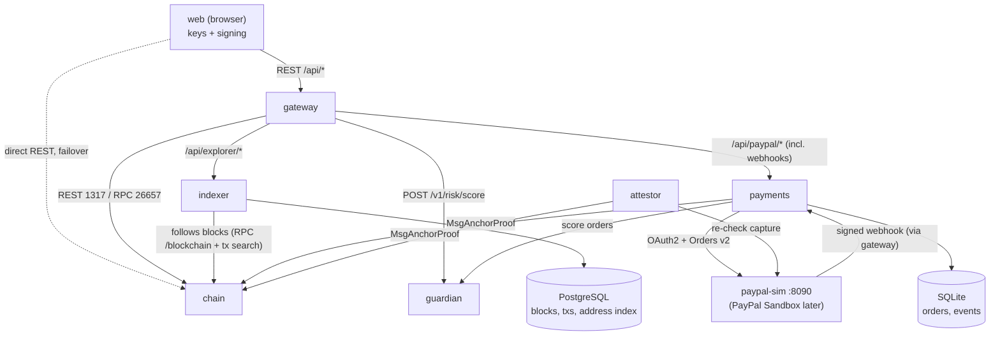
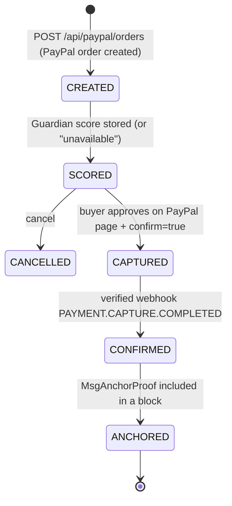

# Service Modelling (as built — MVP)

> Status legend: **built** = in the repository and tested; **temporary** = used until the real PayPal Sandbox is connected; **planned** = designed, not built.

The MVP runs **7 service types** (plus the static web app served by the gateway):

| Service | Language / stack | Ports | Layer | Depends on | Status |
| --- | --- | --- | --- | --- | --- |
| `chain` — `aurixd` node | Go, Cosmos SDK v0.50, CometBFT v0.38 | 26657 (CometBFT RPC), 1317 (REST/LCD), 9090 (gRPC) | 1-2 | — | built (4 validators by default) |
| `gateway` — API Gateway (edge) | Python, FastAPI, SQLite (risk log) | 8080 (also serves `web/`) | 4 | chain, guardian, indexer, payments | built |
| `payments` — PayPal connector | Python, FastAPI, SQLite (orders, webhook events) | 8085 | 4 | chain, guardian, PayPal (simulator) | built |
| `indexer` — explorer read model | Python, FastAPI, **PostgreSQL** | 8086 | — | chain, PostgreSQL | built |
| `guardian` — Neural Guardian (×N) | Python, FastAPI, logistic regression + SHAP | 8000 | 3 | — | built (trained on PaySim) |
| `attestor` — independent PayPal attestor (×N) | Python | 8095 (health) | 2/4 | chain, PayPal | built |
| `paypal-sim` — PayPal API simulator | Python, FastAPI | 8090 | 4 (external stand-in) | gateway (webhook target) | temporary |
| `web` — Wallet & explorer | Vanilla JS, `@noble` secp256k1, AG Grid | served on 8080 | — | chain nodes (direct), gateway (optional) | built |
| Redis | — | — | — | — | **planned** (not needed by the MVP) |

`gateway`, `payments` and `indexer` share the library `common/aurix_common` (keys and BIP39, Cosmos tx
signing, chain and PayPal clients, Guardian quorum); each service has its own process, data store,
Dockerfile, health check, tests and CI job.

---

## 1. `chain` — AURIX node (`aurixd`)

Single source of truth for balances, escrows and proofs. Details: [`chain/README.md`](../../chain/README.md).

| Module | Message | Preconditions | Effect |
| --- | --- | --- | --- |
| `x/auth` + `x/bank` ("aurixbank") | `MsgSend` | valid secp256k1 signature, expected account sequence, balance ≥ amount + fees | Debit/credit in `uaur`, fees charged, sequence +1 (replay rejected) |
| `x/smartmoney` | `MsgCreateEscrow` | sufficient balance, deadline > current height | Funds moved to the module account, `LOCKED` |
| `x/smartmoney` | `MsgReleaseEscrow` | `LOCKED`, signer = sender or arbiter | Funds → recipient, `RELEASED` |
| `x/smartmoney` | `MsgRefundEscrow` | `LOCKED`, height ≥ deadline | Funds → sender, `REFUNDED` |
| `x/smartmoney` | `MsgAnchorProof` | signer = authorised gateway account, unique hash | Proof stored, **no AUR created** |

`x/staking` runs 4 validators by default (`chain/scripts/init-localnet.sh`): each has its own key and equal stake, and the nodes are persistent peers. The chain keeps finalising blocks with 3/4 validators and halts (no fork) with 2/4. Independent operators on separate machines are **planned**.

## 2. `gateway` — API Gateway (edge)

The single public entry point; never holds user private keys. It holds only the dev faucet key.

| Endpoint | Purpose |
| --- | --- |
| `GET /api/health`, `GET /api/chain/status` | Health (incl. the PayPal rail reported by payments) and chain height |
| `POST /api/wallets`, `GET /api/wallets/{addr}`, `POST /api/wallets/{addr}/faucet` | Demo key, balance (chain) + history (indexer, chain fallback), testnet faucet |
| `POST /api/txs/prepare` | Account number, sequence, chain-id and the signed Guardian quorum score for the unsigned tx |
| `POST /api/txs`, `POST /api/txs/observed` | Broadcasts a tx signed in the browser / records a tx the wallet broadcast directly |
| `GET /api/escrows[/{id}]`, `GET /api/proofs/{hash}` | Escrow state and normalised proof (k-of-n status) from the chain |
| `GET /api/explorer/*` | **Proxied to the indexer** |
| `/api/paypal/*` | **Proxied to payments** (orders, approve, cancel, webhook) |

If the indexer is down, `/api/explorer/*` answers 503 and wallet history falls back to the chain tx
search; if payments is down, `/api/paypal/*` answers 503. Wallet sends and escrows keep working.

## 2b. `payments` — PayPal connector

Owns PayPal orders and webhook events (SQLite) and the anchor key (`GATEWAY_*` names, the address
listed in `anchor_signers`). Endpoints `/api/paypal/orders`, `/orders/{id}`, `/orders/{id}/approve`,
`/orders/{id}/cancel`, `/webhook`, `/health`. A background poller refreshes `ATTESTING` orders and
retries failed anchors.

## 2c. `indexer` — explorer read model (PostgreSQL)

Follows the chain block by block (CometBFT finality: no re-orgs) and stores blocks, txs (normalised rows
+ raw JSON) and an address index. Serves `/api/explorer/blocks`, `/txs`, `/txs/{hash}`,
`/addresses/{addr}/history`, `/search`, `/stats`, `/proofs/{hash}`; `/health` reports `indexed_height`,
`chain_height` and `lag`. It is a cache: dropping the database and re-syncing rebuilds it. Balances,
escrows and proofs are always read live from the chain.

### PayPal order lifecycle

In the code, `CREATED` and `SCORED` happen in the same request; the stored status after creation is `SCORED`. Proof hash = `sha256(order_id|capture_id)`, memo `paypal:<order_id>`.

## 3. `guardian` — Neural Guardian

`POST /v1/risk/score` → `{risk_score, level, reasons[], advisory_only: true}`. Logistic regression with exact linear SHAP reasons and an isotonic-calibrated probability, **trained on PaySim** (Kaggle `ealaxi/paysim1`, out-of-time ROC-AUC 0.978, PR-AUC 0.939; see `guardian/MODEL_CARD.md`). If Guardian is down, the gateway returns `risk_status: "unavailable"` and the user can still proceed (US-10). Model card: [`guardian/MODEL_CARD.md`](../../guardian/MODEL_CARD.md). GNN analysis is **planned**.

Signed scores (H3): each response carries `attestation` (secp256k1 signature over sha256 of the canonical
payload `{chain_id, from, to, amount, denom, score, decision, model_version, issued_at}`), `GET /pubkey`
returns the guardian key. The gateway queries every `GUARDIAN_URLS` entry in parallel, drops unsigned,
forged, stale (>300 s), duplicate-key or wrong-payment attestations (and keys outside `GUARDIAN_PUBKEYS`
when set), returns the most severe valid decision plus `quorum {configured, valid, agree, required,
quorum_met}` and per-guardian `guardians[]`; `risk_status` is `ok`, `quorum_not_met` or `unavailable`.
The wallet re-verifies each signature with noble-secp256k1 and shows "k/n guardians agree".

## 4. `paypal-sim` — PayPal API simulator (temporary)

Implements the subset of PayPal used by the gateway: `POST /v1/oauth2/token`, `POST /v2/checkout/orders`, `GET /v2/checkout/orders/{id}`, `POST /v2/checkout/orders/{id}/capture`, `POST /v1/notifications/verify-webhook-signature`, a buyer approval page `GET /checkoutnow?token=…`, and test helpers under `/sim/*` (list, resend and forge webhook events). On capture it POSTs a signed `PAYMENT.CAPTURE.COMPLETED` webhook to the gateway. The gateway uses the same PayPal client for the simulator and the real Sandbox; switching is configuration only — see [`paypal-sim/README.md`](../../paypal-sim/README.md).

## 5. `web` — Wallet & explorer

Tabs: **Wallet**, **Send AUR**, **Smart Money**, **PayPal (USD)**, **Explorer** (AG Grid). Keys are generated in the browser (secp256k1); transactions are built as Cosmos protobuf and signed locally with `SIGN_MODE_DIRECT` (`web/cosmos-tx.js`). USD and AUR balances are displayed separately.

## Invariants

1. The chain is the only source of truth for AUR balances.
2. Balances never go negative; fees are always charged.
3. Each sequence is used once (replay rejected).
4. An escrow leaves `LOCKED` exactly once.
5. No release after refund, no refund before deadline.
6. Duplicate PayPal webhooks are a 200 no-op.
7. Webhooks with an invalid signature are rejected.
8. No PayPal capture without explicit human approval.
9. The AI is advisory only: it never blocks or modifies a transaction.
10. USD never becomes AUR: only a hash is anchored.

## Run and test

- Local stack: [`scripts/dev-up.sh`](../../scripts/dev-up.sh), [`scripts/dev-down.sh`](../../scripts/dev-down.sh), all tests: [`scripts/test-all.sh`](../../scripts/test-all.sh).
- Deployment and healthchecks: [`deploy/README.md`](../../deploy/README.md).
