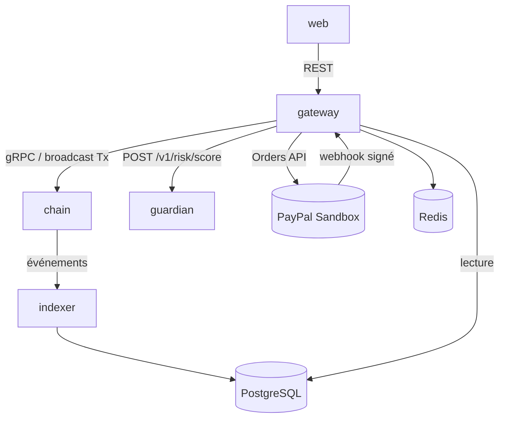
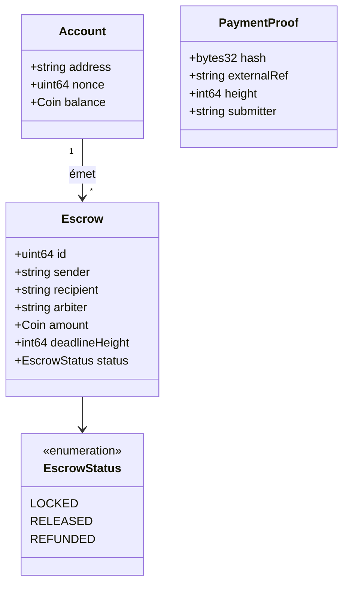
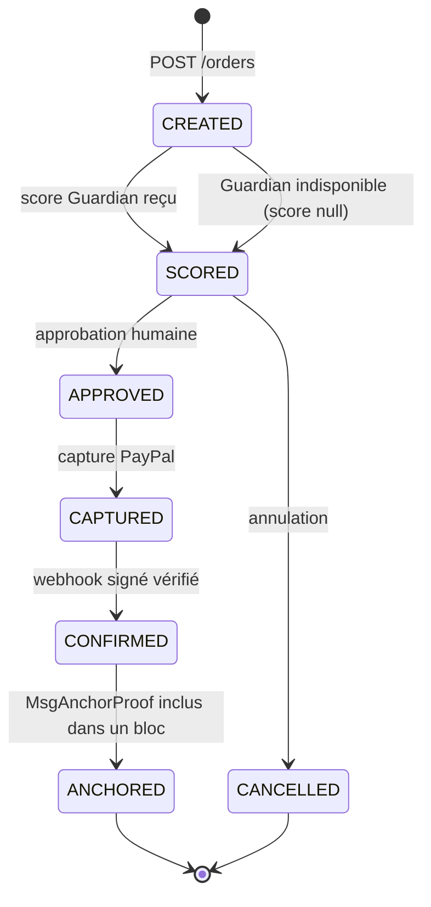
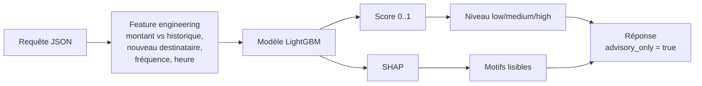

# Modélisation des services

AURIX est découpé en **6 services** déployables indépendamment.

| Service | Langage | Port [Proposition] | Couche | Dépend de |
| --- | --- | --- | --- | --- |
| `chain` — Noeud AURIX | Go, Cosmos SDK, CometBFT | 26657 (RPC), 9090 (gRPC) | 1-2 | — |
| `gateway` — API Gateway | Java 21 / Spring Boot (ou FastAPI) | 8080 | 4 | chain, guardian, PayPal, postgres, redis |
| `guardian` — Neural Guardian | Python, FastAPI | 8000 | 3 | — |
| `indexer` — Indexeur | Go ou Python | — | — | chain, postgres |
| `web` — Wallet & explorateur | TypeScript, AG Grid | 3000 | — | gateway |
| `postgres` / `redis` | — | 5432 / 6379 | — | — |



---

## 1. Service `chain` — Noeud AURIX

**Responsabilité** : source de vérité unique des soldes et des séquestres.

### Modules et messages

| Module | Message | Préconditions | Effet |
| --- | --- | --- | --- |
| `x/aurixbank` | `MsgSend` | signature valide, nonce attendu, solde ≥ montant + frais | Débit/crédit, frais prélevés, nonce +1 |
| `x/smartmoney` | `MsgCreateEscrow` | solde suffisant, échéance > hauteur actuelle | Fonds verrouillés, état `LOCKED` |
| `x/smartmoney` | `MsgReleaseEscrow` | état `LOCKED`, signataire = émetteur ou arbitre | Fonds → bénéficiaire, état `RELEASED` |
| `x/smartmoney` | `MsgRefundEscrow` | état `LOCKED`, hauteur ≥ échéance (ou annulation autorisée) | Fonds → émetteur, état `REFUNDED` |
| `x/smartmoney` | `MsgAnchorProof` | signataire = gateway autorisée, hash unique | Preuve enregistrée, **aucun AUR créé** |

### Modèle d'état



---

## 2. Service `gateway` — API Gateway / orchestration

**Responsabilité** : point d'entrée unique ; orchestre IA, PayPal et chaîne. Ne détient **aucune** autorité sur les soldes.

### Composants internes


### Endpoints

| Méthode | Chemin | Service interne | Story |
| --- | --- | --- | --- |
| POST | `/api/wallets` | WalletService | US-02 |
| GET | `/api/wallets/{addr}` | WalletService | US-03 |
| POST | `/api/transfers` | TransferService | US-04 |
| POST | `/api/escrows` | EscrowService | US-05 |
| POST | `/api/escrows/{id}/release` | EscrowService | US-06 |
| POST | `/api/escrows/{id}/refund` | EscrowService | US-07 |
| POST | `/api/paypal/orders` | PaymentService | US-11 |
| POST | `/api/paypal/orders/{id}/approve` | PaymentService | US-12 |
| POST | `/api/paypal/webhook` | WebhookHandler | US-13, US-14 |
| GET | `/api/explorer/blocks`, `/api/explorer/txs` | ReadRepository | US-15 |

### Cycle de vie d'une commande PayPal



---

## 3. Service `guardian` — Neural Guardian

**Responsabilité** : renvoyer un score de risque **consultatif** et ses motifs. Aucun chemin d'écriture vers la chaîne.



| Élément | Valeur |
| --- | --- |
| Endpoint | `POST /v1/risk/score`, `GET /health` |
| Modèle V1 | LightGBM + SHAP |
| Seuils [Proposition] | low < 0,4 ≤ medium < 0,7 ≤ high |
| Données d'entraînement | Jeu synthétique généré (à documenter) |
| Indisponibilité | La gateway affiche « analyse indisponible » et n'empêche rien |

---

## 4. Service `indexer`

**Responsabilité** : s'abonner aux événements de blocs et alimenter PostgreSQL (lecture seule pour les soldes).

### Modèle de données

```mermaid
erDiagram
    BLOCKS ||--o{ TXS : contient
    TXS ||--o| ESCROWS : "crée / modifie"
    PAYPAL_ORDERS ||--o{ WEBHOOK_EVENTS : reçoit
    PAYPAL_ORDERS ||--o| RISK_SCORES : évaluée
    TXS ||--o| RISK_SCORES : évaluée
    PAYPAL_ORDERS ||--o| TXS : "ancrée par"

    BLOCKS { bigint height PK; text hash; timestamp time }
    TXS { text hash PK; bigint height FK; text type; text sender; text recipient; numeric amount; text status }
    ESCROWS { bigint id PK; text sender; text recipient; text arbiter; numeric amount; bigint deadline_height; text status }
    PAYPAL_ORDERS { text order_id PK; numeric amount_usd; text status; text capture_id; text anchor_tx FK }
    WEBHOOK_EVENTS { text event_id PK "UNIQUE"; text order_id FK; text type; boolean signature_valid; timestamp received_at }
    RISK_SCORES { bigint id PK; text context; text ref; numeric score; text level; jsonb reasons; text model_version }
```

---

## 5. Service `web`

| Écran | Données | Source |
| --- | --- | --- |
| Wallet | Adresse, solde AUR, solde USD Sandbox (séparés) | gateway → chain |
| Transfert | Formulaire + alerte Guardian + confirmation | gateway |
| Smart Money | Liste et actions sur séquestres | gateway |
| Paiement PayPal | Commande, score, bouton d'approbation | gateway |
| Explorateur | Blocs, transactions (AG Grid) | gateway → postgres |

---

## Invariants

| # | Invariant | Service | Test |
| --- | --- | --- | --- |
| 1 | L'offre totale ne change que par l'émission prévue | chain | unitaire |
| 2 | Σ fonds verrouillés = Σ séquestres `LOCKED` | chain | unitaire |
| 3 | Pas de double libération ni de libération après remboursement | chain | unitaire |
| 4 | Nonce strictement croissant ; rejeu refusé | chain | unitaire |
| 5 | Solde jamais négatif | chain | propriété |
| 6 | Webhook rejoué sans effet | gateway | intégration |
| 7 | Webhook à signature invalide rejeté | gateway | intégration |
| 8 | Aucune capture sans approbation humaine | gateway | intégration |
| 9 | Guardian ne modifie aucune transaction | gateway + guardian | intégration |
| 10 | Sans PayPal, transferts et séquestres fonctionnent | tous | bout en bout |
