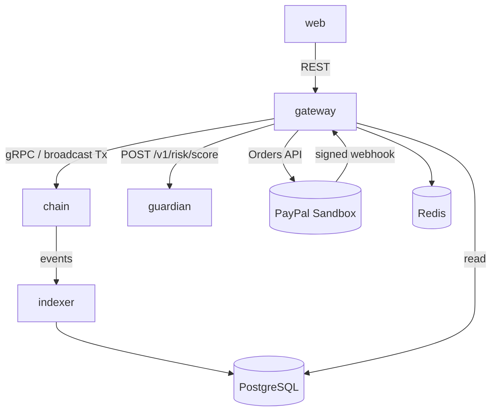
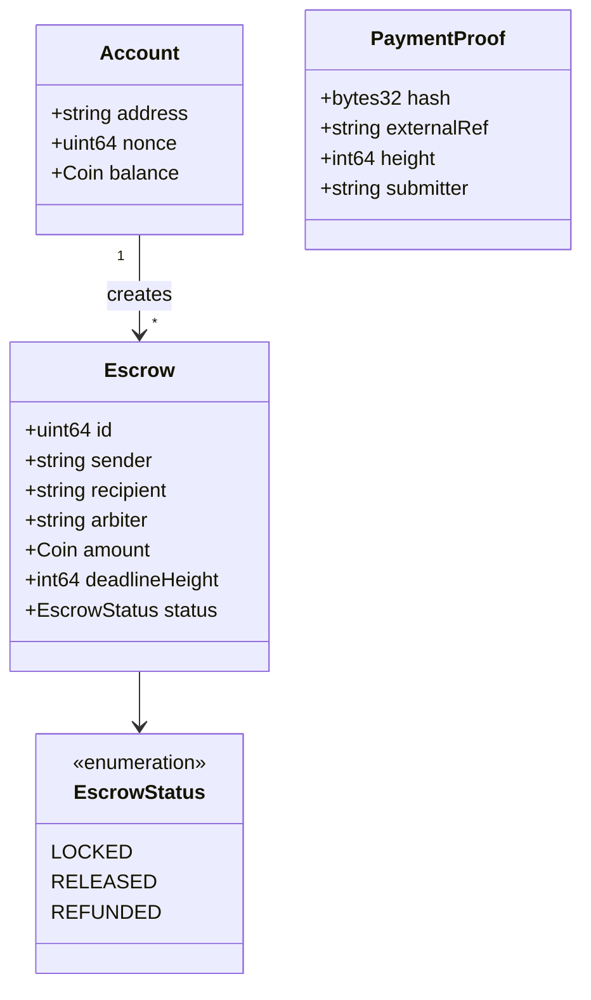
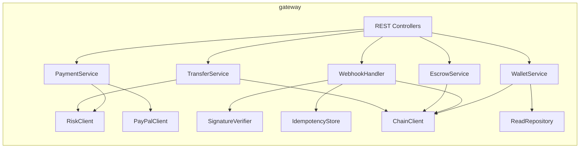
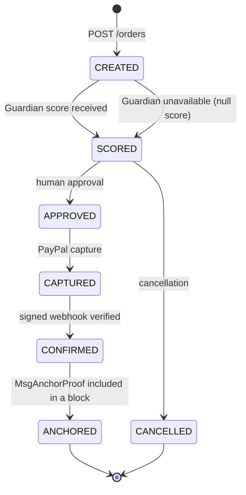
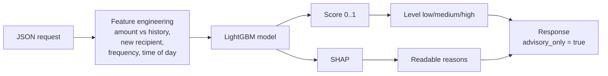

# Service Modelling

AURIX is split into **6 independently deployable services**.

| Service | Language | Port [Proposal] | Layer | Depends on |
| --- | --- | --- | --- | --- |
| `chain` — AURIX node | Go, Cosmos SDK, CometBFT | 26657 (RPC), 9090 (gRPC) | 1-2 | — |
| `gateway` — API Gateway | Java 21 / Spring Boot (or FastAPI) | 8080 | 4 | chain, guardian, PayPal, postgres, redis |
| `guardian` — Neural Guardian | Python, FastAPI | 8000 | 3 | — |
| `indexer` — Indexer | Go or Python | — | — | chain, postgres |
| `web` — Wallet & explorer | TypeScript, AG Grid | 3000 | — | gateway |
| `postgres` / `redis` | — | 5432 / 6379 | — | — |



---

## 1. `chain` service — AURIX node

**Responsibility**: single source of truth for balances and escrows.

### Modules and messages

| Module | Message | Preconditions | Effect |
| --- | --- | --- | --- |
| `x/aurixbank` | `MsgSend` | valid signature, expected nonce, balance ≥ amount + fees | Debit/credit, fees charged, nonce +1 |
| `x/smartmoney` | `MsgCreateEscrow` | sufficient balance, deadline > current height | Funds locked, `LOCKED` state |
| `x/smartmoney` | `MsgReleaseEscrow` | `LOCKED` state, signer = sender or arbiter | Funds → recipient, `RELEASED` state |
| `x/smartmoney` | `MsgRefundEscrow` | `LOCKED` state, height ≥ deadline (or authorised cancellation) | Funds → sender, `REFUNDED` state |
| `x/smartmoney` | `MsgAnchorProof` | signer = authorised gateway, unique hash | Proof recorded, **no AUR created** |

### State model



---

## 2. `gateway` service — API Gateway / orchestration

**Responsibility**: single entry point; orchestrates AI, PayPal and chain. Holds **no** authority over balances.

### Internal components



### Endpoints

| Method | Path | Internal service | Story |
| --- | --- | --- | --- |
| POST | `/api/wallets` | WalletService | US-02 |
| GET | `/api/wallets/{addr}` | WalletService | US-03 |
| POST | `/api/transfers` | TransferService | US-04 |
| POST | `/api/escrows` | EscrowService | US-05 |
| POST | `/api/escrows/{id}/release` | EscrowService | US-06 |
| POST | `/api/escrows/{id}/refund` | EscrowService | US-07 |
| POST | `/api/paypal/orders` | PaymentService | US-11 |
| POST | `/api/paypal/orders/{id}/approve` | PaymentService | US-12 |
| POST | `/api/paypal/webhook` | WebhookHandler | US-13, US-14 |
| GET | `/api/explorer/blocks`, `/api/explorer/txs` | ReadRepository | US-15 |

### PayPal order lifecycle



---

## 3. `guardian` service — Neural Guardian

**Responsibility**: return an **advisory** risk score and its reasons. No write path to the chain.



| Item | Value |
| --- | --- |
| Endpoints | `POST /v1/risk/score`, `GET /health` |
| V1 model | LightGBM + SHAP |
| Thresholds [Proposal] | low < 0.4 ≤ medium < 0.7 ≤ high |
| Training data | Generated synthetic dataset (to be documented) |
| Unavailability | The gateway shows "analysis unavailable" and blocks nothing |

---

## 4. `indexer` service

**Responsibility**: subscribe to block events and feed PostgreSQL (read-only for balances).

### Data model

```mermaid
erDiagram
    BLOCKS ||--o{ TXS : contains
    TXS ||--o| ESCROWS : "creates / updates"
    PAYPAL_ORDERS ||--o{ WEBHOOK_EVENTS : receives
    PAYPAL_ORDERS ||--o| RISK_SCORES : "scored by"
    TXS ||--o| RISK_SCORES : "scored by"
    PAYPAL_ORDERS ||--o| TXS : "anchored by"

    BLOCKS { bigint height PK; text hash; timestamp time }
    TXS { text hash PK; bigint height FK; text type; text sender; text recipient; numeric amount; text status }
    ESCROWS { bigint id PK; text sender; text recipient; text arbiter; numeric amount; bigint deadline_height; text status }
    PAYPAL_ORDERS { text order_id PK; numeric amount_usd; text status; text capture_id; text anchor_tx FK }
    WEBHOOK_EVENTS { text event_id PK "UNIQUE"; text order_id FK; text type; boolean signature_valid; timestamp received_at }
    RISK_SCORES { bigint id PK; text context; text ref; numeric score; text level; jsonb reasons; text model_version }
```

---

## 5. `web` service

| Screen | Data | Source |
| --- | --- | --- |
| Wallet | Address, AUR balance, Sandbox USD balance (kept separate) | gateway → chain |
| Transfer | Form + Guardian alert + confirmation | gateway |
| Smart Money | Escrow list and actions | gateway |
| PayPal payment | Order, score, approve button | gateway |
| Explorer | Blocks, transactions (AG Grid) | gateway → postgres |

---

## Invariants

| # | Invariant | Service | Test |
| --- | --- | --- | --- |
| 1 | Total supply changes only through planned issuance | chain | unit |
| 2 | Σ locked funds = Σ `LOCKED` escrows | chain | unit |
| 3 | No double release, no release after refund | chain | unit |
| 4 | Nonce strictly increasing; replay rejected | chain | unit |
| 5 | Balance never negative | chain | property |
| 6 | Replayed webhook has no effect | gateway | integration |
| 7 | Webhook with invalid signature rejected | gateway | integration |
| 8 | No capture without human approval | gateway | integration |
| 9 | Guardian modifies no transaction | gateway + guardian | integration |
| 10 | Without PayPal, transfers and escrows still work | all | end-to-end |
