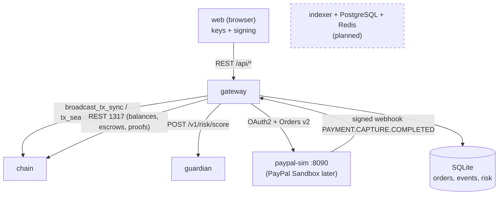
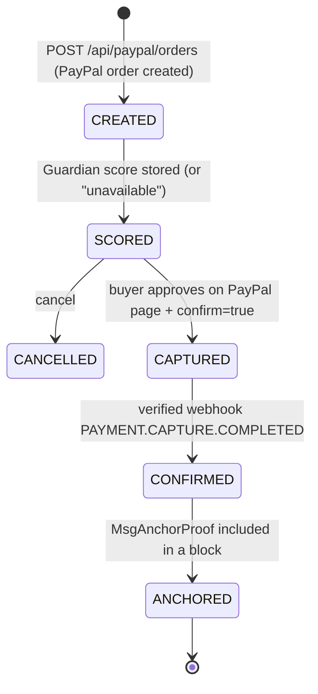

# Service Modelling (as built — MVP)

> Status legend: **built** = in the repository and tested; **temporary** = used until the real PayPal Sandbox is connected; **planned** = designed, not built.

The MVP runs **4 services** (plus the static web app served by the gateway):

| Service | Language / stack | Ports | Layer | Depends on | Status |
| --- | --- | --- | --- | --- | --- |
| `chain` — `aurixd` node | Go, Cosmos SDK v0.50, CometBFT v0.38 | 26657 (CometBFT RPC), 1317 (REST/LCD), 9090 (gRPC) | 1-2 | — | built (4 validators by default) |
| `gateway` — API Gateway | Python, FastAPI, SQLite | 8080 (also serves `web/`) | 4 | chain, guardian, PayPal (simulator) | built |
| `guardian` — Neural Guardian | Python, FastAPI, LightGBM + SHAP | 8000 | 3 | — | built (trained on PaySim) |
| `paypal-sim` — PayPal API simulator | Python, FastAPI | 8090 | 4 (external stand-in) | gateway (webhook target) | temporary |
| `web` — Wallet & explorer | Vanilla JS, `@noble` secp256k1, AG Grid | served on 8080 | — | gateway | built |
| `indexer`, PostgreSQL, Redis | — | — | — | — | **planned** (the gateway reads the chain directly and keeps its own index in SQLite) |

---

## 1. `chain` — AURIX node (`aurixd`)

Single source of truth for balances, escrows and proofs. Details: [`chain/README.md`](../../chain/README.md).

| Module | Message | Preconditions | Effect |
| --- | --- | --- | --- |
| `x/auth` + `x/bank` ("aurixbank") | `MsgSend` | valid secp256k1 signature, expected account sequence, balance ≥ amount + fees | Debit/credit in `uaur`, fees charged, sequence +1 (replay rejected) |
| `x/smartmoney` | `MsgCreateEscrow` | sufficient balance, deadline > current height | Funds moved to the module account, `LOCKED` |
| `x/smartmoney` | `MsgReleaseEscrow` | `LOCKED`, signer = sender or arbiter | Funds → recipient, `RELEASED` |
| `x/smartmoney` | `MsgRefundEscrow` | `LOCKED`, height ≥ deadline | Funds → sender, `REFUNDED` |
| `x/smartmoney` | `MsgAnchorProof` | signer = authorised gateway account, unique hash | Proof stored, **no AUR created** |

`x/staking` runs 4 validators by default (`chain/scripts/init-localnet.sh`): each has its own key and equal stake, and the nodes are persistent peers. The chain keeps finalising blocks with 3/4 validators and halts (no fork) with 2/4. Independent operators on separate machines are **planned**.

## 2. `gateway` — API Gateway (FastAPI)

Orchestrates the chain, Guardian and PayPal; never holds user private keys. It holds only its own gateway key (used for faucet and `MsgAnchorProof`).

| Endpoint | Purpose |
| --- | --- |
| `GET /api/health`, `GET /api/chain/status` | Health and chain height |
| `POST /api/wallets`, `GET /api/wallets/{addr}`, `POST /api/wallets/{addr}/faucet` | Register address, balance (read from chain), testnet faucet |
| `POST /api/txs/prepare` | Returns account number, sequence, chain-id and a Guardian risk score for the unsigned tx |
| `POST /api/txs` | Broadcasts a tx signed in the browser |
| `GET /api/escrows`, `GET /api/escrows/{id}` | Escrow state from the chain |
| `GET /api/explorer/blocks`, `/txs`, `/proofs/{hash}` | Explorer data |
| `POST /api/paypal/orders`, `GET /api/paypal/orders[/{id}]` | Create (and score) / list USD orders |
| `POST /api/paypal/orders/{id}/approve` (`confirm=true`), `/cancel` | Human approval → capture; cancel |
| `POST /api/paypal/webhook` | Signature-verified, idempotent webhook → anchor proof |

The explorer search API is being added in parallel; see the gateway code and [`api/openapi.json`](../../api/openapi.json).

### PayPal order lifecycle

In the code, `CREATED` and `SCORED` happen in the same request; the stored status after creation is `SCORED`. Proof hash = `sha256(order_id|capture_id)`, memo `paypal:<order_id>`.

## 3. `guardian` — Neural Guardian

`POST /v1/risk/score` → `{risk_score, level, reasons[], advisory_only: true}`. LightGBM classifier with native TreeSHAP reasons, **trained on PaySim** (Kaggle `ealaxi/paysim1`, out-of-time ROC-AUC 0.978, PR-AUC 0.939; see `guardian/MODEL_CARD.md`). If Guardian is down, the gateway returns `risk_status: "unavailable"` and the user can still proceed (US-10). Model card: [`guardian/MODEL_CARD.md`](../../guardian/MODEL_CARD.md). GNN analysis is **planned**.

## 4. `paypal-sim` — PayPal API simulator (temporary)

Implements the subset of PayPal used by the gateway: `POST /v1/oauth2/token`, `POST /v2/checkout/orders`, `GET /v2/checkout/orders/{id}`, `POST /v2/checkout/orders/{id}/capture`, `POST /v1/notifications/verify-webhook-signature`, a buyer approval page `GET /checkoutnow?token=…`, and test helpers under `/sim/*` (list, resend and forge webhook events). On capture it POSTs a signed `PAYMENT.CAPTURE.COMPLETED` webhook to the gateway. The gateway uses the same PayPal client for the simulator and the real Sandbox; switching is configuration only — see [`paypal-sim/README.md`](../../paypal-sim/README.md).

## 5. `web` — Wallet & explorer

Tabs: **Wallet**, **Send AUR**, **Smart Money**, **PayPal (USD)**, **Explorer** (AG Grid). Keys are generated in the browser (secp256k1); transactions are built as Cosmos protobuf and signed locally with `SIGN_MODE_DIRECT` (`web/cosmos-tx.js`). USD and AUR balances are displayed separately.

## Invariants

1. The chain is the only source of truth for AUR balances.
2. Balances never go negative; fees are always charged.
3. Each sequence is used once (replay rejected).
4. An escrow leaves `LOCKED` exactly once.
5. No release after refund, no refund before deadline.
6. Duplicate PayPal webhooks are a 200 no-op.
7. Webhooks with an invalid signature are rejected.
8. No PayPal capture without explicit human approval.
9. The AI is advisory only: it never blocks or modifies a transaction.
10. USD never becomes AUR: only a hash is anchored.

## Run and test

- Local stack: [`scripts/dev-up.sh`](../../scripts/dev-up.sh), [`scripts/dev-down.sh`](../../scripts/dev-down.sh), all tests: [`scripts/test-all.sh`](../../scripts/test-all.sh).
- Deployment and healthchecks: [`deploy/README.md`](../../deploy/README.md).
