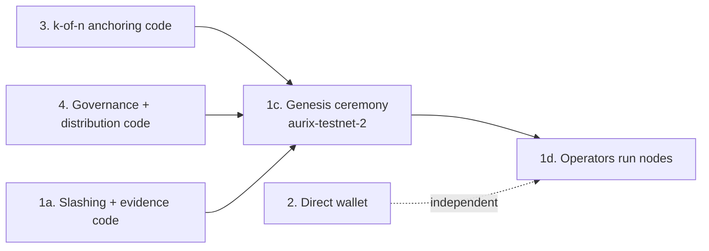

# Decentralisation plan

Status: **planning only, nothing below is implemented yet.** Last updated 2026-11-07.

Today the monetary rules are enforced by a BFT consensus that neither the gateway, the AI nor
PayPal can bypass. Who *operates* the network is still centralised:

- one team runs the 4 validators, on one machine;
- one gateway serves the wallet;
- one key anchors PayPal proofs;
- no rule can be changed by a vote.

This plan removes those points, in four workstreams.

| # | Workstream | Removes | Effort (dev-days) | Fits before the 12 Nov deadline? |
| --- | --- | --- | --- | --- |
| 1 | Independent validators | Single operator controlling consensus | 3–4 + coordination with operators | No (needs outside operators) |
| 2 | Wallet talks to the chain directly | Gateway as a single point of failure | 2–3 | Yes |
| 3 | k-of-n proof anchoring | Single anchoring key | 3–4 (option A) / 1 (option B) | Option B only |
| 4 | On-chain governance | Frozen rules / operator-only upgrades | 3–4 | No |

**Recommended order:** first land the code changes of 3 and 4, plus slashing from 1. Then run the
multi-operator genesis (1), so that the new network starts with its final module set and needs no
early chain upgrade. Workstream 2 is independent and can run in parallel at any time.

---

## 1. Independent validators

**Goal:** at least 4 (ideally 5–7) validators run by **different operators** on **different
machines and providers**, none with more than 1/3 of the voting power. The chain must keep running
when any one operator is offline.

### 1a. Code changes (before genesis)

1. Wire `x/slashing` and `x/evidence` in `chain/app/app.go`.
   - Without them, a validator that is offline or double-signs is never penalised, so honest operation is not enforced.
   - Add their store keys, keepers, staking hooks (`stakingKeeper.SetHooks`), begin/end blocker order and genesis order.
2. Wire `x/distribution`. It pays fees and rewards to validators and delegators, which gives operators an incentive to stay online. Workstream 4 needs it too.
3. Expose the staking and slashing CLI in `aurixd`:
   - `tx staking create-validator`, `delegate`, `unbond`;
   - `tx slashing unjail`;
   - `query staking validators`.
   This lets new validators join after genesis.
4. Expose CometBFT Prometheus metrics: set `prometheus = true` in `init-localnet.sh` and document port 26660.
5. Write tests:
   - a validator missing blocks gets jailed (short `signed_blocks_window` in the test genesis);
   - `unjail` works after the downtime period;
   - the existing keeper and gateway suites stay green.

**Acceptance:** `scripts/test-all.sh` passes. A local 4-node test shows a stopped validator jailed
after the window, then rejoining after `unjail`.

### 1b. Operator onboarding package

1. Write `networks/aurix-testnet-2/README.md` with:
   - hardware: 2 vCPU, 4 GB RAM, 50 GB SSD;
   - open ports: P2P 26656 public, RPC/REST private or behind a proxy;
   - the operator checklist.
2. Provide a reproducible `aurixd` binary: a tagged release, a published SHA-256, and the Docker image built in CI.
3. Security guidelines:
   - keep `priv_validator_key.json` offline-backed-up and never copy it to two running machines (that double-signs);
   - optionally use a sentry-node layout or `tmkms`;
   - firewall RPC; use the `file` or `os` keyring, not `test`.

### 1c. Genesis ceremony (`aurix-testnet-2`)

1. Each operator runs `aurixd init <moniker>` and `aurixd keys add <name>` **on their own machine**, then sends only their account address. No private key is shared.
2. The coordinator builds the pre-genesis:
   - genesis accounts with **equal stake**, so nobody gets more than 1/3 of the voting power;
   - faucet and gateway accounts;
   - the module params from workstreams 3 and 4;
   - a `genesis_time` 48 h in the future.
   The coordinator publishes it with its SHA-256.
3. Each operator verifies the hash, runs `aurixd genesis gentx` locally and opens a PR adding `networks/aurix-testnet-2/gentx/<moniker>.json`.
4. The coordinator runs `collect-gentxs` and `validate-genesis`, then publishes the final `genesis.json` and its hash in the repo.
5. Operators verify the hash, set `persistent_peers` and `seeds` from the published list (`networks/aurix-testnet-2/peers.txt`), and start before `genesis_time`.

### 1d. Operations

1. Run one public seed node and at least 2 public RPC/REST endpoints, operated by **different** operators. Workstream 2 uses them.
2. Monitoring: a shared Grafana or uptime page per validator, plus an alert on missed blocks.
3. Run a failure drill and record it for the demo:
   - one operator stops their node: the chain continues;
   - two operators stop theirs: the chain halts;
   - restart: the chain recovers.
4. Retire the single-machine 4-validator setup as the "public testnet". Keep it for local development (`scripts/dev-up.sh`).

**Acceptance:** at least 4 validators with distinct operators, IPs and providers are in the active
set. None has more than 1/3 of the voting power. A 24 h uptime report exists, and the failure drill
behaves as expected.

**Risks:**

| Risk | Mitigation |
| --- | --- |
| Operators drop out | Recruit more than needed (7 for a 5-validator set) |
| Genesis mistakes | Do a dry-run ceremony on a throwaway chain id |
| Clock or peer issues at launch | Publish multiple seeds and a launch checklist |

---

## 2. Wallet talks to the chain directly

**Goal:** sending AUR and using escrows work with the gateway turned off. The gateway becomes
optional: it is only needed for Neural Guardian scoring and PayPal.

### 2a. Chain endpoints

1. Publish a list of public endpoints in `web/endpoints.json`: REST and RPC of several nodes, run by different operators once workstream 1 is done.
2. Put each public node behind TLS with a reverse proxy (Caddy or nginx), with CORS limited to the wallet's origin rather than `enabled-unsafe-cors`, and rate limiting.

### 2b. Web wallet changes (`web/`)

1. Add a small chain client in `web/chain.js` that:
   - reads the account (`/cosmos/auth/v1beta1/account_info/{addr}`), the balance (`/cosmos/bank/v1beta1/balances/{addr}/by_denom`), escrows (`/aurix/smartmoney/v1/escrows`) and transactions (`/cosmos/tx/v1beta1/txs?query=…`);
   - broadcasts with `POST /cosmos/tx/v1beta1/txs` (`BROADCAST_MODE_SYNC`), then polls `/cosmos/tx/v1beta1/txs/{hash}` until included;
   - checks that the node's `chain_id` matches the expected one before signing.
2. Port the gateway's row normalisation (`normalize_tx`, `normalize_escrow` in `gateway/app/clients.py`) to JS. Explorer, history and escrow lists then come straight from the chain.
3. Change transaction building to use account number, sequence and chain id read from the chain, instead of the gateway's `/api/txs/prepare`. Signing is already done in the browser.
4. Endpoint failover: try the endpoints in order and switch on a timeout or HTTP 5xx. Add a settings panel where a user can add their own node URL.
5. Make Guardian scoring optional:
   - call the gateway or Guardian if one is configured;
   - otherwise show "analysis unavailable" and still allow the payment, as the gateway already does today.
6. Make the faucet a separate optional endpoint, since it is a testnet-only convenience.
7. Make `web/` deployable as a static site (any CDN, or IPFS) independently of the gateway, with a `config.json` holding the endpoints, chain id and optional gateway URL.

### 2c. Tests

1. Extend the Playwright journey with a mode where the gateway is **stopped** after the faucet step. Send and escrow create/release must still succeed.
2. Add a failover test: stop node0, then the wallet keeps working through node1.

**Acceptance:** both tests pass in `scripts/test-all.sh`. Turning off the gateway only disables
PayPal and risk scoring, and the UI says so.

**Limit:** the wallet trusts the node it reads from. Light-client verification of the data is out
of scope; using several independent endpoints reduces the risk.

---

## 3. k-of-n proof anchoring

**Goal:** a PayPal payment proof is final only when **k of n independent attestors** confirm it,
for example 2 of 3. No single key can anchor a fake proof.

### Option B: quick (about 1 day), no module change

1. Replace the gateway anchor key with a Cosmos **multisig account**: `aurixd keys add anchor --multisig a,b,c --multisig-threshold 2`, where a, b and c are held by different people.
2. Put the multisig address as the only entry of `anchor_signers` in genesis.
3. Signature collection, run off-chain:
   - the gateway prepares the unsigned `MsgAnchorProof`;
   - each holder checks the payment in PayPal and signs with `aurixd tx sign --multisig`;
   - the gateway combines the signatures (`tx multisign`) and broadcasts.

**Drawback:** coordination happens off-chain and the individual approvals are not visible on-chain.
Good for the hackathon, not the target design.

### Option A: target (3–4 days), attestation in `x/smartmoney`

1. **Proto** (`chain/proto/aurix/smartmoney/v1`):
   - `Params`: add `anchor_threshold` (uint32).
   - `PaymentProof`: add `status` (`PENDING` or `CONFIRMED`), `attestations` (repeated signer addresses), `capture_ref` (the PayPal capture id, so that attestors can check it independently), `first_seen_height` and `confirmed_height`.
   - Regenerate with `scripts/protogen.sh`.
2. **Keeper** (`msg_server.go`, `MsgAnchorProof` becomes an attestation):
   - Reject the signer if it is not in `anchor_signers`.
   - For a new hash, create the proof as `PENDING` with one attestation.
   - For an existing hash, reject a duplicate attestation from the same signer, and reject a different `external_ref` or `capture_ref` for the same hash.
   - When the number of attestations reaches the threshold, set the proof to `CONFIRMED`.
   - Emit `proof_attested` and `proof_confirmed` events.
   - Optional: expire `PENDING` proofs after N blocks.
3. **Genesis validation:** `1 <= anchor_threshold <= len(anchor_signers)`, with no duplicate signers.
4. **Queries:** `Proof` returns status and attestations, and a new `PendingProofs` returns the proofs waiting for attestations.
5. **Attestor service** (new `attestor/`, one instance per operator, each with its own key and its own read-only PayPal credentials):
   - poll `PendingProofs` or watch the `proof_attested` events;
   - call PayPal `GET /v2/payments/captures/{capture_ref}` itself and check `COMPLETED`, the amount, and that the order id matches `external_ref`;
   - recompute `sha256(order_id|capture_id)`, compare it with the hash, and submit its own `MsgAnchorProof`.
6. **Gateway:** it becomes the first attestor, not the authority. An order is `ANCHORED` only once the proof is `CONFIRMED`; add an intermediate state `ATTESTING (1/2)`.
7. **Web:** show the attestation progress (1 of 2, then 2 of 2) on the PayPal tab and in the proof card of the explorer.
8. **Tests:**
   - keeper tests: threshold reached, duplicate attestor, unauthorised signer, mismatched reference, genesis validation;
   - gateway integration: 2 attestors with the PayPal simulator;
   - an attestor refuses to confirm a capture that the simulator never completed.
9. **Migration:** bump `ConsensusVersion` and include the change in the `aurix-testnet-2` genesis, so no in-place migration is needed.

**Acceptance:** with `anchor_threshold = 2` and 3 attestors, a payment is `CONFIRMED` only after 2
independent checks against PayPal. A fake proof submitted by one compromised attestor stays `PENDING`.

---

## 4. On-chain governance

**Goal:** module parameters, the anchor signer set and software upgrades change only through
proposals that validators and delegators vote on.

### 4a. Code changes

1. Wire `x/distribution` (shared with 1a), then `x/gov` v1 and `x/upgrade` in `chain/app/app.go`:
   - store keys, keepers (the gov keeper needs the account, bank, staking and distribution keepers and the msg service router);
   - the gov router for legacy content;
   - module account permissions: gov needs `Burner`;
   - begin/end blocker order (gov end blocker; upgrade pre-blocker via `app.SetPreBlocker`);
   - genesis order.
2. Make the existing authority meaningful. The keepers already use `authtypes.NewModuleAddress(govtypes.ModuleName)` as their authority, so bank, staking, distribution, consensus and upgrade params become changeable by proposal as soon as gov exists.
3. `x/smartmoney`: add `MsgUpdateParams` (fields `authority` and `params`), checked against the gov module address stored in the keeper, with `Params.Validate()` checking addresses, the threshold and duplicates. Proto, keeper, codec and tests.
4. Add an upgrade handler skeleton in `app/upgrades.go`, registered with `UpgradeKeeper.SetUpgradeHandler`, for the first planned upgrade (`v2`).
5. CLI: `aurixd tx gov submit-proposal`, `deposit`, `vote`, `query gov proposals`, `tx upgrade software-upgrade`.

### 4b. Parameters for `aurix-testnet-2`

| Param | Testnet value | Reason |
| --- | --- | --- |
| `min_deposit` | 1,000 AUR | Spam protection, affordable for operators |
| `max_deposit_period` | 24 h | |
| `voting_period` | 24 h (10 min for a demo chain) | Quick iterations on testnet |
| `quorum` | 33.4 % | SDK default |
| `threshold` | 50 % | SDK default |
| `veto_threshold` | 33.4 % | SDK default |
| `expedited_voting_period` | 1 h | Emergency fixes |

### 4c. Process and tests

1. Write `docs/governance.md`: who can propose, how to draft a proposal JSON, the timeline, and the upgrade procedure (halt height, then swap binaries, then restart). It should give a worked example: "add a 4th attestor to `anchor_signers`".
2. Integration test on a local 4-validator network (short voting period):
   - submit `MsgUpdateParams` for `x/smartmoney`;
   - 3 of 4 validators vote yes, so it passes and the params change;
   - a proposal with 1 of 4 yes is rejected.
3. Upgrade drill on the local network: propose `v2` at height H, the chain halts at H, restart with the `v2` binary, the chain continues and the state is preserved.

**Acceptance:** an anchor signer can be added only by a passed proposal. The upgrade drill succeeds.
`docs/governance.md` is published.

---

## Overall definition of done

- Consensus: at least 4 validators with distinct operators, none with more than 1/3 of the voting power, and a recorded failure drill.
- The wallet works with the gateway off, and fails over between at least 2 public endpoints run by different operators.
- PayPal proofs require 2-of-3 independent attestations, each checked against PayPal.
- Rule changes and upgrades go through `x/gov`, and the process is documented and tested.
- README, architecture docs and the Devpost "limitations" section are updated to match.
