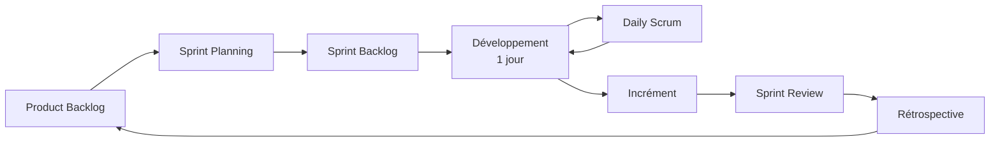

# Organisation Scrum

## Cadre

| Paramètre | Valeur |
| --- | --- |
| Durée du projet | 7 → 12 novembre 2026 (6 jours) |
| Durée d'un sprint | **1 jour** (sprints courts adaptés au hackathon) |
| Nombre de sprints | 6 (S0 à S5) |
| Unité d'estimation | Story points (suite de Fibonacci : 1, 2, 3, 5, 8, 13) |
| Outil | GitHub Projects (colonnes : Backlog → To Do → In Progress → Review → Done) |

## Rôles

| Rôle | Responsabilités |
| --- | --- |
| **Product Owner** | Porte la vision « l'IA conseille, le protocole décide, l'humain approuve » ; priorise le backlog selon les catégories de prix (priorité 1 : *Best Use of PayPal + AI*) |
| **Scrum Master** | Anime les cérémonies, protège le périmètre gelé, lève les blocages (accès Sandbox, déploiement Render) |
| **Équipe de développement** | Chaîne (Go), passerelle, Neural Guardian (Python), front (wallet/explorateur) |

## Cérémonies (format compressé, sprint d'un jour)

| Cérémonie | Moment | Durée | Sortie |
| --- | --- | --- | --- |
| Sprint Planning | Début de journée | 30 min | Objectif du sprint + sprint backlog |
| Daily Scrum | Mi-journée | 10 min | Blocages identifiés |
| Sprint Review | Fin de journée | 20 min | Démo de l'incrément (enregistrée pour la vidéo) |
| Rétrospective | Après la review | 10 min | 1 amélioration appliquée le lendemain |
| Affinage du backlog | Continu | — | Stories prêtes (DoR) |

## Definition of Ready (DoR)

- La story suit le format « En tant que… je veux… afin de… ».
- Les critères d'acceptation sont testables.
- Les dépendances (service, clé Sandbox, endpoint) sont identifiées.
- L'estimation est ≤ 8 points (sinon découper).

## Definition of Done (DoD)

- Code revu (pull request) et fusionné sur la branche principale.
- Tests unitaires passants ; invariants concernés testés (voir [architecture/services.md](../architecture/services.md#invariants)).
- Aucun secret commité ; variables ajoutées à `.env.example` sans valeur.
- Endpoint documenté dans `api/openapi.yaml` le cas échéant.
- Fonctionnalité démontrable dans Docker Compose.

## Gestion des risques du périmètre

Chaque sprint définit ce qui est **abandonné en premier** en cas de retard (voir [sprints.md](sprints.md)). Le noyau Cosmos SDK et le connecteur PayPal ne sont jamais sacrifiés : ils portent la démonstration.
