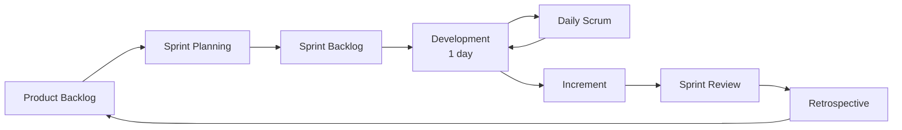

# Scrum Setup

## Framework

| Parameter | Value |
| --- | --- |
| Project duration | November 7 → 12, 2026 (6 days) |
| Sprint length | **1 day** (short sprints suited to a hackathon) |
| Number of sprints | 6 (S0 to S5) |
| Estimation unit | Story points (Fibonacci: 1, 2, 3, 5, 8, 13) |
| Tool | GitHub Projects (columns: Backlog → To Do → In Progress → Review → Done) |

## Roles

| Role | Responsibilities |
| --- | --- |
| **Product Owner** | Owns the vision "the AI advises, the protocol decides, the human approves"; prioritises the backlog by prize category (priority 1: *Best Use of PayPal + AI*) |
| **Scrum Master** | Runs the ceremonies, protects the frozen scope, removes blockers (Sandbox access, Render deployment) |
| **Development team** | Chain (Go), gateway, Neural Guardian (Python), front end (wallet/explorer) |

## Ceremonies (compressed format, one-day sprint)

| Ceremony | When | Duration | Output |
| --- | --- | --- | --- |
| Sprint Planning | Start of day | 30 min | Sprint goal + sprint backlog |
| Daily Scrum | Midday | 10 min | Blockers identified |
| Sprint Review | End of day | 20 min | Increment demo (recorded for the video) |
| Retrospective | After the review | 10 min | 1 improvement applied the next day |
| Backlog refinement | Ongoing | — | Stories ready (DoR) |

## Definition of Ready (DoR)

- The story follows the "As a… I want… so that…" format.
- Acceptance criteria are testable.
- Dependencies (service, Sandbox key, endpoint) are identified.
- Estimate is ≤ 8 points (otherwise split it).

## Definition of Done (DoD)

- Code reviewed (pull request) and merged into the main branch.
- Unit tests pass; relevant invariants tested (see [architecture/services.md](../architecture/services.md#invariants)).
- No secrets committed; new variables added to `.env.example` without values.
- Endpoint documented in `api/openapi.yaml` where applicable.
- Feature demonstrable in Docker Compose.

## Scope risk management

Each sprint defines what is **dropped first** if it runs late (see [sprints.md](sprints.md)). The Cosmos SDK core and the PayPal connector are never sacrificed: they carry the demo.
