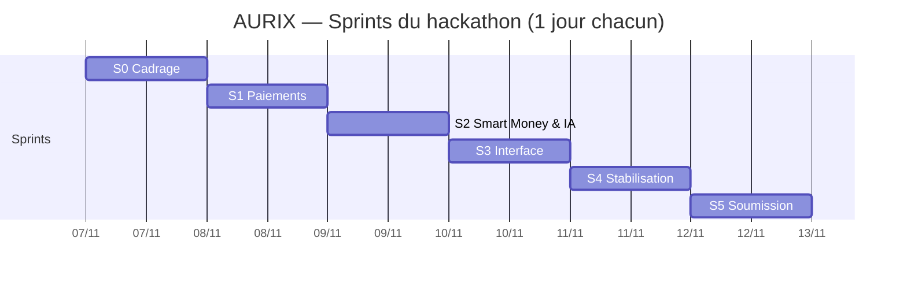

# Sprints

## Vue calendrier



## S0 — 7 nov · Cadrage

- **Objectif** : périmètre gelé, environnement prêt.
- **Sprint backlog** : US-01 (5), squelette du dépôt, compte PayPal Sandbox, scénario de démo validé.
- **Livrable** : dépôt structuré, `docker compose up` fonctionnel (services vides), documentation.
- **Abandon si retard** : Kubernetes, graphes.
- **Capacité** : 8 pts.

## S1 — 8 nov · Paiements

- **Objectif** : premier paiement de bout en bout (USD et AUR).
- **Sprint backlog** : US-02 (3), US-03 (2), US-04 (8), US-11 (5) → 18 pts.
- **Livrable** : commande PayPal créée et capturée ; transfert AUR confirmé dans un bloc.
- **Abandon si retard** : fonctions annexes du wallet.

## S2 — 9 nov · Smart Money & Neural Guardian

- **Objectif** : séquestre complet et score de risque affiché.
- **Sprint backlog** : US-05 (5), US-06 (3), US-07 (3), US-08 (8), US-10 (2), US-12 (3), US-13 (5), US-14 (3) → 32 pts.
- **Livrable** : escrow complet, tests d'invariants 1 à 8, preuve ancrée.
- **Abandon si retard** : modèle complexe (garder LightGBM).

## S3 — 10 nov · Interface

- **Objectif** : parcours utilisateur démontrable.
- **Sprint backlog** : US-09 (3), US-15 (5), US-16 (2), US-18 (3) → 13 pts.
- **Livrable** : wallet web, historique, explorateur AG Grid.
- **Abandon si retard** : finitions visuelles.

## S4 — 11 nov · Stabilisation & vidéo

- **Objectif** : release candidate.
- **Sprint backlog** : US-17 (5), US-19 (5), tests d'intégration 9 et 10, README final → 10 pts.
- **Abandon si retard** : tout nouveau développement.

## S5 — 12 nov · Soumission

- **Objectif** : dépôt Devpost l'après-midi du 12.
- **Checklist** : vidéo, dépôt, description, démo en ligne, aucun secret, catégories cochées, re-vérification des liens.

## Burndown prévisionnel

| Fin de sprint | S0 | S1 | S2 | S3 | S4 | S5 |
| --- | --- | --- | --- | --- | --- | --- |
| Points restants (sur 81) | 73 | 55 | 23 | 10 | 0 | 0 |

```mermaid
xychart-beta
    title "Burndown prévisionnel (story points)"
    x-axis [Début, S0, S1, S2, S3, S4, S5]
    y-axis "Points restants" 0 --> 90
    line [81, 73, 55, 23, 10, 0, 0]
```

## Modèle de compte rendu de rétrospective

| Ce qui a bien marché | À améliorer | Action pour demain |
| --- | --- | --- |
| | | |
