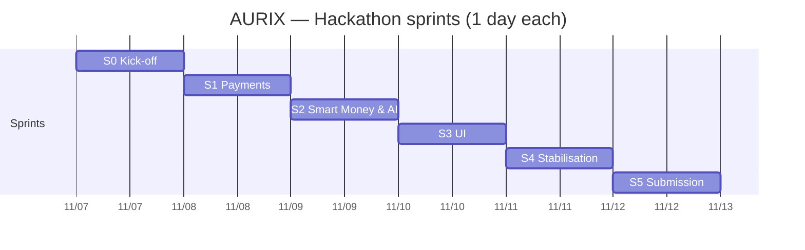
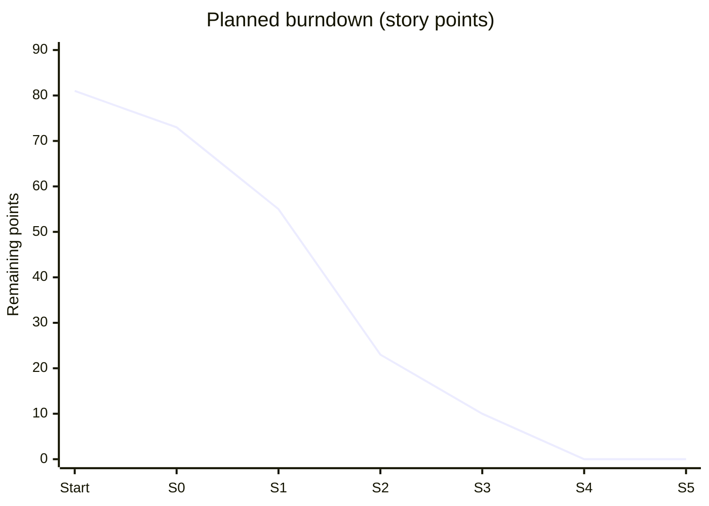

# Sprints

## Calendar view

## S0 — Nov 7 · Kick-off

- **Goal**: scope frozen, environment ready.
- **Sprint backlog**: US-01 (5), repository skeleton, PayPal Sandbox account, demo script validated.
- **Deliverable**: structured repository, working `docker compose up` (empty services), documentation.
- **Drop first if late**: Kubernetes, graphs.
- **Capacity**: 8 pts.

## S1 — Nov 8 · Payments

- **Goal**: first end-to-end payment (USD and AUR).
- **Sprint backlog**: US-02 (3), US-03 (2), US-04 (8), US-11 (5) → 18 pts.
- **Deliverable**: PayPal order created and captured; AUR transfer confirmed in a block.
- **Drop first if late**: secondary wallet features.

## S2 — Nov 9 · Smart Money & Neural Guardian

- **Goal**: complete escrow and risk score displayed.
- **Sprint backlog**: US-05 (5), US-06 (3), US-07 (3), US-08 (8), US-10 (2), US-12 (3), US-13 (5), US-14 (3) → 32 pts.
- **Deliverable**: full escrow, tests for invariants 1 to 8, anchored proof.
- **Drop first if late**: complex model (keep LightGBM).

## S3 — Nov 10 · UI

- **Goal**: demonstrable user journey.
- **Sprint backlog**: US-09 (3), US-15 (5), US-16 (2), US-18 (3) → 13 pts.
- **Deliverable**: web wallet, history, AG Grid explorer.
- **Drop first if late**: visual polish.

## S4 — Nov 11 · Stabilisation & video

- **Goal**: release candidate.
- **Sprint backlog**: US-17 (5), US-19 (5), integration tests 9 and 10, final README → 10 pts.
- **Drop first if late**: any new development.

## S5 — Nov 12 · Submission

- **Goal**: Devpost submission on the afternoon of Nov 12.
- **Checklist**: video, repository, description, online demo, no secrets, categories ticked, links re-checked.

## Planned burndown

| End of sprint | S0 | S1 | S2 | S3 | S4 | S5 |
| --- | --- | --- | --- | --- | --- | --- |
| Remaining points (of 81) | 73 | 55 | 23 | 10 | 0 | 0 |

## Retrospective template

| What went well | To improve | Action for tomorrow |
| --- | --- | --- |
| | | |
